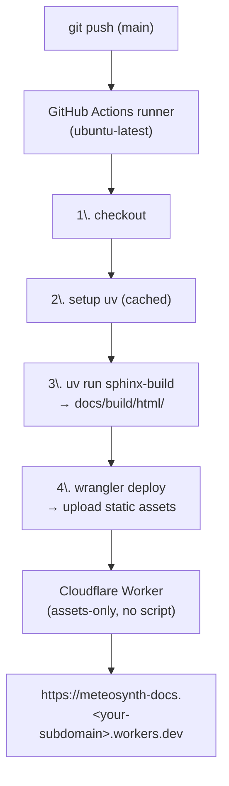

# Documentation Deployment: GitHub Actions → Cloudflare Workers (Static Assets)

This document describes the recommended (2026) workflow for publishing **public Sphinx documentation** from a **private GitHub repository** at **zero cost**, using the `meteosynth` package as the reference example.

**Why this approach** (vs. the earlier `cloudflare_tried.md` and `cloudflare.md` drafts):

* Cloudflare Pages is being absorbed into Workers; as of 2026 Cloudflare recommends **Workers with static assets** for new projects. Both prior drafts targeted Pages (maintenance mode).
* The documentation is **built on GitHub Actions** (debuggable logs, dependency caching, config versioned in the repo) and Cloudflare acts only as a **dumb static host** — the weakest link of the old setup was precisely Cloudflare's opaque build environment.
* `uv` + `pyproject.toml` + `uv.lock` remain the **single source of truth**. No `runtime.txt`, no `requirements.txt`.
* Unlike the old py3dic Workers experiment, the asset directory is now **explicit and deterministic** in `wrangler.jsonc` — no mysterious `./public` relocation, no manual `wrangler deploy` from your machine.

---

# 1 Architecture Overview



**Cost:** Static asset requests on Workers are free and unlimited. GitHub Actions on private repos consumes your free quota (2,000 min/month on the Free plan); a Sphinx build is ~1–2 min, so effectively negligible.

---

# 2 Repository Context

Target structure of `meteosynth` after this walkthrough (two new files, marked `NEW`):

```text
meteosynth/ (Root)
├── .github/
│   └── workflows/
│       └── docs.yml             <-- NEW: build + deploy workflow
├── docs/
│   ├── Makefile
│   ├── make.bat
│   ├── build/                   <-- generated locally; must be in .gitignore
│   └── source/
│       ├── conf.py
│       ├── index.rst
│       └── ...
├── src/
│   └── meteosynth/
├── pyproject.toml               <-- deps incl. dev group (sphinx, furo, myst, mermaid)
├── uv.lock
└── wrangler.jsonc               <-- NEW: Cloudflare asset configuration
```

> [!NOTE] Repo hygiene
> Ensure `docs/build/` is listed in `.gitignore`. The HTML is always rebuilt fresh in CI; committed build artifacts cause conflicts and bloat.

---

# 3 One-Time Setup (Per Cloudflare / GitHub Account)

These steps are done **once per account**, not per repository.

## 3.1 Cloudflare Account

1. Sign up at the **[Cloudflare Dashboard](https://dash.cloudflare.com/)** (Free tier) and verify your email.
2. Note your **Account ID**: Dashboard → **Workers & Pages** → right sidebar (or any Workers overview page). It is a 32-character hex string.

## 3.2 workers.dev Subdomain

1. Navigate to **Workers & Pages**. On first visit, Cloudflare prompts you to register a **workers.dev subdomain** (e.g. `npapnet.workers.dev`).
2. Choose it carefully — all your Workers will live under `*.{subdomain}.workers.dev`. It can be changed later, but that breaks existing URLs.

## 3.3 API Token

1. Dashboard → **My Profile** (top-right avatar) → **API Tokens** → **Create Token**.
2. Use the **Edit Cloudflare Workers** template (this grants Workers Scripts:Edit — required by `wrangler deploy`; the older "Cloudflare Pages" template is *not* sufficient).
3. Optionally restrict **Account Resources** to your single account.
4. Click **Continue to summary** → **Create Token**, and copy the token immediately (it is shown only once).

> [!TIP] Token reuse
> One token can serve all your documentation repositories (py3dic, meteosynth, future packages). You add it as a secret to each repo, but you create it once.

---

# 4 Per-Repository Setup

Repeat this section for each package whose docs you want to publish.

## 4.1 GitHub Secrets

In the GitHub repository: **Settings** → **Secrets and variables** → **Actions** → **New repository secret**. Add:

| Secret name             | Value                    |
| :---------------------- | :----------------------- |
| `CLOUDFLARE_API_TOKEN`  | The token from §3.3      |
| `CLOUDFLARE_ACCOUNT_ID` | The Account ID from §3.1 |

## 4.2 `wrangler.jsonc` (Repository Root)

This is the only Cloudflare-specific file in the repo. It defines an **assets-only Worker** — no `main` script, no server-side code.

**File:** `meteosynth/wrangler.jsonc`

```jsonc
{
  "name": "meteosynth-docs",
  "compatibility_date": "2026-07-01",
  "assets": {
    "directory": "./docs/build/html",
    "not_found_handling": "404-page"
  }
}
```

| Field                | Value               | Rationale                                                                                           |
| :------------------- | :------------------ | :-------------------------------------------------------------------------------------------------- |
| `name`               | `meteosynth-docs`   | Defines the URL: `meteosynth-docs.<subdomain>.workers.dev`.                                         |
| `compatibility_date` | today's date        | Freezes runtime behavior; bump occasionally.                                                        |
| `assets.directory`   | `./docs/build/html` | Standard Sphinx output. Must match `sphinx-build` output path in the workflow. Explicit — no magic. |
| `not_found_handling` | `404-page`          | Correct mode for multi-page docs (serves nearest `404.html`); the SPA mode is for JS apps.          |

> [!NOTE] Assets-only Worker
> Because there is no `main` field, no Worker script runs — requests are served directly from the asset store. Do **not** add an `"binding": "ASSETS"` entry; it is only valid alongside a `main` script.
>
> Optionally add a `.assetsignore` file inside `docs/build/html` sources if stray files (e.g. `.doctrees`) ever end up in the output directory — though `sphinx-build -b html` normally keeps doctrees separate.

## 4.3 GitHub Actions Workflow

**File:** `meteosynth/.github/workflows/docs.yml`

```yaml
name: Deploy Documentation

on:
  push:
    branches:
      - main
    # Optional: only rebuild when docs or source change
    # paths:
    #   - "docs/**"
    #   - "src/**"
    #   - "pyproject.toml"
    #   - "uv.lock"
  workflow_dispatch:      # manual trigger from the Actions tab

jobs:
  build-and-deploy:
    runs-on: ubuntu-latest
    permissions:
      contents: read
    steps:
      - name: Checkout repository
        uses: actions/checkout@v4

      - name: Set up uv
        uses: astral-sh/setup-uv@v5
        with:
          enable-cache: true
          python-version: "3.11"

      - name: Build documentation
        run: uv run --group dev sphinx-build -b html docs/source docs/build/html

      - name: Deploy to Cloudflare Workers
        uses: cloudflare/wrangler-action@v3
        with:
          apiToken: ${{ secrets.CLOUDFLARE_API_TOKEN }}
          accountId: ${{ secrets.CLOUDFLARE_ACCOUNT_ID }}
          command: deploy
```

> [!NOTE] How this differs from the Pages-era draft (`cloudflare.md`, Approach B)
> 1. `command: deploy` (reads `wrangler.jsonc`) replaces `pages deploy public --project-name=...`. The output directory lives in versioned config, not in a CLI flag.
> 2. `deployments: write` permission is no longer needed (that was for the GitHub Deployments integration of Pages).
> 3. Build output goes to `docs/build/html` (matching `wrangler.jsonc` and local `make html` behavior) instead of an ad-hoc `public/` folder.
> 4. The **first** `wrangler deploy` **creates the Worker automatically** — no dashboard pre-registration, no "Connect Git", no build configuration screen. Cloudflare never sees your repository.

## 4.4 First Deployment

1. Commit both new files and push to `main`:
   ```bash
   git add wrangler.jsonc .github/workflows/docs.yml
   git commit -m "Add docs deployment: GH Actions -> Cloudflare Workers"
   git push origin main
   ```
2. Watch the run under the repo's **Actions** tab. The `wrangler-action` step prints the deployed URL on success.
3. Verify the site at `https://meteosynth-docs.<subdomain>.workers.dev`.

---

# 5 Local Testing (Optional but Recommended)

Simulate the CI build exactly, from a clean state:

```bash
# From the repository root
uv run --group dev sphinx-build -b html docs/source docs/build/html

# Preview the site exactly as the Worker will serve it
npx wrangler dev
```

`wrangler dev` reads `wrangler.jsonc` and serves `docs/build/html` at `http://localhost:8787`. If this works locally, CI will behave identically — the Worker itself performs no build.

You can also deploy manually from your machine (useful for debugging before the workflow exists):

```bash
npx wrangler login      # one-time browser OAuth
npx wrangler deploy
```

---

# 6 Optional Enhancements

## 6.1 Custom Domain

Dashboard → **Workers & Pages** → `meteosynth-docs` → **Settings** → **Domains & Routes** → **Add** → **Custom domain** (e.g. `docs.meteosynth.example.com`). Requires the domain's DNS to be on Cloudflare (free tier suffices).

## 6.2 Preview Deployments for Branches / PRs

Workers supports non-production **preview versions** with unique URLs:

```yaml
# Alternative deploy step for a PR-triggered workflow
- name: Upload preview version
  uses: cloudflare/wrangler-action@v3
  with:
    apiToken: ${{ secrets.CLOUDFLARE_API_TOKEN }}
    accountId: ${{ secrets.CLOUDFLARE_ACCOUNT_ID }}
    command: versions upload
```

`versions upload` publishes to a preview URL without touching production; ensure `preview_urls` is enabled (`"preview_urls": true` in `wrangler.jsonc`).

## 6.3 Restricting Rebuild Triggers

Uncomment the `paths:` filter in §4.3 so pushes touching only e.g. `tests/` do not consume Actions minutes.

---

# 7 Comparison with the Previous Approaches

| Feature               | py3dic (Pages + pip, `cloudflare_tried.md`)        | Pages + uv (`cloudflare.md` A/B) | **This guide (Workers static assets)**          |
| :-------------------- | :------------------------------------------------- | :------------------------------- | :---------------------------------------------- |
| Product status (2026) | Maintenance mode                                   | Maintenance mode                 | **Recommended path**                            |
| Build location        | Cloudflare (opaque)                                | Cloudflare (A) / GitHub (B)      | GitHub Actions (logged, cacheable)              |
| Root files            | `runtime.txt`, `requirements.txt`, `wrangler.toml` | None (A) / `.github` only (B)    | `wrangler.jsonc` + `.github` workflow           |
| Dependency truth      | Duplicated (`requirements.txt`)                    | `pyproject.toml` + `uv.lock`     | `pyproject.toml` + `uv.lock`                    |
| Repo access           | Cloudflare GitHub App reads private repo           | Same (A) / token-only (B)        | **Cloudflare never sees the repo** (token-only) |
| Asset path            | Implicit / surprising (`./public`)                 | CLI flag                         | Explicit in versioned `wrangler.jsonc`          |
| Deploy trigger        | Git push (A) / manual `wrangler deploy`            | Git push                         | Git push + `workflow_dispatch`                  |
| Cost                  | Free                                               | Free                             | Free (Actions minutes ≪ quota)                  |

---

# 8 Troubleshooting

| Symptom                                      | Likely cause / fix                                                                                                                             |
| :------------------------------------------- | :--------------------------------------------------------------------------------------------------------------------------------------------- |
| `Authentication error [code: 10000]`         | Token lacks Workers Scripts:Edit — recreate with the **Edit Cloudflare Workers** template.                                                     |
| `The directory specified ... does not exist` | `sphinx-build` output path ≠ `assets.directory` in `wrangler.jsonc`. They must match exactly.                                                  |
| Sphinx build fails only in CI                | Dev group incomplete in `pyproject.toml` — reproduce locally with `uv run --group dev sphinx-build ...` in a fresh clone.                      |
| Site serves stale pages                      | Cloudflare edge cache; assets are content-hashed on upload, so hard-refresh or wait a minute.                                                  |
| Docs must not be public after all            | Assets-only Workers are public by design; access control requires a Worker script + Cloudflare Access (Zero Trust free tier covers ≤50 users). |