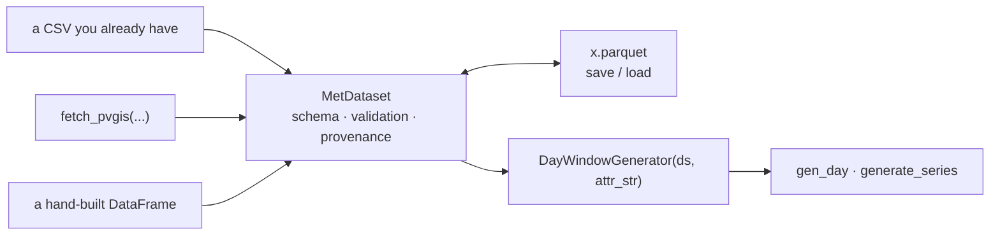

# FEAT-13 — `MetDataset`: a strict, source-agnostic training format

Status: proposed · Author: N. Papadakis (with Claude) · Date: 2026-07-29 · Targets: v0.3.0

Supersedes `FEAT-1`. Absorbs `FEAT-2 (1)`, `FEAT-5` and `CHORE-3`.
Replaces [`FEAT-2-FEAT-1-column-resolution-and-provenance.md`](FEAT-2-FEAT-1-column-resolution-and-provenance.md),
which put provenance inside the adapter's cache — the wrong place, for the reason below.

## Overview

The package's core business is **generating synthetic series from a training dataset**.
Getting that dataset is auxiliary: a user may fetch it, read it from a file, or build the
frame by hand, and nothing downstream should care which.

Today no object *is* the training dataset. There is a `MetDataProcessor` that wraps a
frame, and a fetcher whose on-disk cache is the only place provenance could live. That
inversion is why `FEAT-1` as filed put provenance in `adapters.py` — which would have made
a traceable dataset a side effect of *having used the fetcher*, exactly backwards.

`MetDataset` is the missing noun: source-agnostic, self-validating, and round-trippable
between memory and disk.



## The claim that caused the inversion

`adapters.py` states:

> *"A file is a convenience for case A... It is never a required step, **so** there is no
> on-disk schema to design or version, and no metadata sidecar."*

That `so` is a non-sequitur. **"Optional to use" does not imply "not worth specifying."**
A format can be strict, versioned and documented while remaining entirely optional to
write. Because the package accepted the inference, provenance had nowhere to live except
the fetcher, and validation had nowhere to live except the fetcher's boundary check.

## Measured — what today's code actually does

pandas 3.0.3 / Python 3.13.11, against this repo.

| Claim | Result |
| :--- | :--- |
| `MetDataProcessor` validates physical support | **No** — `validate_support` is called only from `adapters.py`. `poa_global = -500` and `temp_air = -400 °C` ingest cleanly |
| Duplicate calendar rows are caught | **No** — accepted at ingestion, then `ValueError: Index contains duplicate entries` from inside `pivot` |
| `month = 13` is caught at ingestion | **No** — accepted, then `ValueError: all months must be in 1..12` from inside `day_slot` |
| The `.parquet` cache branch works | **No** — `pyarrow` is not installed; `_write_cache` raises `ImportError` on that path today |
| CSV round-trips a frame | **No** — `float32→float64`, `int8→int64`. This is why the suite carries `check_dtype=False` |
| Parquet round-trips frame **and** metadata | **Yes** — dtypes exact, and `df.attrs` survives `to_parquet`/`read_parquet` intact |

The first three are correctness holes on the **core** path, not the adapter path. They are
the substantive argument for this item: strictness belongs to the format, so it applies
however the data arrived.

---

## The design

### The object

```python
class MetDataset:
    SCHEMA_VERSION = 1

    frame: pd.DataFrame                  # canonical, validated, trimmed
    provenance: Provenance               # always present, never None

    def __init__(self, frame, provenance=None) -> None
    def __eq__(self, other) -> bool      # frame + provenance: round-trip identity

    # what it holds
    @property variables -> tuple[str, ...]        # registered columns present
    @property irradiance_column -> str
    def describe(self) -> dict                    # FEAT-5, for free

    # I/O
    def save(self, path) -> None                  # parquet, canonical
    @classmethod def load(cls, path) -> MetDataset
    @classmethod def read_csv(cls, path, provenance=None) -> MetDataset   # import
    def to_csv(self, path) -> None                # export, warns: lossy

    # views (from MetDataProcessor, unchanged in behaviour)
    def month_subset(self, month) -> pd.DataFrame
    def day_window_subset(self, month, day, n_days=15) -> pd.DataFrame
```

Lives in a new `dataset.py`. `met_data_processor.py` retires; its free functions
(`convert_to_daily_wide`, `_add_date_id`) move alongside. `MetDataProcessor` goes away
entirely — the name described a processor, and the thing is a dataset.

### The schema, v1

| Rule | Value |
| :--- | :--- |
| Columns | exactly `INDEX_COLS` + at least one registered variable; nothing else |
| dtypes | `year` int32, `month`/`day`/`hour` int8, variables float64 — **canonicalised at construction** |
| Row identity | `(year, month, day, hour)` unique |
| Ranges | month 1–12, day valid for that month, hour 0–23 |
| Ordering | sorted by `(year, month, day, hour)` |
| Completeness | **not required** — a date with fewer than 24 hours is legal, and reported by `describe()` |

Canonicalising dtypes and order at construction is what makes the format strict in a way
that is testable: `MetDataset.load(path) == ds` holds by construction rather than by luck,
whatever dtypes the source frame arrived with.

> **To verify before enabling the canonical sort:** `completed/transition-pair-alignment.md`
> records that an innocent `sort_values` once corrupted 26 808 training pairs. That defect
> was about pairing by *row position* rather than by date, and the pivot is keyed on
> date and hour — so a calendar sort of the long frame should be inert. Assert it against
> the existing transition-pair tests rather than assuming it.

### Construction: reject structural, clip physical

| Condition | Behaviour | Why |
| :--- | :--- | :--- |
| Duplicate calendar rows | **raise**, naming the offending dates | Already fatal today inside `pivot`; this only makes the error legible |
| Invalid calendar (`month=13`, `day=31` in April) | **raise**, naming the row | Already fatal today inside `day_slot`; same |
| Missing `INDEX_COLS` / no registered column | **raise** | Unchanged from `validate_columns` |
| Value outside a spec's support | **clip to the bound**, warn once, count in `describe()` | New, and deliberately not fatal — see below |
| Unregistered columns | dropped, as `trim_columns` does today | Unchanged |
| Date with fewer than 24 hours | accepted, reported | Sparse records are legitimate input |

**Nothing that works today stops working.** The two raising conditions are already fatal
further down the call stack; moving them to the front door changes the error message, not
the set of accepted inputs.

**Out-of-support values are clipped rather than rejected** because real station records
routinely carry small negative irradiance at night from sensor noise, and rejecting a
19-year record over four `-2 W/m²` readings would block real work. The check is also
weaker than it looks: the suite already asserts, in `test_kelvin_temperature_slips_through`
and `test_fahrenheit_mislabelled_as_celsius_passes`, that it cannot catch the unit errors
it was designed for — 280 K and 20 °F both sit inside support. Its reach is limited to
violations that happen to cross a bound, which in practice means boundary noise.

Clipping is also consistent with what the model already does: sampling is truncated to
support via `VariableSpec.clamp_domain`, so a clipped input matches the output's domain
instead of being a special case.

```text
MetDataset(df)
→ ValueError: 3 duplicate calendar rows: 2011-03-14 h07, 2011-03-14 h08, ...
→ ValueError: month must be in 1..12, row 4021 has 13

→ UserWarning: clipped 4 values in 'poa_global' to [0, inf)
   ds.describe()["clipped"] == {"poa_global": 4}
```

### I/O: parquet canonical, CSV as explicit export

`save` / `load` handle **parquet only**. It is one file, dtypes are exact, and metadata
travels inside it — the three properties round-trip identity needs.

CSV keeps its place as *interchange*, under names that say what it is:
`read_csv` imports, `to_csv` exports and warns that dtypes and provenance are not
preserved. The asymmetry is the point — `save`/`load` are a pair, `read_csv`/`to_csv` are
not.

**Provenance travels as explicit parquet key-value metadata, in both directions** — never
via `DataFrame.attrs`:

```python
payload = {"schema_version": 1, "provenance": {...}}

# write
table = pa.Table.from_pandas(frame, preserve_index=False)
meta = {**(table.schema.metadata or {}), b"meteosynth": json.dumps(payload).encode()}
pq.write_table(table.replace_schema_metadata(meta), path)

# read
table = pq.read_table(path)
payload = json.loads(table.schema.metadata[b"meteosynth"])
frame = table.to_pandas()
```

Both routes were measured to round-trip, but key-value metadata is a documented feature of
the parquet format while attrs-in-parquet is pandas-internal behaviour. Going through
`pyarrow` on **both** sides is what matters: it keeps provenance serialisation independent
of how a given pandas/pyarrow pair happens to negotiate `attrs` between them, so an upgrade
on either side cannot quietly change what a saved dataset says about itself.

Measured: a file written this way is still readable by plain `pd.read_parquet`, which
returns the columns and ignores the metadata. The dataset stays usable by anything that
speaks parquet, and only this package needs to know where provenance lives.

**Dependency changes:** `pyarrow` becomes a hard dependency (~27 MB). In exchange,
**XLSX support is dropped** and `openpyxl` leaves the dependency list — it existed only to
serve a cache format that CSV export covers.

### Provenance

```python
@dataclass(frozen=True)
class Provenance:
    source: str = "user"               # "pvgis_hourly" | "pvgis_tmy" | "open_meteo" | "user"
    site: Optional[str] = None         # free label, e.g. "heraklion"
    latitude: Optional[float] = None
    longitude: Optional[float] = None
    start_year: Optional[int] = None
    end_year: Optional[int] = None
    fetched: Optional[str] = None      # ISO-8601, when a network fetch produced it
    meteosynth_version: str = __version__
    notes: Optional[str] = None
```

**Always present, never `None`.** A hand-built frame gets `source="user"` and everything
else absent. That satisfies `FEAT-5`'s caution that *"provenance cannot be invented"* —
`"user"` invents nothing, it records that nobody claimed a source — while sparing every
downstream caller an `Optional` branch.

There is no `irradiance_form` field: the column list answers it, because the column name
*is* the quantity. That part of the original design was right and survives intact.

#### Version tolerance: strict on schema, tolerant on provenance

Two different senses of "written by a newer version", and they must not be handled the
same way:

- **`schema_version` governs the data, so it is a gate.** A file whose `schema_version`
  exceeds `SCHEMA_VERSION` **raises**, naming both numbers. Today's code cannot know
  whether v2 changed the column rules, the dtypes or the row-identity contract, and
  guessing yields a plausible-looking wrong dataset — the failure this whole item exists
  to prevent. A *lower* version is read, migrated if a migration exists.
- **Provenance fields are descriptive, so they are tolerant.** `Provenance.from_dict(d)`
  keeps the keys it knows, fills missing ones with their defaults, and **ignores unknown
  ones after a single warning**. A future `elevation` or `timezone` field must not make a
  dataset unreadable by today's code, because nothing in the modelling path depends on it.

`from_dict` is not optional sugar — `Provenance(**d)` on a frozen dataclass raises
`TypeError` on the first unknown key, so a plain splat would make every provenance field
ever added a breaking change. It is the only constructor the reader should use.

This is the ordinary must-understand / descriptive split, and it is what lets the format
move without stranding files.

### Irradiance resolution

One ordered constant in `variables.py`, beside the registry it mirrors:

```python
#: Total irradiance columns, most preferred first. Components are deliberately absent:
#: a component is a part of a total, never "the irradiance".
IRRADIANCE_COLUMNS = ("poa_global", "ghi")
```

`ds.irradiance_column` returns the first of these present; failing that, the sole
irradiance column if there is exactly one; otherwise it raises, naming what it found.

| dataset holds | resolves to |
| :--- | :--- |
| `poa_global`, `temp_air`, `wind_speed` | `poa_global` |
| `ghi`, `dni`, `dhi` (a TMY) | `ghi` |
| `poa_direct` alone | `poa_direct` |
| the three POA components, no total | **raises**, naming them |

A user registering their own irradiance column names it explicitly or passes `prefer=`;
auto-discovery of user columns is the acceptable cost of having no `role` concept.

**Rejected: `attr_str=None` on `DayWindowGenerator`, meaning "resolve it for me."** It would
let `DayWindowGenerator(ds)` model irradiance by default, which puts the solar quantity back
at the centre of a package whose registry design makes it variable-agnostic — `temp_air` has
equal standing. It also turns a *missing argument* into a *guess*, the failure mode the
ingestion checks exist to avoid. Resolution stays an explicit call whose result the caller
can see, print and pass on: `DayWindowGenerator(ds, ds.irradiance_column)`.

### `describe()` — FEAT-5, for free

```python
{
  "rows": 96432, "years": (2010, 2020), "variables": ("poa_global", "temp_air", "wind_speed"),
  "dates": 4018, "incomplete_dates": 0, "clipped": {"poa_global": 4},
  "provenance": Provenance(source="pvgis_hourly", site="heraklion", ...),
  "schema_version": 1,
}
```

`FEAT-5`'s other caution — that the *training subset* size is a different number living on
`DayWindowGenerator` — still holds and is not answered here.

---

## What shrinks

The point of the inversion is that it removes code rather than adding a layer.

| Today | After |
| :--- | :--- |
| `_read_cache` / `_write_cache` extension dispatch | `MetDataset.load` / `.save` |
| `validate_columns` + `trim_columns` free functions | folded into construction |
| `validate_support` called only from adapters | one call in construction, covering every path |
| The superseded plan's sidecar reader, `CacheMismatchError`, match predicate (~140 lines) | load the dataset, compare `ds.provenance` to the request (~15 lines) |
| `check_dtype=False` workarounds in tests | removable — parquet is exact |
| `openpyxl` dependency | dropped |

`adapters.fetch_pvgis` and `fetch_pvgis_tmy` keep their signatures but return a
`MetDataset` with `provenance` filled. The cache question becomes: load it, compare, refetch
on mismatch or when `force_refetch=True`.

**Comparing coordinates: equal to 4 decimal places (~11 m).** Finer than any provider's
grid, coarser than float noise — `35.3387` and `35.33870000001` must not read as different
sites, because a false miss costs a silent re-download. Period and source compare exactly.

## Migration

No backwards compatibility is preserved — by decision, this is a single-user codebase.

- **Examples' cached CSVs** — `MetDataset.read_csv(p).save(p.with_suffix(".parquet"))`,
  a one-time script, or simply refetch.
- **`examples/tools/site_data.py`** — most of it becomes a thin site table; the caching and
  `add_poa_global` logic move or retire. Closes part of `INBOX-10`.

### What the rename touches — counted

`MetDataProcessor` / `met_data_processor` appears **171 times across 39 files**. Excluding
the historical record — `CHANGELOG.md`, `docs/design/completed/`, and the superseded plan,
none of which should be rewritten — this is what must change:

| Area | Files | Note |
| :--- | :--- | :--- |
| `src/` | `__init__.py`, `generators.py`, `adapters.py`, `sup_plot_lib.py`, `day_window.py`; `met_data_processor.py` retires | Two are **not** string swaps — see below |
| `tests/` | 8 files | `conftest.py`'s `synthetic_mdp` fixture is the root; rename it with the class |
| `examples/` | 10 files | incl. `tools/envelope.py` and `diagnostics-overshoot/step2_simulate.py` |
| `docs/source/` | `api.rst`, `quickstart.md`, `workflow.md`, `examples.md`, `theory.md` | prose plus autodoc targets — folds into `CHORE-4` |
| `docs/design/architecture.md` | 1 | **active** reference, unlike `completed/`: its module table and flow diagram both name the class |
| `README.md` | 1 | |

Two need real edits rather than a rename:

- **`sup_plot_lib.plot_month_by_year_sns(mdp: MetDataProcessor, ...)`** takes the object in
  its signature and calls `get_month_subset` on it. The signature changes with the class.
- **`day_window.py`** carries two `:meth:`~meteosynth.met_data_processor.MetDataProcessor.…``
  cross-references in its module docstring. These become dangling Sphinx references — they
  fail the docs build, not the test suite, so nothing catches them until the docs are built.

## Order of work

| Step | What | Needs |
| :--- | :--- | :--- |
| 1 | `Provenance` + `from_dict`; `IRRADIANCE_COLUMNS` + resolver in `variables.py` | — |
| 2 | `dataset.py`: `MetDataset`, schema canonicalisation, the three checks, `describe()` | 1 |
| 3 | Parquet `save`/`load` via `pyarrow` both ways; `schema_version` gate; `read_csv`/`to_csv`; `__eq__` | 2 |
| 4 | Retire `met_data_processor.py`; repoint `generators.py`, `sup_plot_lib.py` (signature), `day_window.py` (docstring refs), `__init__.py` | 2 |
| 5 | Rewrite `adapters.py` against `MetDataset`; `force_refetch` | 3 |
| 6 | Tests: schema, round-trip identity, version tolerance, resolver, clipping, provenance | all |
| 7 | Drop `openpyxl`, add `pyarrow`; migrate examples; update `docs/source/`, `architecture.md`, `README.md` | all |

Nothing here touches the KDE core, so no golden test is re-baselined and `FIX-1`,
`PERF-11` and `CHORE-12` are unaffected.

## Still open

- **`FEAT-4`** — where a default cache lives (`./data/<source>/` vs a user-level directory)
  is untouched by this and still needs deciding before caching-by-default lands.
- **Period containment** — whether a 2010–2020 dataset can answer a 2012–2015 request by
  slicing. Deferred: a sliced dataset's provenance would have to be rewritten per read.
- **`FEAT-2` (3)** — whether a derived column is distinguishable from a fetched one. Still
  open, and still honest: with the resolver raising rather than reconstructing, the package
  never produces a derived total in the first place.
- **Schema migrations** — the `schema_version` gate refuses a future file and accepts a
  past one, but no migration exists to write yet. The first v1→v2 change is when that
  question becomes real.
