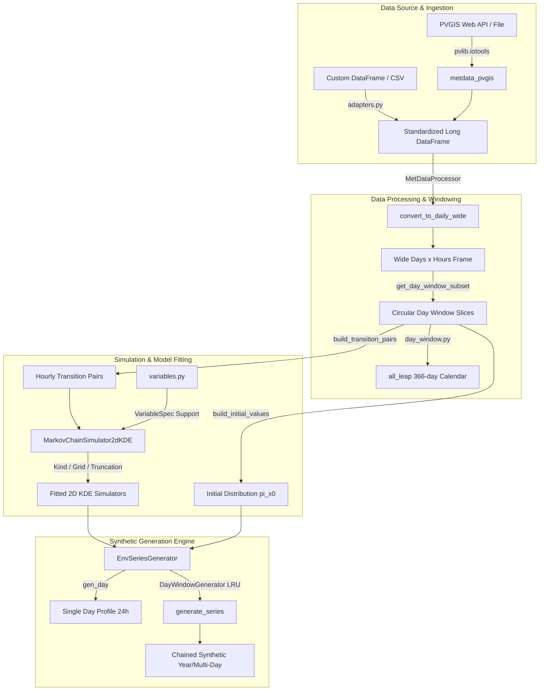
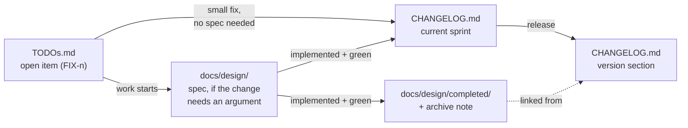

Status: accepted · Author: Antigravity Agent · Date: 2026-07-27

# Package Architecture & Design Overview

## Document Scope

This document provides a concise, high-level architectural overview of the `meteosynth` package. It serves as the primary entry point and technical orientation for human developers and AI agents working on, extending, or integrating `meteosynth`.

- **In Scope**: Package essence, domain focus, current architectural state (v0.2.0), component boundaries, data flow pipelines, folder tree structure, module responsibilities, and developer onboarding workflows.
- **Out of Scope**: Detailed API parameter references (see Sphinx docs in [`docs/source/`](../source/)), end-user quickstart tutorials (see [`README.md`](../../README.md)), and historical design decision records (see [`docs/design/completed/`](completed/)).

---

## Package Essence & Domain Focus

`meteosynth` is a Python library for generating stochastic, physically consistent synthetic environmental time-series data (e.g., solar irradiance, air temperature, wind speed) from historical weather records or online database APIs (PVGIS).

### Primary Use Case
The primary application of `meteosynth` is **Monte-Carlo simulation for renewable energy systems**. Rather than evaluating energy systems under a single deterministic historical profile, `meteosynth` generates ensembles of statistically plausible weather realizations to quantify energy yield variability, storage requirements, financial risk, and extreme operational scenarios.

### Core Mathematical & Modeling Approach
1. **Non-Parametric 2D KDE Markov Transitions**: Models hourly transitions $P(X_h \mid X_{h-1})$ using 2D Kernel Density Estimation. Degenerate data regions (such as night-time zero irradiance) are handled robustly via a `Kind` enum fallback strategy (`KDE_2D`, `KDE_1D`, `CONSTANT`).
2. **Physical Support Truncation**: Enforces domain-specific physical constraints (e.g., non-negative solar irradiance) by restricting evaluation grids to variable physical support bounds prior to inverse CDF sampling, preventing out-of-domain synthetic values.
3. **Circular Rolling-Window Climate Models**: Uses a 366-day `all_leap` circular calendar to construct smooth, centered rolling training windows ($\pm n$ days) that wrap across New Year and treat Feb 29 as a continuous calendar slot without data discarding.
4. **Date-Aligned Cross-Midnight Continuity**: Chains multi-day synthetic time series by sampling hour 0 from a fitted initial distribution $\pi(X_0)$ or linking day transitions via a cross-midnight pair model $P(X_{0, \text{today}} \mid X_{23, \text{yesterday}})$.

---

## Current Package State (v0.2.0)

- **Version**: `0.2.0` (managed via `uv` and `hatchling`).
- **Python Compatibility**: `>=3.10`.
- **Key Architectural Features**:
  - **Decoupled Variable Specs**: Physical constraints (`support`, `units`, `long_name`) are registered centrally in `meteosynth.variables` independently of dataset-specific column names.
  - **Date-Indexed Pair Alignment**: Daily wide-format restructuring keys transition pairs on calendar dates, eliminating silent mispairing bugs caused by dataset re-sorting.
  - **Lazy LRU-Cached Generators**: `DayWindowGenerator` dynamically instantiates daily models behind an LRU cache, permitting full-year simulations without excessive memory consumption.
  - **PVGIS API Integration**: Built-in wrappers (`meteosynth.metdata_pvgis`) interface with `pvlib.iotools` for direct fetching and caching of hourly and TMY meteorological data.

---

## System Architecture & Data Flow



---

## Repository & Folder Structure

```
meteosynth/
├── .github/                 # CI/CD workflows and automated actions
├── data/                    # Cached sample data (e.g. pvgis_hourly_data.xlsx)
├── docs/                    # Package documentation root
│   ├── Makefile / make.bat  # Sphinx build entry points
│   ├── build/               # Generated HTML output target
│   ├── design/              # Internal design specifications workspace
│   │   ├── README.md        # Workspace conventions & index
│   │   ├── architecture.md  # [This File] Architecture & current state overview
│   │   └── completed/       # Implemented design specs archive
│   └── source/              # Sphinx source files (rst, md, conf.py)
├── examples/                # Runnable scripts, split by purpose (see examples/README.md)
│   ├── README.md            # Index: what each folder and script is for
│   ├── data/                # Cached PVGIS downloads (git-ignored)
│   ├── output/              # Generated series and figures (git-ignored)
│   ├── tools/               # Shared helpers imported by the scripts
│   │   ├── site_data.py     # Sites, cached PVGIS records, output paths
│   │   ├── envelope.py      # Observed-vs-synthetic comparison and figures
│   │   └── fetch_site_data.py  # Runnable: prime the download cache
│   ├── concepts/            # How the package behaves (Paris 2011-2012)
│   │   ├── example_exploratory_analysis.py
│   │   ├── example_leap_year_windows.py
│   │   ├── example_markov_generation.py
│   │   ├── example_rolling_window.py
│   │   └── example_synthetic_year.py
│   └── use_cases/           # Applied workflows (Heraklion 2010-2020)
│       ├── day_envelope_pv.py      # One synthetic 21 May vs eleven real ones
│       ├── day_envelope_temp.py
│       ├── day_envelope_wind.py
│       ├── synthetic_year.py       # 8760 hours x 3 attributes, written to CSV
│       └── monthly_statistics.py   # Ensemble of synthetic Mays, reported as statistics
├── src/
│   └── meteosynth/          # Core Python library package
│       ├── __init__.py      # Package public API exports
│       ├── adapters.py      # Data source schema adapters
│       ├── constants.py     # Index column definitions & attribute groups
│       ├── day_window.py    # Circular 366-day calendar arithmetic
│       ├── generators.py   # Daily & multi-day synthetic series generators
│       ├── markov_chain_simulator_kde2d.py # 2D KDE Markov engine & fallbacks
│       ├── markov_implementations/         # Alternative Markov simulators
│       │   ├── markov_chain_simulator_continuous.py # Binned 1D KDE simulator
│       │   └── markov_chain_simulator_discrete.py   # Discrete transition matrix simulator
│       ├── met_data_processor.py # DataFrame restructuring & window slicing
│       ├── metdata_pvgis.py # PVGIS data fetching & local Excel/parquet caching
│       ├── py.typed          # PEP 561 static type marker
│       ├── sup_plot_lib.py  # Visual diagnostics & KDE surface plotting
│       └── variables.py     # VariableSpec registry & physical support bounds
├── tests/                   # Automated test suite (pytest)
│   ├── conftest.py          # Shared test fixtures & synthetic frames
│   └── test_*.py            # 16 component test modules
├── .gitignore
├── CHANGELOG.md             # Version release history
├── LICENSE                  # MIT License
├── README.md                # Main user documentation & quickstart
├── TODOs.md                 # Project backlog & roadmap
├── pyproject.toml           # Hatchling build spec & dependency groups
├── uv.lock                  # Lockfile for reproducible environments
└── wrangler.jsonc           # Cloudflare deployment config for docs
```

---

## Module Overview & Responsibilities

### `src/meteosynth/`

| Module | Core Responsibility |
| :--- | :--- |
| [`__init__.py`](../../src/meteosynth/__init__.py) | Exposes top-level public API symbols (`MetDataProcessor`, `MarkovChainSimulator2dKDE`, `EnvSeriesGenerator`, `DayWindowGenerator`, `VariableSpec`, `register`, etc.). |
| [`variables.py`](../../src/meteosynth/variables.py) | Defines `VariableSpec` dataclass (`support`, `units`, `long_name`), domain clamping logic (`clamp_domain`), and the global variable registry (`register`, `get_spec`). Pre-registers `IRRADIANCE`, `TEMP_AIR`, `WIND_SPEED`. |
| [`markov_chain_simulator_kde2d.py`](../../src/meteosynth/markov_chain_simulator_kde2d.py) | Main stochastic engine (`MarkovChainSimulator2dKDE`). Fits 2D Gaussian KDE over $(X_{h-1}, X_h)$ pairs, constructs cumulative conditional distributions $P(X_h \mid X_{h-1} = x)$, truncates evaluation grids to physical support, and handles degenerate data via `Kind.KDE_2D`, `Kind.KDE_1D`, and `Kind.CONSTANT`. |
| [`generators.py`](../../src/meteosynth/generators.py) | High-level daily series orchestration. `EnvSeriesGenerator` manages 23 hourly transition simulators + 1 initial distribution. `DayWindowGenerator` manages rolling window generation with an LRU cache. Also builds date-aligned transition pairs (`build_transition_pairs`, `build_cross_midnight_pairs`). |
| [`day_window.py`](../../src/meteosynth/day_window.py) | Pure-function circular 366-day `all_leap` calendar arithmetic (`day_slot`, `window_slots`, `circular_delta`, `slot_to_month_day`). Enables New Year wrapping and leap-year treatment without pandas timestamp overhead. |
| [`met_data_processor.py`](../../src/meteosynth/met_data_processor.py) | Handles ingestion validation (`validate_columns`), wide-format pivot (`convert_to_daily_wide`), and training data slicing by calendar month (`get_month_subset`) or centered day windows (`get_day_window_subset`). |
| [`metdata_pvgis.py`](../../src/meteosynth/metdata_pvgis.py) | Interfaces with `pvlib.iotools` to fetch hourly or TMY solar/weather data for specified latitude/longitude coordinates, with local file caching (`save_hourly`, `load_hourly`). |
| [`adapters.py`](../../src/meteosynth/adapters.py) | Input source adapters converting external datasets into standardized `meteosynth` long frames. |
| [`constants.py`](../../src/meteosynth/constants.py) | Package constants including index column names (`year`, `month`, `day`, `hour`) and shipped attribute sets. |
| [`sup_plot_lib.py`](../../src/meteosynth/sup_plot_lib.py) | Visual diagnostic functions for plotting fitted 2D KDE surfaces, conditional CDFs, and synthetic time-series comparisons. |
| [`markov_implementations/`](../../src/meteosynth/markov_implementations) | Alternative Markov models: `ContinuousMarkovChainSimulator` (binned 1D KDE) and `MarkovChainSimulatorDiscrete` (binned matrix transitions). |

---

## Project Record-Keeping: Where Each Kind of Writing Lives

Four files carry the project's written record, and each answers a different question. The
rule that keeps them from duplicating one another: **an item lives in exactly one place at
a time, and moves when its status changes.**

| File | Answers | Contains | Never contains |
| :--- | :--- | :--- | :--- |
| [`TODOs.md`](../../TODOs.md) | *What is still broken or unbuilt?* | **Open work only**, grouped as Fixes / Performance & internals / Features / Direction / Housekeeping, each with a stable ID (`FIX-1`, `PERF-2`, `FEAT-1`, `VISION-1`, `CHORE-1`) and the measurements behind it, plus an **Inbox** (`INBOX-n`) for notes not yet triaged | A "done" section |
| [`CHANGELOG.md`](../../CHANGELOG.md) | *What is the package now, and when did that become true?* | Released state per version, `Added`/`Changed`/`Fixed`/`Removed`, plus an optional `### Decisions` subsection | Extended rationale; narrative of how a decision was reached |
| [`docs/design/`](README.md) | *Why should we do it this way?* | Specifications and argued rationale for work **in flight** | Implemented work |
| [`docs/design/completed/`](completed/) | *Why was it done this way?* | The same documents once their feature has landed, each with an archive note recording move date, implementation date and commits | Work still in flight |

### The lifecycle



### The rules this implies

1. **Completed TODO items move to the changelog.** When an item ships, fold it into the
   current sprint entry and **delete it from `TODOs.md`**. A `✅ DONE` item left in place
   is a duplicate that will drift out of sync with the code.
2. **The changelog states the current state, not the reasoning.** Say what the package
   does now and what a number measures; do not re-argue the choice. Rationale belongs in
   `docs/design/`, which the changelog links to.
3. **Significant decisions get one line each, under `### Decisions`.** A decision is worth
   recording there when a reader would otherwise ask *"is this missing, or deliberate?"* —
   typically deliberate absences and API-shape choices. One sentence, then a link to the
   design doc that argues it.
4. **Cross-reference TODO items by ID, never by position.** `FIX-2`, not "item 7". Tests,
   examples and design docs all cite these IDs; ordinal references break the moment the
   file is re-grouped.
5. **The Inbox is a waiting room, not a group.** A raw note lands as `INBOX-n` with an
   initial assessment and the question that decides its shape. It leaves by graduating
   into a group above with a real ID, or by being dropped — it is not a place items
   settle. Do not cite an `INBOX-n` ID from code or docs; it is not stable.
6. **Sync the whole set at release.** Closing a version means: rename the sprint section to
   `## [x.y.z] — date`, move any newly-completed TODO items into it, drop TODO entries the
   release invalidated, and re-check that every "already tried" note reflects what actually
   shipped.

---

## Onboarding Quickstart for Developers & AI Agents

### 1. Environment Setup
```bash
# Clone repository & synchronize dependencies using uv
uv sync

# Install optional extras for runnable examples
uv sync --extra examples
```

### 2. Verification & Testing
```bash
# Run full test suite in headless mode
$env:MPLBACKEND = "Agg"; uv run pytest    # Windows (PowerShell)
MPLBACKEND=Agg uv run pytest              # Linux / macOS
```

### 3. Key Extension Points
- **Adding a New Environmental Quantity**:
  Register a new `VariableSpec` with physical support bounds:
  ```python
  import meteosynth
  meteosynth.register("rel_humidity", meteosynth.VariableSpec(support=(0.0, 100.0), units="%", long_name="Relative Humidity"))
  ```
- **Custom Data Ingestion**:
  Pass custom DataFrames into `MetDataProcessor(df)`, ensuring required index columns (`year`, `month`, `day`, `hour`) are present.

### 4. Documentation Build
```bash
# Build local HTML documentation via Sphinx
uv run sphinx-build -b html docs/source docs/build/html
```
