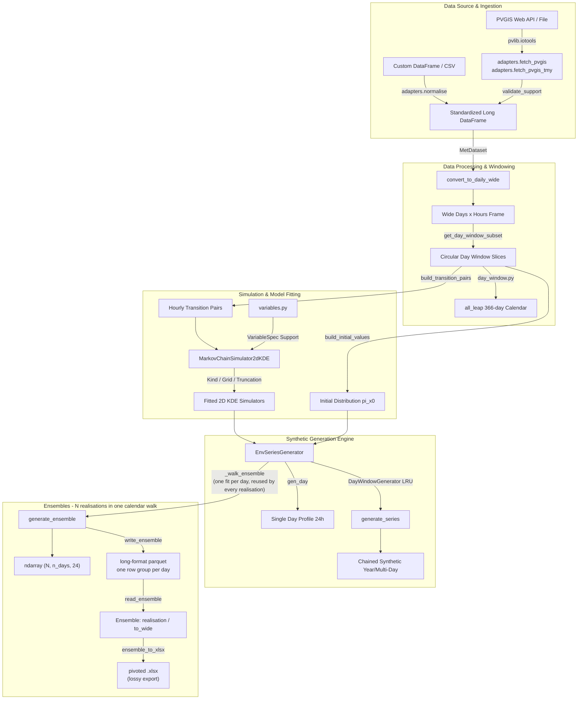
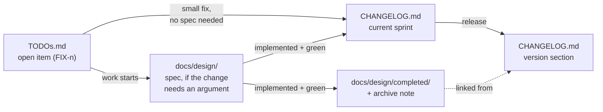

Status: accepted · Author: Antigravity Agent · Date: 2026-07-27 · Last revised: 2026-08-03

# Package Architecture & Design Overview

## Document Scope

This document provides a concise, high-level architectural overview of the `meteosynth` package. It serves as the primary entry point and technical orientation for human developers and AI agents working on, extending, or integrating `meteosynth`.

- **In Scope**: Package essence, domain focus, current architectural state (v0.3.1), component boundaries, data flow pipelines, folder tree structure, module responsibilities, and developer onboarding workflows.
- **Out of Scope**: Detailed API parameter references (see Sphinx docs in [`docs/source/`](../source/)), end-user quickstart tutorials (see [`README.md`](../../README.md)), and historical design decision records (see [`docs/design/completed/`](completed/)).

---

## Package Essence & Domain Focus

`meteosynth` is a Python library for generating stochastic, physically consistent synthetic environmental time-series data (e.g., solar irradiance, air temperature, wind speed) from historical weather records or online database APIs (PVGIS).

### Primary Use Case
The primary application of `meteosynth` is **Monte-Carlo simulation for renewable energy systems**. Rather than evaluating energy systems under a single deterministic historical profile, `meteosynth` generates ensembles of statistically plausible weather realizations to quantify energy yield variability, storage requirements, financial risk, and extreme operational scenarios.

### Core Mathematical & Modeling Approach
1. **Non-Parametric 2D KDE Markov Transitions**: Models hourly transitions $P(X_h \mid X_{h-1})$ using 2D Kernel Density Estimation. Degenerate data regions (such as night-time zero irradiance) are handled robustly via a `Kind` enum fallback strategy (`KDE_2D`, `KDE_1D`, `CONSTANT`).
2. **Physical Support Truncation**: Enforces domain-specific physical constraints (e.g., non-negative solar irradiance) by restricting evaluation grids to variable physical support bounds prior to inverse CDF sampling, preventing out-of-domain synthetic values.
3. **Circular Rolling-Window Climate Models**: Uses a 366-day `all_leap` circular calendar to construct smooth, centered rolling training windows ($\pm n$ days) that wrap across New Year and treat Feb 29 as a continuous calendar slot without data discarding.
4. **Date-Aligned Cross-Midnight Continuity**: Chains multi-day synthetic time series by sampling hour 0 from a fitted initial distribution $\pi(X_0)$ or linking day transitions via a cross-midnight pair model $P(X_{0, \text{today}} \mid X_{23, \text{yesterday}})$.

---

## Current Package State (v0.3.1)

- **Version**: `0.3.1`, released 2026-07-31 (managed via `uv` and `hatchling`). The
  release history is [`CHANGELOG.md`](../../CHANGELOG.md); open work is
  [`TODOs.md`](../../TODOs.md).
- **Python Compatibility**: `>=3.10`.
- **Test suite**: 447 tests across 20 modules, headless by construction -- `conftest.py` selects the `Agg` backend at import, so no environment variable is needed.
- **Runtime dependencies**: `numpy`, `pandas`, `scipy`, `pvlib`, `matplotlib`, `seaborn`,
  `tqdm`, `pyarrow` — all required. One optional extra, `excel` (`openpyxl`), for
  `ensemble_to_xlsx` alone.
- **Key Architectural Features**:
  - **`MetDataset` is the core noun.** The training record is an object with a versioned
    format (schema v1), validated on construction whatever route the data arrived by, and
    round-trippable to parquet without loss. Provenance is a field on it, not a property
    of a fetcher's cache path.
  - **Collect once per site, project-locally.** Downloads are stored in a `data/` folder
    beside the work and found again by
    provenance rather than by filename; a wider record answers a narrower request by
    narrowing (`get_period_subset`), so one download serves every training period. When
    two records could answer, the package refuses and lists them. *Which* folder is "beside
    the work" is answered by [Where Files Go](#where-files-go): the script's own folder for
    a script, the working directory for a command.
  - **Decoupled Variable Specs**: Physical constraints (`support`, `units`, `long_name`) are registered centrally in `meteosynth.variables` independently of dataset-specific column names. A column is modellable if and only if it has a spec.
  - **Date-Indexed Pair Alignment**: Daily wide-format restructuring keys transition pairs on calendar dates, eliminating silent mispairing bugs caused by dataset re-sorting.
  - **Lazy LRU-Cached Generators**: `DayWindowGenerator` dynamically instantiates daily models behind an LRU cache, permitting full-year simulations without excessive memory consumption. The cache serves *repeated* requests for the same day (`gen_day`); an ordered calendar walk visits each slot once and gets no hits from it.
  - **Lazily Cached Conditional Sampling**: a simulator sampled past a threshold caches its conditional inverse CDF over a grid of `previous` values, turning each draw into two interpolations. Lazy by design — a chained year takes one sample per simulator and must not pay to build a cache it will use once.
  - **Ensembles are a first-class operation**, with their own on-disk format
    (`ensemble.py`, long-format parquet, one row group per calendar day).
  - **PVGIS API Integration**: `meteosynth.adapters` interfaces with `pvlib.iotools` to fetch hourly (`fetch_pvgis`, plane-of-array) and TMY (`fetch_pvgis_tmy`, horizontal) data, normalising each to the canonical schema and validating against registered support before it reaches the core. Adapters are an optional convenience, not a required layer.

---

## Four Things a Newcomer Gets Wrong

Properties of the current design that are load-bearing and not visible from a signature.
The release history behind them is in [`CHANGELOG.md`](../../CHANGELOG.md).

| property | why it has to be known up front |
| :--- | :--- |
| **The sampler has two paths, not one** (`PERF-1`) | `MarkovChainSimulator2dKDE` answers a draw either by evaluating the conditional density live, or by reading a cached quantile grid built once the simulator proves hot. Anything reasoning about sampling cost, memory, or exact reproducibility across ensemble sizes has to know this. ~8× on ensembles; nothing on a chained year, by design. Which path is taken is currently decided by a hidden call counter — a known defect, tracked as `FEAT-17`. See [`PERF-1-precomputed-conditional-quantiles.md`](completed/PERF-1-precomputed-conditional-quantiles.md). |
| **Two generation entry points with different cost models** (`FEAT-15`) | `generate_series` walks the calendar and fits each day as it arrives; `generate_ensemble` / `write_ensemble` walk it **once** and pass every realisation through each day's single fit — ~77× at N = 1000. Both share `_walk_ensemble`, so calendar behaviour cannot diverge. Two consequences: an ensemble **does** exercise `PERF-1`'s cached sampler (a chained year still does not), and randomness is keyed on `(seed, realisation index, attribute name)` rather than drawn from one stream. See [`completed/FEAT-15-ensemble-generation.md`](completed/FEAT-15-ensemble-generation.md). |
| **Degeneracy is detected by scale, not by exact zero** (`FIX-2`) | `Kind` classification does not assume a source stores physical zero as exact `0.0`. This is what **allows ingesting providers other than PVGIS**, where resampling and unit conversion leave `1e-16` nights. Relatedly, a singular covariance re-categorises to `KDE_1D` with a warning rather than raising, so one unfittable hour cannot take a whole synthetic year with it. |
| **Two irradiance specs, deliberately distinct** | `IRRADIANCE_HORIZONTAL` (`ghi`/`dni`/`dhi`) is a *separate spec object* from `IRRADIANCE` (plane-of-array) despite identical support and units, because `long_name` is quoted back to the user by `validate_support` — naming a horizontal quantity "plane-of-array" misinforms exactly when someone is debugging provenance. |

---

## Where the Accuracy Evidence Lives

`examples/diagnostics-overshoot/` is not an example in the demonstrative sense; it is the
repo's **measuring instrument**, with a pre-registered decision rule, three controls and
dated findings. **Claims about generator accuracy are expected to cite it.**

What it has established, and what the package therefore does and does not promise:

- **There is no mean overshoot.** `FIX-1` once read "+14 %"; that figure came from a
  retired estimator (month subsets, pre-0.2.0 code) on one two-year record without
  repetition. Measured against the pool the model is fitted to — 19 years, four dates,
  n = 1000 — the mean lands **within 0.7 %** and no date's interval excludes parity.
- **What is real is a lower-tail deficit**: ~4× too few heavily overcast days. It is worth
  **0.12 % of an annual P90**, so yield work is unaffected; storage autonomy and
  worst-case-day work are not. `FIX-1` is deliberately deferred on that basis, and the
  limitation is documented in `README.md` rather than left to be discovered.
- **The default window half-width is unsettled, with numbers.** Within-window seasonal
  structure is 3.8 % of pool variance at ±7 days and 10.4 % at ±15 on 21 March — but
  19.3 % at ±7 on 21 September, because the same seasonal slope sits on a smaller
  day-to-day variance. A single global half-width cannot be right for every date
  (`CHORE-1`).
- **Nothing in the test suite pins what the sampler produces distributionally.** The suite
  tests properties, so `PERF-1`'s entirely new sampling path passed 271 tests unmodified —
  and would have passed had it been wrong. Tracked as `CHORE-12`, and it gates the two
  items that would add a third value-producing path.

---

## System Architecture & Data Flow



---

## Where Files Go

Read this before adding a script, or a subcommand, that writes anything. The rationale is
[`FEAT-21`](completed/FEAT-21-workspace-and-file-locations.md).

### The rule

**One workspace root per run**, with two folders hanging off it — `data/` for what was
collected, `output/` for what was generated, both git-ignored. What the root *is* depends
on how the code was entered, and on nothing else:

| entry point | workspace root |
| :--- | :--- |
| a script — `workspace(__file__)` | **the script's own folder**, whatever directory it was launched from |
| a command — `workspace()` | **the working directory**, the folder you are standing in. What `FEAT-14`'s subcommands will call |
| a notebook or REPL, where there is no script file | the working directory, via the `workspace(globals().get("__file__"))` idiom |
| an explicitly given path — `data_dir=`, `--data-dir` | that path; a **relative** one is read from the **working directory**, never from the workspace root |

The last row is the one that surprises people, and it is deliberate: a path someone typed
should mean what their shell would make of it. The workspace root applies only when the
caller says nothing.

`meteosynth.paths` owns this. `store.default_data_dir()` is defined as
`workspace().data_dir`, so the store and the rule cannot drift; **there is still no
environment variable and no global setting**, for the reason `store.py` gives at length.

The module is `paths` while the function is `workspace` on purpose — a `workspace.py`
exporting a `workspace()` would leave `meteosynth.workspace` bound to the function and the
module unreachable by import.

### Records are found by provenance, not by filename

The package's normal path, and — since each example folder holds a single-record store —
what the examples now demonstrate rather than work around:

- **Give a folder, not a file.** `fetch_pvgis(..., data_dir=...)` scans parquet footers and
  matches on what each record says it is — site, period, columns. A wider record answers a
  narrower request; two that both answer raise `AmbiguousRecordError` rather than one being
  chosen.
- **Naming a file (`cache=<path>`) is the exception, and needs a reason.** The examples all
  named files until `FEAT-21`, because the shared `examples/data/` held two overlapping
  Heraklion records and discovery would rightly refuse to choose. One store per folder
  removed the collision and with it the workaround.
- **The reason that survives is collection method, not site or period.**
  `diagnostics-overshoot/` keeps `cache=` because its record is fetched with
  `components=False` — PVGIS's own `poa_global` rather than the summed components — and
  `StoredRecord.holds` (`store.py:177-185`) deliberately treats those as interchangeable,
  exact to the provider's rounding. That equivalence is right for the package and wrong for
  a measuring instrument whose findings are cited by date. It is the only `cache=` left in
  `examples/`, and `tests/test_store.py` pins the behaviour it guards against.

So: **name a file when *how* a record was collected is load-bearing; give a folder when
only its site and period are.**

---

## Repository & Folder Structure

```
meteosynth/
├── .github/                 # CI/CD workflows and automated actions
├── docs/                    # Package documentation root
│   ├── Makefile / make.bat  # Sphinx build entry points
│   ├── build/               # Generated HTML output target (git-ignored)
│   ├── design/              # Internal design specifications workspace — work in flight
│   │   ├── README.md        # Workspace conventions & index
│   │   ├── architecture.md  # [This File] Architecture & current state overview
│   │   ├── FEAT-2-FEAT-1-column-resolution-and-provenance.md  # superseded; record only
│   │   └── completed/       # Implemented design specs archive
│   │       ├── FEAT-21-workspace-and-file-locations.md  # where data/ and output/ live
│   │       ├── FEAT-15-ensemble-generation.md      # one calendar walk per ensemble
│   │       ├── FEAT-13-met-dataset-format.md       # MetDataset & schema v1
│   │       ├── PERF-1-precomputed-conditional-quantiles.md  # the cached sampling path
│   │       ├── variable-specs-and-initialisation.md
│   │       ├── rolling-day-window.md
│   │       └── transition-pair-alignment.md
│   └── source/              # Sphinx source files — the published documentation
│       ├── index.rst        # Toctree root
│       ├── quickstart.md    # First contact: install, fetch, generate
│       ├── concepts.md      # Vocabulary: ensemble, realisation, envelope, P50/P90, pi(x0)
│       ├── workflow.md      # MetDataset schema v1, save/load, the training workflow
│       ├── ensemble_format.md  # The on-disk ensemble file, readable without meteosynth
│       ├── theory.md        # The modelling approach and its caveats
│       ├── examples.md      # Walk-through of the runnable scripts
│       ├── api.rst          # Autodoc entry points
│       └── conf.py
├── examples/                # Runnable scripts, split by purpose (see examples/README.md)
│   ├── README.md            # Index: what each folder and script is for
│   │                        # Each script folder below holds its own data/ (collected) and
│   │                        # output/ (generated), both git-ignored. See "Where Files Go".
│   ├── tools/               # Shared helpers imported by the scripts; not importable from src/
│   │   ├── __init__.py
│   │   ├── site_data.py     # Site definitions and loading; takes the caller's Workspace
│   │   └── envelope.py      # Observed-vs-synthetic comparison and figures
│   ├── concepts/            # How the package behaves (Paris 2011-2012)
│   │   ├── example_exploratory_analysis.py
│   │   ├── example_leap_year_windows.py
│   │   └── example_rolling_window.py
│   ├── benchmark/           # What drives generation time? Answered in ratios, ~9-10 min
│   │   ├── leros_timing_benchmark.py  # Four sweeps: N scaling, attribute split, noise, additivity
│   │   └── benchmarks/      # Per-machine JSON history, git-ignored and compared run to run
│   ├── diagnostics-overshoot/  # The repo's measuring instrument, not a demonstration
│   │   ├── README.md            # What it is, how the comparison works, what guards it
│   │   ├── PLAN.md              # Why it is measured this way; pre-registered decision rule
│   │   ├── FINDINGS-2026-07-28.md  # One dated file per run; never edited after the fact
│   │   ├── run_all.py           # All four steps, with progress and a measured ETA
│   │   ├── config.py            # Dates, window, bandwidth factor, seeds, thresholds
│   │   ├── step1_fetch.py       # Probe PVGIS for the widest range it serves, cache it
│   │   ├── step2_simulate.py    # Every configuration -> results/raw/, then self-check
│   │   ├── step3_analyse.py     # Reads results/raw/ only -> results/summary_*.csv
│   │   └── step4_figures.py     # ECDF with a tail zoom, ratio-with-interval charts
│   └── use_cases/           # Applied workflows (Heraklion 2010-2020)
│       ├── README.md               # Index over the three time scales
│       ├── day/                    # Does a synthetic day look like a real one?
│       │   ├── README.md
│       │   ├── day_envelope_pv.py  # One synthetic 21 May vs eleven real ones
│       │   ├── day_envelope_temp.py
│       │   └── day_envelope_wind.py
│       ├── month/                  # Does an ensemble vary like the real months?
│       │   ├── README.md
│       │   └── monthly_statistics.py  # Ensemble of synthetic Mays, as statistics
│       └── year/                   # Produce a full series for downstream use
│           ├── README.md
│           └── synthetic_year.py   # 8760 hours x 3 attributes, written to CSV
├── src/
│   └── meteosynth/          # Core Python library package
│       ├── __init__.py      # Package public API exports
│       ├── adapters.py      # Data source schema adapters
│       ├── store.py         # The project data store: footer scan, containment, refusal
│       ├── paths.py         # Workspace: which folder is the root of this run, and its data/ + output/
│       ├── constants.py     # Index column definitions & attribute groups
│       ├── dataset.py       # MetDataset: schema, validation, parquet I/O, slicing
│       ├── day_window.py    # Circular 366-day calendar arithmetic
│       ├── ensemble.py      # Ensembles on disk: long parquet, views, xlsx export
│       ├── generators.py    # Daily, multi-day and ensemble synthetic series generators
│       ├── markov_chain_simulator_kde2d.py # 2D KDE Markov engine & fallbacks
│       ├── markov_implementations/         # Alternative Markov simulators
│       │   ├── markov_chain_simulator_continuous.py # Binned 1D KDE simulator
│       │   └── markov_chain_simulator_discrete.py   # Discrete transition matrix simulator
│       ├── provenance.py    # Provenance: source, site, period -- what a name cannot say
│       ├── py.typed         # PEP 561 static type marker
│       ├── sup_plot_lib.py  # Visual diagnostics & KDE surface plotting
│       └── variables.py     # VariableSpec registry: support, units, long names
├── tests/                   # Automated test suite (pytest)
│   ├── conftest.py          # Shared fixtures; selects a headless backend at import
│   └── test_*.py            # 19 modules, 439 tests
├── .gitignore
├── .python-version          # Interpreter pin for uv
├── CHANGELOG.md             # Version release history
├── LICENSE                  # MIT License
├── README.md                # Main user documentation & quickstart
├── TODOs.md                 # Project backlog & roadmap (open work only)
├── pyproject.toml           # Hatchling build spec & dependency groups
├── uv.lock                  # Lockfile for reproducible environments
└── wrangler.jsonc           # Cloudflare deployment config for docs
```

---

## Module Overview & Responsibilities

### `src/meteosynth/`

| Module | Core Responsibility |
| :--- | :--- |
| [`__init__.py`](../../src/meteosynth/__init__.py) | Exposes top-level public API symbols (`MetDataset`, `MarkovChainSimulator2dKDE`, `EnvSeriesGenerator`, `DayWindowGenerator`, `Ensemble`, `write_ensemble`, `VariableSpec`, `register`, etc.) and resolves `__version__` from installed package metadata. |
| [`variables.py`](../../src/meteosynth/variables.py) | Defines `VariableSpec` dataclass (`support`, `units`, `long_name`), domain clamping logic (`clamp_domain`), and the global variable registry (`register`, `unregister`, `registered`, `get_spec`). Pre-registers `IRRADIANCE` (plane-of-array), `IRRADIANCE_HORIZONTAL` (`ghi`/`dni`/`dhi`), `TEMP_AIR` and `WIND_SPEED`. Also owns irradiance column resolution — `IRRADIANCE_COLUMNS` (the ordered preference `poa_global`, `ghi`), `irradiance_columns` and `resolve_irradiance`, which refuses to guess when only *components* of a total are present. A column is modellable if and only if it has a spec, which is what makes the package variable-agnostic. |
| [`markov_chain_simulator_kde2d.py`](../../src/meteosynth/markov_chain_simulator_kde2d.py) | Main stochastic engine (`MarkovChainSimulator2dKDE`). Fits 2D Gaussian KDE over $(X_{h-1}, X_h)$ pairs, constructs cumulative conditional distributions $P(X_h \mid X_{h-1} = x)$, truncates evaluation grids to physical support, and handles degenerate data via `Kind.KDE_2D`, `Kind.KDE_1D`, and `Kind.CONSTANT`. **Two sampling paths**: a direct KDE evaluation, and a cached conditional-quantile grid built lazily once a simulator proves hot (`precompute_grid`, `has_quantile_grid`). |
| [`generators.py`](../../src/meteosynth/generators.py) | High-level daily series orchestration. `EnvSeriesGenerator` manages 23 hourly transition simulators + 1 initial distribution + 1 cross-midnight model, and can force their quantile grids up front (`precompute_grids`). `DayWindowGenerator` manages rolling window generation with an LRU cache, and exposes both `generate_series` (one chained series) and `generate_ensemble` (N of them in **one** calendar walk). `_walk_ensemble` is the single implementation of that walk, shared by both and by the ensemble writer, so the calendar rules cannot drift between them; it yields an `EnsembleDay` per calendar day. `realisation_stream` derives the per-`(realisation, attribute)` random stream. Also builds date-aligned transition pairs (`build_transition_pairs`, `build_cross_midnight_pairs`). |
| [`ensemble.py`](../../src/meteosynth/ensemble.py) | The on-disk form of a generated ensemble. `write_ensemble` streams N realisations to **one long-format parquet file**, a row group per calendar day, with the full generating parameters and the source dataset's provenance embedded as key-value metadata; `read_ensemble` reads it back and refuses a newer `ensemble_schema_version` rather than guessing. `Ensemble` carries the views (`realisation`, `to_wide`), and `ensemble_to_xlsx` is a lossy pivoted export behind the optional `excel` extra. |
| [`day_window.py`](../../src/meteosynth/day_window.py) | Pure-function circular 366-day `all_leap` calendar arithmetic (`day_slot`, `window_slots`, `circular_delta`, `slot_to_month_day`). Enables New Year wrapping and leap-year treatment without pandas timestamp overhead. |
| [`dataset.py`](../../src/meteosynth/dataset.py) | **The core noun.** `MetDataset` owns schema v1 — canonical dtypes, calendar validity, unique `(year, month, day, hour)`, sorted order — enforced on construction whatever route the data arrived by. Structural defects raise; out-of-support values are clipped and counted. Lossless parquet `save`/`load` with provenance embedded as key-value metadata, plus `read_csv`/`to_csv` as explicitly lossy interchange. Also carries the wide-format pivot (`convert_to_daily_wide`) and the training slices (`get_month_subset`, `get_day_window_subset`). |
| [`provenance.py`](../../src/meteosynth/provenance.py) | `Provenance`: source, site, coordinates, period, fetch date. Always present (`source="user"` when nobody claimed one). `from_dict` tolerates unknown keys so a newer writer cannot strand a reader — the opposite of `schema_version`, which refuses a future file rather than guessing. |
| [`adapters.py`](../../src/meteosynth/adapters.py) | Optional collection helpers, returning a `MetDataset` with provenance filled in. `fetch_pvgis` (hourly, plane-of-array) and `fetch_pvgis_tmy` (TMY, horizontal) call `pvlib.iotools` and **cache by default**, matching an existing cache against the request rather than trusting its path — a mismatch is `CacheMismatchError`, not a silent wrong answer. A default fetch takes the provider's widest range (`probe_year_range`) and keeps every column returned, deriving `poa_global` by summation; `start`/`end` select a view. `normalise` maps provider columns to canonical names per source; `validate_support` remains as an opt-in hard check for callers who would rather be stopped than repaired. |
| [`store.py`](../../src/meteosynth/store.py) | **The project's data store, and discovery as distinct from validation.** `adapters` answers *"is this named file the one I want?"*; this answers *"which file in this folder is?"* — `scan` and `resolve` read provenance and column names from parquet **footers** (1.3 ms/file against 113 ms to load), so no manifest or sidecar is needed and nothing can drift from the records it describes. Owns `default_data_dir` — `./data` under the working directory, **with no environment variable or global setting**, so two projects keep independent stores — the filename convention, and `period_contains`, the single definition of "wide enough" called by both this module and `adapters`. Refuses with `AmbiguousRecordError` when several records answer, rather than choosing. Deliberately not called a *cache*: the records are not expendable (a provider may revise its archive), not transparent, and not shared. Note `StoredRecord.holds` treats a record carrying all three POA components as able to answer a `poa_global` request — right for the package, and the one case where naming a file is still correct (see [Where Files Go](#where-files-go)). |
| [`paths.py`](../../src/meteosynth/paths.py) | Answers one question: *which folder is the root of this run?* The script's own folder when given `__file__`, the working directory when given nothing. `Workspace.data_dir` / `.output_dir` hang `data/` and `output/` off it. Exists so the rule is written once rather than copied into every script and again into the CLI; `store.default_data_dir()` is defined as `workspace().data_dir`. Module named `paths` while the function is `workspace`, so neither shadows the other. See [`completed/FEAT-21-workspace-and-file-locations.md`](completed/FEAT-21-workspace-and-file-locations.md). |
| [`constants.py`](../../src/meteosynth/constants.py) | Package constants including index column names (`year`, `month`, `day`, `hour`) and shipped attribute sets. |
| [`sup_plot_lib.py`](../../src/meteosynth/sup_plot_lib.py) | Visual diagnostic functions for plotting fitted 2D KDE surfaces, conditional CDFs, and synthetic time-series comparisons. |
| [`markov_implementations/`](../../src/meteosynth/markov_implementations) | Alternative Markov models: `ContinuousMarkovChainSimulator` (binned 1D KDE) and `MarkovChainSimulatorDiscrete` (binned matrix transitions). |

---

## Project Record-Keeping: Where Each Kind of Writing Lives

Four files carry the project's written record, and each answers a different question. The
rule that keeps them from duplicating one another: **an item lives in exactly one place at
a time, and moves when its status changes.**

| File | Answers | Contains | Never contains |
| :--- | :--- | :--- | :--- |
| [`TODOs.md`](../../TODOs.md) | *What is still broken or unbuilt?* | **Open work only**, grouped as Fixes / Performance & internals / Features / Direction / Housekeeping, each with a stable ID (`FIX-1`, `PERF-2`, `FEAT-1`, `VISION-1`, `CHORE-1`) drawn from one shared never-reused counter and the measurements behind it, plus an **Inbox** (`INBOX-n`) for notes not yet triaged and a **Next ID** line | A "done" section; a per-category counter |
| [`CHANGELOG.md`](../../CHANGELOG.md) | *What is the package now, and when did that become true?* | Released state per version, `Added`/`Changed`/`Fixed`/`Removed`, plus an optional `### Decisions` subsection | Extended rationale; narrative of how a decision was reached |
| [`docs/design/`](README.md) | *Why should we do it this way?* | Specifications and argued rationale for work **in flight** | Implemented work |
| [`docs/design/completed/`](completed/) | *Why was it done this way?* | The same documents once their feature has landed, each with an archive note recording move date, implementation date and commits | Work still in flight |

### The lifecycle



### The rules this implies

1. **Completed TODO items move to the changelog.** When an item ships, fold it into the
   current sprint entry and **delete it from `TODOs.md`**. A `✅ DONE` item left in place
   is a duplicate that will drift out of sync with the code.
2. **The changelog states the current state, not the reasoning.** Say what the package
   does now and what a number measures; do not re-argue the choice. Rationale belongs in
   `docs/design/`, which the changelog links to.
3. **Significant decisions get one line each, under `### Decisions`.** A decision is worth
   recording there when a reader would otherwise ask *"is this missing, or deliberate?"* —
   typically deliberate absences and API-shape choices. One sentence, then a link to the
   design doc that argues it.
4. **Cross-reference TODO items by ID, never by position.** `FIX-2`, not "item 7". Tests,
   examples and design docs all cite these IDs; ordinal references break the moment the
   file is re-grouped.
5. **IDs come from one shared counter, and the number is the identity.** `TODOs.md` carries
   a single **Next ID** line for every category together, not one counter per group. The
   prefix says what an item *is* and may change; the number says *which* item it is and
   never does.
   - **Numbers are never reused.** Landing, dropping or superseding an item does not free
     its number — commit messages and released changelog entries cite them, and history
     must not be made to lie.
   - **Reclassifying changes only the prefix.** `FEAT-14` becoming a defect is `FIX-14`.
     Because the number is unique across all categories, a stale citation still resolves.
     This is the reason category is deliberately *not* part of the identity: it is the
     mutable attribute, as the 2026-07-27 triage demonstrated.
   - **Triage preserves the number**: `INBOX-8` graduates to `FEAT-8` — *unless the number
     was already spent*, in which case rule "numbers are never reused" wins and the item is
     re-allocated from the counter. This is not hypothetical: `INBOX-13` was raised against
     a number `FEAT-13` had already taken, and became `FIX-18` + `CHORE-19` on triage
     (2026-08-01). **Allocate an `INBOX-n` from the same counter as everything else**, and
     bump the Next ID line when you do; the waiting room is not exempt.
   - **IDs below 10 predate the scheme** and are not globally unique (`FIX-1`, `PERF-1` and
     `FEAT-1` are three items). For those the full `PREFIX-N` string is the identity. They
     were deliberately not renumbered.
   - Splits mint fresh IDs and record their origin in prose (*"split from #12"*). Composite
     `FIX-12-1` grammar was considered and rejected: it lengthens every citation to express
     something rare, and the second segment cannot be known when the ID is allocated.
6. **The Inbox is a waiting room, not a group.** A raw note lands as `INBOX-n` with an
   initial assessment and the question that decides its shape. It leaves by graduating
   into a group above with a real ID, or by being dropped — it is not a place items
   settle. Do not cite an `INBOX-n` ID from code or docs; it is not stable.
7. **Sync the whole set at release.** Closing a version means: rename the sprint section to
   `## [x.y.z] — date`, move any newly-completed TODO items into it, drop TODO entries the
   release invalidated, and re-check that every "already tried" note reflects what actually
   shipped.

---

## Onboarding Quickstart for Developers & AI Agents

### 1. Environment Setup
```bash
# Clone repository & synchronize dependencies using uv
uv sync

# Optional: Excel export of an ensemble (`ensemble_to_xlsx`) -- the only extra there is
uv sync --extra excel
```

> **There is no `examples` extra.** `tqdm` is a core runtime dependency, so `uv sync`
> alone is enough to run every script under `examples/`. The documentation used to
> instruct `uv sync --extra examples`, which failed outright; corrected across 13 files
> by `FIX-18`.

### 2. Verification & Testing
```bash
# Run the full test suite. Headless by construction -- no environment to set.
uv run pytest
```

> **`MPLBACKEND=Agg` is not needed for the suite**, and has not been since 0.2.0:
> `tests/conftest.py` calls `matplotlib.use("Agg")` at import, before any test module
> pulls in `pyplot`. Verified — the suite passes with the variable unset, and reports the
> `Agg` backend.
>
> **It *is* needed to run an example script non-interactively.** Six of them end in
> `plt.show()`, and the default backend on a desktop is interactive (`tkagg` here), so an
> unattended run blocks forever waiting for a window to be closed. Measured: `plt.show()`
> under `tkagg` never returns; under `Agg` it warns and continues. So use it for CI and
> scripted runs — and *not* when running an example yourself, where blocking on the
> figure is the point.
>
> ```bash
> MPLBACKEND=Agg uv run python examples/use_cases/year/synthetic_year.py   # unattended
> uv run python examples/use_cases/year/synthetic_year.py                  # interactive
> ```

### 3. Key Extension Points
- **Adding a New Environmental Quantity**:
  Register a new `VariableSpec` with physical support bounds:
  ```python
  import meteosynth
  meteosynth.register("rel_humidity", meteosynth.VariableSpec(support=(0.0, 100.0), units="%", long_name="Relative Humidity"))
  ```
- **Custom Data Ingestion**:
  Pass custom DataFrames into `MetDataset(df)`, ensuring required index columns (`year`, `month`, `day`, `hour`) are present.

### 4. Documentation Build
```bash
# Build local HTML documentation via Sphinx
uv run sphinx-build -b html docs/source docs/build/html
```
