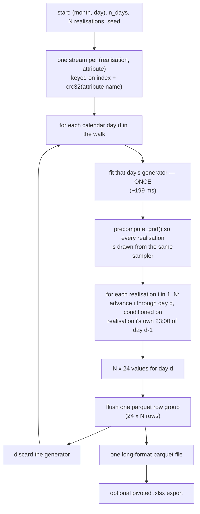

Status: implemented · Author: Claude (Opus 5) · Date: 2026-07-30 · Serves: `FEAT-15`

> **Archive note.** Implemented 2026-07-30; moved here the same day, with the suite green at
> **345 passed, 12 skipped** (was 314). Landed as specified, with four deviations worth
> recording:
>
> 1. **`generate_series` keeps its own RNG plumbing.** The spec said it would become
>    `generate_ensemble(n_realisations=1)`. It shares the *walk*, but not the stream
>    derivation: `rng=<Generator>` has always meant "draw from this and advance it", which is
>    what makes repeated one-day calls an ensemble of independent days, and the keyed streams
>    would have broken that. The walk therefore *consumes* streams it is handed rather than
>    deriving them. Verified bit-for-bit identical to the pre-refactor implementation.
> 2. **`generate_ensemble` clears the LRU cache on entry and exit** — not anticipated by the
>    spec, and a genuine defect found by testing. The cache holds *sampler state*, not just
>    fitted models: a cached simulator remembers how often it has been sampled, so one past
>    `PERF-1`'s threshold answers from its grid where a fresh one answers directly. Without
>    clearing, the same call on the same object returned different numbers. Costs nothing,
>    since a walk never revisits a slot.
> 3. **`precompute` is an explicit parameter**, because the automatic threshold means
>    realisation *i* is not bit-identical across the 64-realisation boundary. The spec
>    promised more than the threshold could deliver; the parameter is the escape hatch, and
>    the docstring now states the limit accurately.
> 4. **The headline number was wrong in the first draft** and is corrected in place below:
>    ~77×, not ~300×. The original projection omitted the quantile-grid build, which every
>    calendar day pays afresh. That correction also cut `PERF-16`'s ceiling from ~3× to ~1.2×
>    and moved the next real optimisation target onto the build itself.

# Generating an ensemble of synthetic years in one pass

## Overview

The package's primary use case — N synthetic years, N in the hundreds or thousands — is
today the slowest thing it can do, for a reason that is pure bookkeeping. `generate_series`
walks the calendar once and fits each day's models as it reaches that day; calling it N
times therefore **fits every day's models N times**. Measured: 1000 realisations of one
attribute would take **~27 hours**, of which all but ~1.2 minutes is refitting models that
were already fitted.

This document specifies **inverting the two loops**. Walk the calendar once on the outside;
at each calendar day, advance all N realisations through that day's already-fitted models.
Fitting is then paid once. Measured: **26.9 h → 20.9 min** at N = 1000, a **77×** reduction.

Three things fall out of the inversion for free, and they are most of why this shape is the
right one rather than merely a faster one:

1. **`PERF-1`'s cached sampler starts applying.** A simulator asked for N samples instead of
   one crosses its activation threshold and builds its quantile grid, cutting the cost of a
   draw ~85×. A chained year is the one path `PERF-1` deliberately leaves cold. (The grid is
   not free — building it turns out to dominate the per-day cost; see below.)
2. **Peak memory goes *down*.** Only one day's generator is alive at a time, against ~126 MB
   per attribute to hold all 366 (the amortisation the `DayWindowGenerator` docstring
   rejects on those grounds).
3. **The output becomes streamable.** With the day loop outermost, each day's rows can be
   flushed to disk as they are produced, so peak memory never holds the whole ensemble.



---

## Why: what was measured

Heraklion 2010–2020 (96 432 rows), `poa_global`, ±7-day window, `bandwidth=0.1`. The full
set of numbers is in [`CHANGELOG.md`](../../../CHANGELOG.md);
these are the ones the design turns on.

**The LRU cache contributes nothing here, and the reason is not that it is too small.** A
30-day walk × 5 realisations at the default `cache_size=8` performed **150** fits for **30**
distinct days — a hit rate of *exactly zero*. An ordered walk visits each calendar slot once
and never revisits it, so no cache size short of the whole walk can hit. Raising
`cache_size` to 32 cut it to 30 fits and 36.5 s → 15.9 s, confirming the misses were the
whole cost. **70 % of wall time was fitting.**

| operation | cost | paid |
| :--- | --: | :--- |
| fit one calendar day's generator (window subset + 25 KDEs) | **199 ms** | per day, per attribute |
| sample one day, direct path — what a chained walk does today | **57.7 ms** | per day, per realisation |
| build that day's quantile grids (`PERF-1`) | **3.32 s** | per day, per attribute |
| sample one day from the built grids | **0.68 ms** | per day, per realisation |

End to end over a **60-day span**, scaled to a 365-day year, one attribute:

| N realisations | today | this design | speedup |
| --: | --: | --: | :--- |
| 10 | 16.1 min | ~5 min | ~3× — direct path, no grids built |
| 100 | 2.7 h | **17.5 min** | **9×** |
| 1000 | **26.9 h** | **20.9 min** | **77×** |

> **The grid build is what makes the win grow with N rather than being flat**, and it is the
> cost easiest to overlook: it is the same ~3.3 s per day whatever N is, so it is nearly the
> whole bill at N = 100 and still ~79 % at N = 1000. It is also why `PERF-1`'s 64-call
> threshold is the right crossover here — at N = 64 the direct path and the grid path cost
> within ~10 % of each other, which is where a threshold should sit.
>
> **An earlier draft of this document claimed ~300× and ~5 min.** That projection took its
> per-day sampling cost from an already-warm generator and so omitted the build entirely —
> but every calendar day gets a *fresh* generator, so the build is paid 365 times rather than
> once. Correcting it cost a factor of four off the headline.

**Statistically it is the same model.** Each realisation remains an independent chain through
the same per-day models: realisation *i*'s hour 0 on day *d* conditions on realisation *i*'s
hour 23 on day *d−1*, exactly as the chained walk does. Only the order of evaluation changes.

---

## The API

```python
# One attribute, held in memory. The convenience form.
arr = dwg.generate_ensemble(start=(1, 1), n_days=365, n_realisations=1000, seed=1)
# -> ndarray (n_realisations, n_days, 24)

# Many attributes, streamed to disk. The form the use case actually wants.
meteosynth.write_ensemble(
    dataset,
    attrs=("poa_global", "temp_air", "wind_speed"),
    path="out/heraklion_1000.parquet",
    start=(1, 1), n_days=365, n_realisations=1000, seed=1,
    n_days_window=7, bandwidth=0.1,
)
```

`start`, `n_days` and `include_feb29` keep `generate_series`'s existing meanings, and the
slot walk is the same code. **`generate_series` must not be a second implementation of the
walk** — the two must not be able to drift apart. (As built it shares `_walk_ensemble` but
keeps its own RNG plumbing; see archive note 1 for why.)

### One walk, three consumers

A `DayWindowGenerator` is bound to one attribute, but a multi-attribute file needs every
attribute for day *d* before that day's rows can be written. So the walk cannot live on
`DayWindowGenerator` alone, and it must not be written twice. Proposed seam — an internal
iterator that owns the calendar walk and yields one day at a time:

```python
def _walk_ensemble(...) -> Iterator[EnsembleDay]:
    """Yields (day_index, month, day, {attr: ndarray (n_realisations, 24)})."""
```

Then: `generate_ensemble` collects it, `write_ensemble` writes each yield as a row group,
and `generate_series` takes the `n_realisations=1` case. One walk, one place for the Feb 29
and wrap-around logic to be right.

### Progress reporting improves as a side effect

`generate_series`'s docstring notes that an ensemble is "this method called hundreds of
times, and hundreds of leftover bars would be worse than none", which is why its bar does
not persist. With the day loop outermost there is **one** bar over the whole ensemble, so it
can persist and can carry a meaningful estimate of time remaining.

---

## Decisions

### 1. Randomness: one stream per (realisation, attribute), keyed by name

**Give every (realisation, attribute) pair its own stream, keyed on the realisation's index
and a stable hash of the attribute's name:**

```python
key = (realisation_index, zlib.crc32(attr_str.encode()))
rng = np.random.default_rng(np.random.SeedSequence(seed, spawn_key=key))
```

This is the whole of the reproducibility question, and it costs nothing to get right at the
outset. Two independent traps, both measured.

**Trap 1 — a shared stream makes a realisation depend on how many realisations you asked
for.** Measured on one day, `seed=42`:

| scheme | realisation 0 at N = 2 vs 5 vs 50 |
| :--- | :--- |
| one shared stream, drawn realisation-major | **differs** — up to 67.7 W/m² across the 24 hours |
| per-realisation stream keyed on the index | **bit-identical at all three** |

Keying on the **index** is what fixes it: `SeedSequence(seed).spawn(10)[i]` and
`spawn(1000)[i]` generate identical state (verified for i = 0, 3, 9; `spawn_key == (i,)`).
Realisation *i* becomes a fixed function of `(seed, i)`. Realisation 0 was also verified
**bit-identical to today's sequential walk** driven by the same stream.

**Trap 2 — keying the attribute by position makes a series depend on which *other*
attributes you asked for.** This is the same bug one level up, and the package walks into it
today: `examples/use_cases/year/synthetic_year.py` seeds with
`SEED + 1000 * realisation + ATTRS.index(attr)`, so dropping `poa_global` from the list moves
`temp_air` from index 1 to index 0 and silently changes the temperature series. Measured:

| attribute key | `temp_air` identical when requested alone vs alongside two others |
| :--- | :--- |
| position in the requested tuple | **no** |
| `zlib.crc32` of the attribute name | **yes** |

Use `zlib.crc32`, **not** Python's built-in `hash()`, which is randomised per process and
would make runs irreproducible across invocations.

The three properties this buys, all worth stating in the docstring because users will rely
on them:

- an ensemble can be **extended** from 100 to 200 realisations without invalidating the
  first 100;
- a single realisation can be **reproduced alone** — realisation 743 out of 1000, without
  generating the other 999 — which is what makes a suspicious result investigable;
- a single **attribute** can be regenerated alone and match its column in a multi-attribute
  run, so adding wind speed to a study does not invalidate the temperatures already
  analysed.

Distinct streams per attribute are required, not merely tidy: attributes are modelled
independently, so handing them one shared stream would feed the same uniform draws into every
attribute's inverse-CDF and lock them together in quantile space — a spurious correlation
that looks like physics.

### 2. Draw every realisation from the same sampler

**Call `precompute_grid()` on each day's simulators before advancing any realisation.**

`PERF-1`'s grid is built lazily, on the 65th call to a given simulator. Left alone, that
means **which sampler a realisation is drawn from depends on its index** — realisation 0
takes the direct path, realisation 500 the grid. That is N-independent, so it does not break
decision 1, but it makes realisations not quite interchangeable, which is a strange property
for an ensemble whose members are supposed to be exchangeable draws. `precompute_grid`
exists for exactly this case.

**Accepted cost: ensemble output will not match today's chained output bit-for-bit.**
Measured at −0.02 % on one day's total here, and −0.185 % on a 2000-day mean in `PERF-1`'s
own measurement, with a two-sample KS p = 1.0. That is an order of magnitude below the
minimum detectable effect of the diagnostics in `examples/diagnostics-overshoot/`, and it is
the same trade `PERF-1` already took. **Say so in the changelog** — anyone re-running a
previous ensemble will see the third digit move.

### 3. Output: one long-format parquet file, flushed per day

One file, not a folder: easier to move, compress and archive, and a folder of N files can
always be produced *from* it while the reverse costs a re-read of N files. Long format, not
wide: it is the shape that streams (see below), it needs no column-naming scheme, and it
matches `MetDataset`'s own long layout so the same tools read both.

**Schema — one row per (realisation, day, hour):**

| column | dtype | meaning |
| :--- | :--- | :--- |
| `realisation` | `int32` | 0 … n_realisations−1 |
| `day_index` | `int16` | 1 … n_days — the walk's own order |
| `month`, `day`, `hour` | `int8` | calendar position |
| one per attribute, e.g. `poa_global` | `float64` | the generated value |

**`day_index` is not redundant with `(month, day)`.** The walk is circular, so
`start=(12, 30)` wraps past New Year and `(month, day)` alone does not order the series.
`day_index` is what makes the file sortable back into the sequence it was generated in. It
also sidesteps the question `FEAT-3` settled for `generate_series`: the model carries **no
year**, so the file must not invent one.

**Streaming.** `pyarrow.parquet.ParquetWriter` writes row groups incrementally, so each day
becomes one row group of 24 × N rows — the "flush every day" behaviour, and peak memory
never holds more than one day. This is only possible because the inverted loop puts the day
on the outside; today's realisation-major order could not stream into a single file.

**Consequence to document, not hide: rows arrive in `(day_index, realisation, hour)` order.**
A reader wanting one realisation therefore touches every row group. Parquet's column
statistics make the filter cheap rather than free. At N = 1000 the whole array is 67 MB, so
an optional `sort=True` that rewrites in `(realisation, day_index, hour)` order is
affordable — offer it, default it off, and let the memory-constrained case keep the streamed
order.

**Provenance rides inside the file**, following `MetDataset.save`'s pattern (parquet
key-value metadata, not `DataFrame.attrs`): the source dataset's own `Provenance`, plus
`seed`, `n_realisations`, `n_days`, `start`, `include_feb29`, the window half-width,
`bandwidth`, the attribute list, and `meteosynth_version`. Carry an
`ensemble_schema_version` and refuse a **newer** one on read, as `MetDataset.load` does.

> This answers the open question `FEAT-2` item (4) — *"what does a saved synthetic series
> carry?"* — for the ensemble case. Worth cross-referencing when this lands.

**Honest caveat the file makes visible.** Attributes are generated **independently**: a
synthetic hour that is hot is not thereby sunny. That is a known limit of the
one-attribute-at-a-time engine (`FEAT-2`), but a multi-column file *looks* like a weather
record, so the limitation stops being abstract. State it in the writer's docstring and in
the file's provenance `notes`.

### 4. `.xlsx` is a pivoted export, never a counterpart

**A long-format `.xlsx` is impossible at the target N, which decides the design.** Excel
holds 1 048 576 rows; N = 1000 × 8760 hours is **8.76 million rows** — it does not fit, and
long format caps out at about 119 realisations. Excel's 16 384-column limit is not
comparable trouble.

So the export **pivots to wide**: one sheet per attribute, 8760 hour-rows × N
realisation-columns. That fits comfortably to N ≈ 16 000.

This mirrors the `save`/`to_csv` asymmetry `FEAT-13` established, and should be named the
same way: parquet is the canonical, round-tripping format; `.xlsx` is a lossy one-way export
that warns. It should also refuse rather than truncate when N exceeds the column limit.

**Needs a new optional dependency** — neither `openpyxl` nor `xlsxwriter` is installed
today. Put it in an extra (`meteosynth[excel]`) and raise an actionable ImportError, rather
than adding a hard dependency for an export path.

---

## Implementation plan

Ordered so the suite stays green at every step.

1. **`_walk_ensemble` iterator** — the calendar walk, lifted out of `generate_series`
   unchanged in behaviour: slot arithmetic, `include_feb29`, the `start=(2, 29)` guard.
   Yields one day at a time for one or more attributes.
2. **`DayWindowGenerator.generate_ensemble`** — collects the iterator into
   `(n_realisations, n_days, 24)`. Streams keyed per decision 1; `precompute_grid` per
   decision 2.
3. **Re-express `generate_series`** as the `n_realisations=1` case. *This is the step that
   proves the refactor:* every existing `generate_series` test must still pass, which pins
   the walk's behaviour across the change.
4. **`write_ensemble`** — the streaming multi-attribute writer, row group per day,
   provenance and `ensemble_schema_version` embedded.
5. **`read_ensemble`** — the counterpart, version check included. Needed to test (4) and to
   drive (6).
6. **`ensemble_to_xlsx`** — pivoted export, optional dependency, refuses past the column
   limit.
7. **Docstring correction** — `DayWindowGenerator`'s claim that "callers walk the calendar in
   order, [so] a small cache hits nearly always" is false, as measured above. Fix it while
   the file is open, and say what the cache *is* for: repeated calls on the **same** day, the
   `gen_day` ensemble case.
8. **Repoint `examples/use_cases/year/synthetic_year.py`** at `write_ensemble`. It currently
   builds a fresh `DayWindowGenerator` per (realisation, attribute) — the exact N-fold refit
   this item removes — and carries the positional seed keying trap 2 describes. It is the
   natural end-to-end check that the new path produces what the old one did, so do it last
   and compare before deleting anything.

Not in scope: **batching the draws** (`PERF-16`, and see the closing section for why),
exporting a folder of N files (derivable from the single file, and nobody has asked for it
yet), and cross-attribute correlation (`FEAT-2` territory, a modelling change).

## Test plan

The properties worth pinning, given that `CHORE-12` records the suite's existing blind spot
around sampled values:

| test | what would break it |
| :--- | :--- |
| realisation *i* is identical at N = 2, 10, 50 | a shared random stream — trap 1 of decision 1 |
| one attribute is identical whether requested alone or alongside others | positional attribute keying — trap 2 of decision 1, which the shipped example currently has |
| two attributes in one run do not share a uniform stream | the spurious cross-attribute correlation decision 1 closes |
| realisation *i* identical to `generate_series` driven by the same stream | the walk diverging between the one- and many-realisation paths |
| every existing `generate_series` test, unchanged | step 3 changing behaviour while refactoring |
| `n_realisations=1` output equals `generate_series` output, shape aside | the wrapper drifting from the thing it wraps |
| an ensemble written then read back is identical | row-group boundaries mis-splitting a day; dtype narrowing |
| a file with a **newer** `ensemble_schema_version` is refused | silently misreading a future file, per `MetDataset.load`'s rule |
| `day_index` orders a wrapped walk (`start=(12, 30)`) correctly | the New Year wrap, which `(month, day)` alone cannot express |
| every value inside the attribute's registered support | the defect class that shipped once already (1.29 % negative irradiance) |
| `.xlsx` export refuses past the column limit | silent truncation of realisations |
| the generator count over an N-realisation walk equals the day count | the regression this whole item is about, guarded directly |

That last one is the one to keep. It is a cheap counter assertion, and it is the only test
that would catch someone reintroducing a per-realisation refit.

---

## Decided: draw one value at a time

**Decision (2026-07-30): keep the existing one-at-a-time sampler.** Batching the draws
across realisations is deferred to **`PERF-16`**, which carries the options, the risk and
the measurements. Nothing in this spec depends on it: batching changes no function name and
no file format, so it can be added later as a pure speed change.

The reasoning is recorded here in plain language because it is the kind of thing that looks
like an obvious oversight to whoever reads this next.

### What was being weighed

Once we stop re-learning the model for every realisation, the time splits in two:

- **Learning from the real weather data** — about **1 minute** for a whole year. This part
  is now done once and cannot be reduced further by this change.
- **Drawing the numbers** — about **4 minutes** for 1000 years. This is where the remaining
  time goes.

A "draw" here means: pulling one value out of the model, like rolling a die that has been
weighted by the real weather. A synthetic year needs 8760 of them, so 1000 years needs
8.76 million.

Right now the program asks for those one at a time: *give me one value… now give me one
value… now give me one value.* The question is whether to rewrite that step to ask in bulk
instead: *here are 1000 starting points, give me all 1000 next values at once.*

**Why asking in bulk is faster at all.** It is the photocopier problem. Making 1000 copies
by walking to the machine, laying one page down, pressing start, collecting it and walking
back takes far longer than putting 1000 sheets in the tray and pressing start once — even
though the machine does exactly the same amount of copying either way. Almost all the time
went into the walking. Each individual request to our model has the same kind of fixed
setup cost, and for a job this small the setup is bigger than the job.

### Why bulk drawing under-delivered when it was tried

We tried it, and the speed-up was much smaller than expected: **5 minutes down to about
3.5 minutes**, not the tenfold jump the photocopier story suggests.

The reason is that a day has two kinds of hours, and only one kind got the bulk treatment.

- **Interesting hours** — daytime, where the value genuinely varies and the model has real
  work to do. These were converted to bulk.
- **Flat hours** — night, where the sun's irradiance is simply zero every single time, so
  the model has nothing to decide. About **12 of the 23 hours** are like this.

The flat hours are individually trivial, but they were still being asked for one at a time,
so they kept their full walking-to-the-photocopier cost — and being the majority of the
hours, they ended up as most of the remaining time. **The cheap part of the work became the
expensive part of the wait.** Converting those too is what would unlock the rest, and we
have not tried it.

**Flat hours are an irradiance phenomenon only** — measured, four dates, ±7-day window:
`poa_global` has 49 of 92 transitions flat (53 %; 43 % in June, 65 % in December), while
`temp_air` and `wind_speed` have **0 of 92**. Temperature and wind never stop varying, not
even at night. So for those two attributes there is nothing extra to convert, and the
cheaper half of the batching work would already be the whole of it. This is the finding that
most shapes `PERF-16`, and it is recorded there.

### How much is actually on the table

This is the number that decided it, and measurement shrank it sharply. Two costs are floors
no amount of faster drawing can touch: **learning** each day's models from the data, and
**preparing** them to be drawn from quickly. Together those are ~3.5 s of every 4.2 s spent
on a calendar day at N = 1000 — **~84 %**. Drawing itself is the remaining ~16 %.

| | time for 1000 years, one attribute |
| :--- | --: |
| today, before any of this work | **27 hours** |
| after the change described above, drawing one at a time | **~21 minutes** |
| if drawing became instantaneous (the absolute floor) | ~17 minutes |

**So the entire question is worth at most about 1.2× — roughly four minutes — against the
77× the main change already delivers.** An earlier draft of this section put the ceiling at
3×; that was computed before the preparation cost was measured, and measuring it cut the
prize by more than half.

**What this does change is where the next real speed-up lives.** It is not in the drawing at
all: it is in that ~3.3 s per day of preparation, which is ~79 % of the bill and is paid
whether you draw 100 realisations or 10 000. Nothing in this document addresses it, and
nobody has looked at whether it can be made cheaper — a smaller node grid, a coarser
evaluation, or exploiting the fact that consecutive days' training windows overlap by ~93 %
at ±7 days. That is the question worth asking next, and it is recorded on `PERF-16`.

### Why one-at-a-time wins for now

Two reasons, and the first is the decisive one.

**The prize is bounded and small next to what is already in hand.** 77× against at most a
further ~1.2×, since preparation and fitting are 84 % of the cost and batching touches
neither. Batching is an optimisation on top of a solved problem, not part of solving it.

**The risk lands in the one place the test suite cannot see.** `CHORE-12` records that when
the cached-sampler change was made, all 271 tests passed without modification — and would
equally have passed had the new sampler been wrong. A batched sampler means **two routines
that produce values where there is now one**, and two routines can disagree in ways nobody
notices, because a slightly wrong weather value still looks like a weather value. Keeping one
routine means an ensemble and a single series *cannot* disagree, which is worth more than
three minutes.

Taking the 77× costs nothing here: the one-at-a-time sampler is the code that already
exists and is already trusted, so the fast path is also the conservative one.
