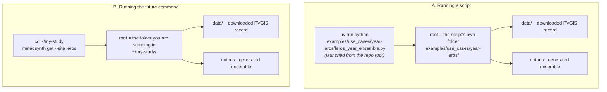

# FEAT-21 — Where downloaded and generated files go

Status: **implemented 2026-08-03** · Author: N. Papadakis · Date: 2026-08-03

> **Archive note — landed 2026-08-03, 447 tests green (was 439).** Implemented as
> designed, with three deviations worth recording:
>
> 1. **The module is `meteosynth/paths.py`, not `meteosynth/workspace.py`.** A
>    `workspace.py` exporting a `workspace()` that the package re-exports leaves
>    `meteosynth.workspace` bound to the *function*, and `import meteosynth.workspace as m`
>    then binds `getattr(meteosynth, "workspace")` — silently handing back the callable and
>    making the module unreachable. Two names, no shadow: `meteosynth.paths` is the module,
>    `meteosynth.workspace` the function, `meteosynth.Workspace` the class. Tests are
>    `tests/test_paths.py` for the same reason.
> 2. **The ID is `FEAT-21`, not the `FEAT-18` this document was drafted under.** `18` was
>    already spent by `FIX-18`, and the counter's rule is that a number is never reused.
>    Re-allocated from the Next ID line, which is now 22.
> 3. **`Workspace.describe()` was added** and is not in the sketch: the example scripts all
>    announced their store before doing anything slow, and having each phrase it itself was
>    how the old three-way disagreement stayed invisible.
>
> §11's open question is deliberately **not** answered here. It lives on as the first
> section of `FEAT-14` in `TODOs.md`, to be settled when the CLI is written; nothing in
> this work depends on which spelling wins.

## Overview

Today, running a script writes its downloaded data next to **wherever you happened to be
standing in the terminal**, not next to the script. Run the Leros script from the repo
root and the training data lands in `<repo>/data/`, several folders away from the script
that asked for it.

This document changes that to one rule with two halves:

- **A script's files belong beside the script.** `uv run python
  examples/use_cases/year-leros/leros_year_ensemble.py` puts everything in
  `examples/use_cases/year-leros/`, no matter which folder you launched it from.
- **A command's files belong where you ran the command.** The future
  `meteosynth get` / `meteosynth generate` (see `FEAT-14`) puts everything in the folder
  you are standing in, because that is the only place a command *can* mean.

In both halves the layout is identical — a `data/` folder for what was downloaded, an
`output/` folder for what was generated, both ignored by git — so a reader who learns one
already knows the other.



The mechanism is a small helper, `meteosynth.workspace`, that answers one question —
*"which folder is the root for this run?"* — and is the only place either answer is
written down.

---

## Words used in this document

These are used precisely below, so they are pinned down first.

| term | what it means here |
| :--- | :--- |
| **working directory** (also *cwd*, "current working directory") | The folder your terminal is standing in when you press Enter. `uv run python examples/.../script.py` from the repo root has the repo root as its working directory — the script's location does not change it. This is the thing that causes today's surprise. |
| **script folder** | The folder the `.py` file itself lives in. Python exposes it to the running file as `__file__`. |
| **workspace root** | *New in this document.* The one folder a run treats as "here" — the script folder for a script, the working directory for a command. `data/` and `output/` hang off it. |
| **store** | The existing name (`meteosynth/store.py`) for the `data/` folder and the rules for finding records inside it. It is not a cache: delete a record and you lose the exact input a published result was built on. |
| **record** | One downloaded dataset saved as a `.parquet` file, carrying inside itself what it is (site, years, provider). Downloaded once, re-read many times. |
| **absolute / relative path** | Absolute names a location from the top of the filesystem (`D:\studies\leros\data`). Relative does not (`data`, `inputs/2023`) and only means something once you say *relative to what*. |
| **anchor** | The thing you hand the helper so it can work out the workspace root: a script hands it `__file__`; a command hands it nothing. |

---

## 1. The problem, concretely

`store.default_data_dir()` is defined as the working directory plus `data`
(`src/meteosynth/store.py:213`):

```python
def default_data_dir() -> pathlib.Path:
    return pathlib.Path.cwd() / DATA_DIR_NAME
```

`leros_year_ensemble.py` calls `fetch_pvgis(...)` with no folder argument, so it gets that
default. Launched from the repo root, the training record lands in `<repo>/data/` while the
script sits in `examples/use_cases/year-leros/`. Nothing is broken, but the file is
nowhere near the thing that wanted it, and running the same script from a different
terminal folder silently starts a second, empty store and re-downloads.

There is a second, quieter problem: **the repository currently demonstrates two different
conventions.**

| script family | where its data goes today | how |
| :--- | :--- | :--- |
| `use_cases/year-leros/` | `<working directory>/data/` | the default store |
| `concepts/`, `use_cases/day/`, `month/`, `year/` | always `examples/data/` | `examples/tools/site_data.py:28-30` hard-codes it |
| `diagnostics-overshoot/` | always `examples/data/` | `config.py:43` names the exact file |

A reader cannot learn the rule from the examples, because the examples do not agree on
one.

---

## 2. The rule

**One workspace root per run. `data/` and `output/` hang off it. Both git-ignored.**

```
<workspace root>/
    the script, or nothing at all if you are using the command
    data/      what was downloaded — training records, fetched inputs
    output/    what was generated — ensembles, csv, figures
```

How the root is chosen:

| you run | workspace root | so files land in |
| :--- | :--- | :--- |
| `uv run python examples/use_cases/year-leros/leros_year_ensemble.py`, from anywhere | the script's folder | `examples/use_cases/year-leros/data/` and `.../output/` |
| `meteosynth get --site leros`, standing in `~/my-study` | `~/my-study` | `~/my-study/data/` and `~/my-study/output/` |
| a notebook or REPL cell, where there is no script file | the working directory | `./data/` and `./output/` |

And when a path is given explicitly, it wins — with one rule for reading it:

> **An explicitly given relative path is relative to the working directory, never to the
> workspace root.**

So `meteosynth get --data-dir inputs` from `~/my-study` writes to `~/my-study/inputs`,
and `fetch_pvgis(..., data_dir="inputs")` in a script launched from the repo root writes
to `<repo>/inputs` — *not* beside the script. This is deliberate: a path you typed is
read the way your shell would read it, because that is the only reading that will not
surprise you. The workspace root applies **only when you say nothing**.

Precedence, highest first:

1. `cache=<file>` — an exact file, as today. Nothing else consulted.
2. `data_dir=<path>` / `--data-dir` — absolute is used as-is; relative is joined to the
   **working directory**.
3. Nothing given — the **workspace root**'s `data/`.

The example scripts stay at rule 3. They will not grow `argparse` options for output
locations; if you want the files elsewhere, copy the script elsewhere.

---

## 3. The mechanism: `meteosynth.workspace`

### Why a helper at all, in plain terms

The rule above has two halves that must never drift apart: the script half and the command
half. There are two ways to guarantee that.

The first is to write the rule out in every script — `_HERE = Path(__file__).parent`,
then pass `data_dir=_HERE / "data"` at each call. That needs no new code in the package.
It also means the rule exists in nine copies, one per script, and the future CLI will
write a tenth copy from scratch. When one copy is edited the others do not follow, and
nothing anywhere fails to tell you. The repository is already in exactly this state — the
three-way disagreement in §1 is what a copied convention looks like after a few months.

The second is to write the rule once, in the package, and have everything ask it. That is
a **helper**: a very small piece of code whose whole job is to answer one question so that
nobody else has to know the answer. Here the question is *"which folder is the root of
this run?"*, and the answer is four lines long. The gain is not that four lines are hard —
it is that there is then exactly one place where "beside the script" and "where you are
standing" are decided, one place a test can check them, and one place the CLI inherits
them from instead of reinventing them.

This is the same reasoning that already produced `store.py`: the question *"which stored
file answers this request?"* was answered once, centrally, rather than in each script.

### Shape

New module `src/meteosynth/workspace.py`:

```python
@dataclass(frozen=True)
class Workspace:
    """The one folder a run treats as 'here', and the two folders hanging off it."""
    root: pathlib.Path

    @property
    def data_dir(self) -> pathlib.Path:      # <root>/data
    @property
    def output_dir(self) -> pathlib.Path:    # <root>/output

    def data(self, name: str) -> pathlib.Path:
        """<root>/data/<name>, creating the folder."""
    def output(self, name: str) -> pathlib.Path:
        """<root>/output/<name>, creating the folder."""


def workspace(anchor=None) -> Workspace:
    """
    anchor=None            -> root is the working directory   (the command case)
    anchor=__file__        -> root is that file's folder       (the script case)
    anchor=<a folder>      -> root is that folder; a relative one is read from the
                              working directory
    """
```

Folders are created when something is actually written, not on import — importing
`workspace` must stay free of side effects, exactly as `store` and `site_data` are today.

### How a script uses it

One line at the top, then two ordinary attributes:

```python
from meteosynth import workspace

WS = workspace(globals().get("__file__"))     # script folder, or cwd in a notebook cell

dataset = fetch_pvgis(LATITUDE, LONGITUDE, site=SITE, data_dir=WS.data_dir)
ensemble_path = WS.output(f"ensemble_{SITE}_{REFERENCE_YEAR}_n{N_REALISATIONS}.parquet")
```

`globals().get("__file__")` rather than plain `__file__` because these scripts are written
as `#%%` cells and are meant to run in VS Code and JupyterLab too, where there is no file.
There it returns `None`, the root falls back to the working directory, and the behaviour
matches the command — which is the honest answer when there is no script to be beside.
The scripts already carry a clumsier version of this same guard (`if "__file__" in
globals() else pathlib.Path.cwd()`, in seven files); this replaces it.

### How the future CLI uses it

```python
ws = workspace()                                    # the folder the user is standing in
data_dir = pathlib.Path(args.data_dir) if args.data_dir else ws.data_dir
```

`--data-dir` is passed straight to `pathlib.Path`, which is what makes a relative one
resolve against the working directory without any extra code. That is rule 2 of §2, and
it costs one line.

### What does not change

`store.default_data_dir()` keeps its meaning — working directory plus `data` — and keeps
its name, its `__init__` export and its docstring's promise that **no environment variable
and no global setting can redirect it**. It is simply re-expressed as `workspace().data_dir`
so there is one definition rather than two. Every existing call, every test in
`tests/test_store.py:103-132`, and the `data_dir=` argument on `fetch_pvgis` behave
exactly as they do now.

---

## 4. Every script gets its own `data/`

Strict reading of the rule: each script folder holds its own store. Six folders end up
holding a record, and the Heraklion 2010-2020 record appears in three of them.

| folder | record it needs |
| :--- | :--- |
| `examples/concepts/` | Paris 2011-2012 |
| `examples/use_cases/day/` | Heraklion 2010-2020 |
| `examples/use_cases/month/` | Heraklion 2010-2020 |
| `examples/use_cases/year/` | Heraklion 2010-2020 |
| `examples/use_cases/year-leros/` | Leros 2005-2023 |
| `examples/diagnostics-overshoot/` | Heraklion 2005-2023 |

**The duplication is the point, and it is cheap.** Measured on the records now on disk:
531 KB × 3 for Heraklion 2010-2020, 2.7 MB across all six folders. What it buys is that
every example folder is self-contained — copy one anywhere and it runs — which is exactly
what the rule promises. The cost that is *not* free is the download itself: a fresh clone
that runs all six pays six PVGIS requests instead of three. That is a one-off on a cold
clone, and the migration in §8 means it is not paid on this machine at all.

**`full_range=False` stays.** The use-case scripts ask for 2010-2020 with
`full_range=False` (`site_data.py:129`), so a cold clone downloads eleven years rather
than nineteen. Left at the default `True`, each of those three folders would fetch the
full 2005-2023 range. Keeping it as-is preserves both the current download size and the
match with the record being migrated in.

---

## 5. The examples stop naming cache files

One record per folder removes the reason the examples name their files, so they stop
naming them. This is specified here, not left as a nice side effect.

### What is there today, and why

`fetch_pvgis` can be told *which* record to use in two ways. It can be given the exact
file (`cache=<path>`), or given a folder and left to work it out from what the records say
about themselves (`data_dir=<folder>`) — the second is what `store.py` calls **discovery**,
and it is the package's normal path.

The examples use the first, and `site_data.py:104-109` states the reason plainly:
`examples/data/` holds two overlapping Heraklion records, 2005-2023 for the diagnostics
and 2010-2020 for the use cases. Both answer a request for 2010-2020 — the store's rule is
containment, not equality (`store.py:112`) — so discovery would find two candidates and
raise `AmbiguousRecordError` rather than pick one. Naming the file was the way around a
collision caused entirely by putting two records in one folder.

§4 puts one record in each folder. **The collision cannot occur, so the workaround goes.**

### What changes

| | before | after |
| :--- | :--- | :--- |
| `use_cases/day`, `month`, `year` | `cache=site.cache_path(...)` | `data_dir=WS.data_dir` |
| `concepts/*` | `cache=site.cache_path(...)` | `data_dir=WS.data_dir` |
| `use_cases/year-leros/*` | already discovery-based | unchanged in kind, `data_dir=WS.data_dir` added |

Removed outright: `Site.cache_path()` (`site_data.py:42-50`), the `cache=cache` argument
in `load_site` (line 128), and the two-paragraph docstring note at lines 104-109 that
exists only to explain the workaround. `load_site` keeps `site`, `start_year`, `end_year`,
`refresh` and gains the caller's `Workspace`.

The point is not that three lines go away. It is that **the examples start demonstrating
the package's normal path.** A reader copying an example currently copies a filename
constructed by hand — the one thing `FEAT-13` put provenance inside the file to make
unnecessary — and carries the workaround into code that never had the collision.

### The one exception: `diagnostics-overshoot/` keeps `cache=`

Its record is not interchangeable with an equivalent one, and discovery cannot see the
difference.

`step1_fetch.py:78-88` fetches with `components=False`, which asks PVGIS for **its own**
`poa_global` rather than the three plane-of-array components that a default fetch collects
and sums. The comment above that call (lines 72-77) says why: the shipped record was
collected that way, the summed alternative differs by up to 0.01 W/m², and *"a measuring
instrument should not quietly change what it measures."*

Discovery would not honour that. `StoredRecord.holds` (`store.py:177-185`) deliberately
treats a record carrying all three components as able to answer a `poa_global` request,
because for PVGIS the reconstruction is exact to the provider's own rounding. That rule is
right for the package and wrong here: it means a components record dropped into that folder
would be selected silently, and the instrument's numbers would shift underneath the
findings that cite them.

So `diagnostics-overshoot/` names its file, and the reason is written at the call as *this*
rather than as the ambiguity workaround it replaces. `run_all.py:43` globs the same folder
to report whether the cache is warm; it follows `RECORD_CACHE.parent` and keeps working.

**The general rule this exception draws out:** name a file when the *way a record was
collected* is load-bearing; use discovery when only its site and period are. Every other
example is the second case.

---

## 6. Changes, file by file

### New

| file | what |
| :--- | :--- |
| `src/meteosynth/workspace.py` | `Workspace`, `workspace()`. Numpydoc, same register as `store.py`. |
| `tests/test_workspace.py` | See §9. |
| `examples/*/​.gitignore` (six) | One per script folder holding a store — see §7. |

### Modified

| file | change |
| :--- | :--- |
| `src/meteosynth/__init__.py` | Export `Workspace`, `workspace`. `default_data_dir` stays exported and unchanged. |
| `src/meteosynth/store.py` | `default_data_dir()` re-expressed as `workspace().data_dir`; docstring gains a pointer to the script case instead of the hand-rolled `Path(__file__).parent / "data"` recipe it currently suggests at line 211. Behaviour identical. |
| `src/meteosynth/adapters.py` | Docstring only: `data_dir=` states that a relative path is read from the working directory. No logic change — `pathlib.Path(data_dir)` already does this. |
| `examples/tools/site_data.py` | Loses `DATA_DIR` / `OUTPUT_DIR` / `output_path` (module-level constants pointing at `examples/`) **and `Site.cache_path` plus `load_site`'s `cache=` argument — §5**. Keeps the `Site` definitions, year ranges, `load_site`, `save_frame`, `save_figure` — each now taking the caller's `Workspace`. Also fixes an existing latent bug: `pd.DataFrame` is annotated at line 152 but `pandas` is never imported (harmless only because `from __future__ import annotations` defers it). |
| `examples/use_cases/year-leros/leros_year_ensemble.py` | Uses `WS.data_dir` and `WS.output(...)`; the module docstring's "Everything lands in the default data store, `./data/` under the directory you run from" is rewritten to the new rule. |
| `examples/use_cases/year-leros/leros_timing_benchmark.py` | Same; `BENCHMARK_DIR` (lines 158-163) becomes `WS.root / "benchmarks"` — same folder, stated once. |
| `examples/concepts/*.py`, `use_cases/day/*.py`, `month/*.py`, `year/*.py` | Replace the seven-line `_HERE` / `_EXAMPLES` / `sys.path` preamble's path half with `WS = workspace(globals().get("__file__"))`. The `sys.path` half stays — it exists so `tools/` is importable from a hyphenated folder, which is a separate concern. |
| `examples/diagnostics-overshoot/config.py` | `RECORD_CACHE` stops pointing at `examples/data/` and becomes this folder's own `data/`. It **keeps naming the file** — §5 — and the reason moves onto it: the record is collected with `components=False` and discovery cannot see that. `RESULTS_DIR` and `FIGURES_DIR` **stay as they are** — see the exception below. |
| `.gitignore` | See §7. |
| `examples/README.md`, `docs/source/examples.md`, `docs/source/quickstart.md`, `docs/source/workflow.md`, `README.md`, `TODOs.md` (`FEAT-14`), `CHANGELOG.md` | Every place that says files land in `examples/data/`, `examples/output/` or "`./data/` under the working directory". |

**The one exception: `diagnostics-overshoot/results/` and `figures/` keep their names.**
Everywhere else, generated files go to `output/`. Here they do not, because
`results/summary_*.csv` are **tracked** — they are the evidence `FIX-1` cites — and §7
ignores `output/` wholesale. Moving them under `output/` would either delete committed
evidence or force a re-include rule that exists only to undo the rule above it. The folder
gets its `data/` like every other, and its own two output folders keep the names they are
cited under.

### Removed

| file | why |
| :--- | :--- |
| `examples/tools/migrate_cache.py` | Converts the legacy CSV caches to parquet. Its inputs (`examples/data/*.csv`) are deleted in §8, and it imports `DATA_DIR` from `site_data`, which no longer exists. Dead on both counts. |
| `examples/tools/fetch_site_data.py` | Primes the one shared `examples/data/` store. With one store per script folder there is nothing shared to prime — each script fetches into its own on first run. |
| `examples/output/.gitignore` | The folder it guards is removed. |

---

## 7. Git ignore rules

Root `.gitignore` today ends its data section with `data/`, which — having no leading
slash — already matches a `data/` folder at any depth. So the six new stores are ignored
the moment they exist, with no change. One line is added beside it:

```gitignore
# Data and OS files
...
data/
output/
```

`output/` likewise matches at any depth, which covers every new `output/` folder and
replaces `examples/output/.gitignore`.

Each of the six script folders gains a `.gitignore` that is **not** about ignoring — the
root already does that — but about the folder existing in a fresh clone, and about telling
a reader what will appear there. It follows the wording already used in
`examples/use_cases/year-leros/benchmarks/.gitignore`:

```gitignore
# The training record this example downloads lands in data/, and everything it generates
# lands in output/. Both are re-creatable by re-running the script, so neither is
# committed. This file exists so a fresh clone shows where they will appear.
data/
output/
```

`examples/diagnostics-overshoot/.gitignore` keeps its existing `!results/summary_*.csv`
re-include, which is what stops the root's blanket `*.csv` from swallowing the tracked
evidence.

---

## 8. What is on disk now, and what happens to it

The report requested. **Nothing here is committed except where marked "tracked"** — the
root `.gitignore` already excludes `data/`, `*.csv` and `*.parquet` paths, so most of this
is untracked working-copy clutter that a `git status` never showed.

### Migrated — moved, not re-downloaded (4 files, 6 destinations, 2.7 MB)

| record | from | to |
| :--- | :--- | :--- |
| `pvgis_hourly_leros_2005_2023.parquet` (883 KB) | `data/` | `examples/use_cases/year-leros/data/` |
| `pvgis_hourly_heraklion_2005_2023.parquet` (603 KB) | `examples/data/` | `examples/diagnostics-overshoot/data/` |
| `pvgis_hourly_heraklion_2010_2020.parquet` (531 KB) | `examples/data/` | `examples/use_cases/day/data/`, `.../month/data/`, `.../year/data/` — copied, three times |
| `pvgis_hourly_paris_2011_2012.parquet` (121 KB) | `examples/data/` | `examples/concepts/data/` |

This is what makes the change free on this machine: six PVGIS downloads are avoided.

### Deleted — generated, re-creatable by re-running (24 files, ~24 MB)

| path | size | what it is |
| :--- | ---: | :--- |
| `data/bench_leros_2023_n1000_d5.parquet` | 2.9 MB | benchmark byproduct; `KEEP_PARQUET = False` says these are throwaway |
| `data/bench_leros_2023_n100_d5.parquet` | 288 KB | as above |
| `data/bench_leros_2023_n10_d5.parquet` | 37 KB | as above |
| `data/ensemble_leros_2023_n100.parquet` | 60 KB | generated ensemble |
| `data/ensemble_leros_2023_n10.parquet` | 16 KB | generated ensemble |
| `data/` (the repo-root folder itself) | — | empty after the above; the layout no longer has one |
| `examples/data/pvgis_hourly_heraklion_2005_2023.csv` | 4.9 MB | superseded by the parquet beside it (Jul 28 vs Aug 1) |
| `examples/data/pvgis_hourly_heraklion_2010_2020.csv` | 4.3 MB | as above |
| `examples/data/pvgis_hourly_paris_2011_2012.csv` | 775 KB | as above |
| `examples/data/` (the folder itself) | — | empty once the parquets move out |
| `examples/output/` — 11 files | 1.8 MB | 5 CSV + 6 PNG from the day and month use cases |
| `examples/output/.gitignore` | — | **tracked** — `git rm` |
| `examples/output/` (the folder itself) | — | replaced by per-script `output/` |
| `examples/diagnostics-overshoot/results/raw/` — 6 files | 9.5 MB | per-realisation dumps; `README.md:119` already calls them regenerable |
| `examples/diagnostics-overshoot/figures/` — 3 PNG | 412 KB | regenerate from `step4_figures.py` in seconds |
| `examples/tools/migrate_cache.py` | — | **tracked** — `git rm`; see §6 |
| `examples/tools/fetch_site_data.py` | — | **tracked** — `git rm`; see §6 |

Optional, unrelated to this change but swept at the same time: nine `__pycache__/`
folders under `examples/` and `src/`.

### Kept

| path | why |
| :--- | :--- |
| `examples/diagnostics-overshoot/results/summary_*.csv` (4 files) | **Tracked.** The evidence `FIX-1` cites. |
| `examples/diagnostics-overshoot/FINDINGS-2026-07-28.md`, `PLAN.md`, `README.md` | **Tracked.** Prose. |
| `examples/use_cases/year-leros/benchmarks/*.json` (2 files, 21 KB) | Two timing runs from 2026-08-03. Machine-specific and expensive to re-measure; the folder's own `.gitignore` keeps them out of the repo while keeping them on disk. |

### Net

| | |
| ---: | :--- |
| moved | 4 records → 6 locations, 2.7 MB |
| deleted | ~24 MB, 3 of them tracked files |
| downloads avoided | 6 |

---

## 9. Tests

New `tests/test_workspace.py` — each one a sentence about the rule:

1. `workspace()` roots at the working directory, and follows a `monkeypatch.chdir`.
2. `workspace(__file__)` roots at that file's folder and **does not** follow a `chdir` —
   the regression this whole document exists to prevent.
3. `workspace(None)` is `workspace()`, which is the notebook fallback.
4. `workspace("inputs")` with a relative folder roots at cwd + `inputs`.
5. `data_dir` is `<root>/data` and `output_dir` is `<root>/output`.
6. Importing the module and constructing a `Workspace` creates no folders; `.data(name)`
   and `.output(name)` do.

Extended:

7. `tests/test_adapters.py` — `fetch_pvgis(..., data_dir="inputs")` (a **relative** path,
   which nothing covers today) writes to cwd + `inputs`, and still does after a `chdir`
   to a different folder. Pins rule 2 of §2.
8. `tests/test_store.py:103` — asserts `default_data_dir() == workspace().data_dir`, so
   the two definitions cannot drift.

For §5, one test that would have caught the thing the exception protects:

9. `tests/test_store.py` — a folder holding **one** record answers a request by discovery
   with no filename given (the state §4 puts every example folder in), and a folder
   holding a *components* record still answers a `poa_global` request. The second is
   existing behaviour (`store.py:185`) and is asserted here so that the reason
   `diagnostics-overshoot` names its file is pinned by a test rather than only by a
   comment.

`tests/conftest.py:38` already isolates the default store per test via `chdir` to
`tmp_path`; that fixture keeps working unchanged, which is itself a check that
`default_data_dir` still means what it meant.

The example scripts are not run by the suite — a full use case takes hours. They are
checked by import and by a static sweep for the strings this change is meant to remove
(`EXAMPLES_ROOT`, `examples/data`, `examples/output`).

---

## 10. Non-goals

- **No environment variable, no config file, no global setting.** `store.py:196-204`
  argues this at length and the argument is unchanged: ambient configuration would mean a
  script reads a different store depending on which shell launched it. `workspace()`
  reads the working directory and `__file__` and nothing else.
- **No walking the call stack to find the caller's file.** The helper is told its anchor;
  it does not go looking. Stack inspection breaks in a REPL, in a notebook and in anything
  frozen, and `store.py:206-209` already rejects it.
- **No `data/` discovery upwards.** The workspace root is the script folder exactly, not
  "the nearest ancestor containing a `data/`". An upward search would make where a file
  lands depend on what happens to exist above it.
- **The CLI itself is still `FEAT-14`.** This document fixes the contract its subcommands
  will inherit and adds the helper they will call. It adds no entry point, no argument
  parsing, no `[project.scripts]` line.

## 11. Open point, handed to `FEAT-14`

`FEAT-14` and this document spell the command `meteosynth`; the request that prompted this
work spelled it `meteogen`. Nothing here depends on which wins — the workspace rule is the
same either way — but the two must agree before `FEAT-14` writes a `[project.scripts]`
line, since an entry-point name cannot be changed later without breaking invocations
already written down.

**This is not tracked as an item of its own.** It briefly was, and that was the wrong
shape: a name has nothing to decide it *against* until the thing being named exists, so a
standalone entry would only have collected re-arguments. It is now the opening section of
`FEAT-14` in [`TODOs.md`](../../../TODOs.md), which is where someone will be standing when
the answer first matters.
