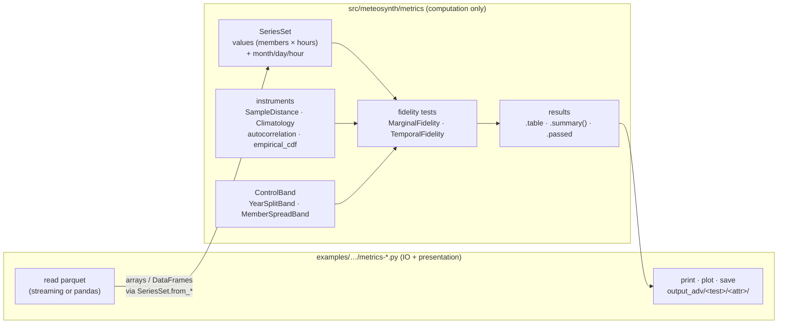

# FEAT-23 — `meteosynth.metrics`: fidelity metrics as a package, computation only

Status: **implemented 2026-09-25** - Date: 2026-09-25

> **Archive note — landed 2026-09-25, 501 tests green (was 471).** Implemented as
> designed; the port was checked against the pre-port outputs on the real Heraklion data
> (see [Verification](#verification)). Deviations and additions worth recording:
>
> 1. **`from_reference_frame` has no `complete_years_only` flag.** A `SeriesSet` cannot
>    hold NaN, so an incomplete year can only be dropped; the flag had no second value.
>    Dropped years are listed in `SeriesSet.dropped`.
> 2. **The constant test uses the standard deviation**, as `Kind.CONSTANT` does, and a
>    cell is degenerate only when both sides are constant *and equal* — two different
>    constants are scored as a failure. `DEGENERACY_RTOL` now lives in `constants.py`.
> 3. **The climatology slots beside the empty Feb 29 slot** (Feb 28, Mar 1) pool one slot
>    fewer on one side. Measured: 0.046 off a steep synthetic seasonal slope at ±1 day;
>    on Heraklion at ±15 days it moves the synthetic anomaly ACF by at most 1.3e-4.
> 4. **The marginal test reproduces the old random sequence exactly** — splits first, then
>    one synthetic subsample per cell and split, synthetic values in day-major order — so
>    the ported tables are identical to the pre-port ones, not merely close.
> 5. **Public additions not in the plan:** `no_leap_calendar()`, `SeriesSet.cell_mask()`,
>    `degeneracy_tolerance()`, `is_degenerate()`, `MarginalResult.scored`.
> 6. **The integral decorrelation time runs low** on a known AR(1) (8.07 h against 9 at
>    φ = 0.8): biased sample ACF lags, truncated at the first noisy zero crossing. The test
>    allows 15 %; the bias is the estimator's, identical before and after the port.

## Overview

The metric scripts in `examples/use_cases/year-metrics/` move their **arithmetic** into a
new subpackage, `src/meteosynth/metrics/`. The scripts keep everything else: reading
files, printing reports, drawing figures, saving outputs.

The boundary is one object. Both sides of a comparison — the reference years and the
synthetic realisations — are handed to the package as a **`SeriesSet`**: a 2-D numeric
array, one row per member (a year, or a realisation), plus the calendar those rows share.
Every metric takes two of them and returns a result object of tables and arrays.



**Three rules hold everywhere in `metrics/`:**

1. No function accepts a path, opens a file, or imports matplotlib.
2. No function reads metadata it was not given. Anything a metric needs (the calendar) is
   inside the `SeriesSet`; anything else (window length, seed, site) is a label the script
   owns.
3. The comparison side is called **`reference`**, the generated side **`synthetic`**.

Plotting stays in the scripts for now. If the same figure code ends up copied across
several scripts, a `metrics/plots.py` can be added later without changing anything here.

### Relation to earlier plans

[`paper/metrics-plan-followup.md`](../../../paper/metrics-plan-followup.md) Part 1 proposed
the same metrics as `src/meteosynth/utilities/`, never implemented. This document
**replaces its Part 1 layout and signatures** (marked superseded there) and keeps its substance:

| Kept from the follow-up                                                           | Changed here                                                                                                                                   |
| :-------------------------------------------------------------------------------- | :--------------------------------------------------------------------------------------------------------------------------------------------- |
| `(n_replicates, T)` as the one matrix shape every metric sees                     | that shape is now an object (`SeriesSet`) carrying its calendar, not a bare array                                                              |
| degenerate (night) cells flagged and excluded from pooled scores                  | detected with the same tolerance as `Kind.CONSTANT`, one definition                                                                            |
| year-split control band, size-matched test, full-power estimate, 90 % rule        | the band is a pluggable `ControlBand`, so Test 1's χ² band slots in beside it                                                                  |
| closed-form + fault-injection tests                                               | unchanged                                                                                                                                      |
| `reference_pool` / `reference_span` naming                                        | generalised: `reference` is the argument name throughout                                                                                       |
| convenience wrappers taking `MetDataset` + `Ensemble` and reading `Ensemble.meta` | **dropped.** Computation never reads package containers or file metadata; the `SeriesSet.from_*` helpers do the conversion, called by the user |

The `Fold` / product-scale guards (refusing an ❌ cell) are compatible with this design
and deferred: `SeriesSet` exposes `n_members` and `hours_per_member`, which is everything
a guard needs.

---

## 1. The data object: `SeriesSet`

A set of equal-length series on one shared calendar. One attribute.

```python
@dataclass(frozen=True)
class SeriesSet:
    values: np.ndarray    # (n_members, n_hours) float
    month: np.ndarray     # (n_hours,) int  -- shared by every member
    day: np.ndarray       # (n_hours,) int
    hour: np.ndarray      # (n_hours,) int, 0..23, whole days in order
    members: np.ndarray   # (n_members,) labels: years, or realisation indices
    attr: str             # used in messages and summaries only

    n_members: int        # properties
    hours_per_member: int
    slots: np.ndarray     # day_slots(month, day), from meteosynth.day_window
    def cell(self, month: int, hour: int) -> np.ndarray: ...   # (n_members, days_in_month)
```

**Validated on construction:** shapes agree; `n_hours` is a multiple of 24; hours run
0..23 within each day; no NaN; calendar arrays have one entry per column.

**Feb 29 is absent on both sides, for every test** — decided 2026-09-25. The ensembles are
generated with `include_feb29=False`, so dropping it from the reference makes every member
exactly 8 760 hours and the array rectangular. The Leros temporal script kept Feb 29 for
contiguity. **Measured on Heraklion** (both ensembles, all three variables): dropping it
moves the reference τ by at most 0.08 h (`temp_air` 105.44 → 105.36 h) and flips 2 of
1 446 per-lag inside-band flags, both on the band edge. See Verification.

### Helpers — the user calls these, the metrics never do

| Helper                                     | Input                                                        | Notes                                                                                                                     |
| :----------------------------------------- | :----------------------------------------------------------- | :------------------------------------------------------------------------------------------------------------------------ |
| `SeriesSet.from_reference_frame(df, attr)` | long frame: `year, month, day, hour, attr`                   | one member per year; drops Feb 29; drops years with missing hours and lists them in `.dropped` so the script can print it |
| `SeriesSet.from_ensemble_frame(df, attr)`  | long frame: `realisation, day_index, month, day, hour, attr` | one member per realisation                                                                                                |
| `SeriesSet.from_ensemble(ensemble, attr)`  | an in-memory `Ensemble`                                      | thin wrapper over the above                                                                                               |

The memory-efficient day-by-day parquet reader stays in the example scripts, because it
reads files. It builds the `(N, 8760)` array directly and calls the constructor.

---

## 2. Layout

```
src/meteosynth/metrics/
├── __init__.py         public surface (re-exports below)
├── _base.py            FidelityTest / FidelityResult protocols
├── series.py           SeriesSet + from_* helpers
├── climatology.py      Climatology: (366, 24) mean, circular smoothing; .anomalies()
├── distances.py        SampleDistance protocol; Wasserstein1, KolmogorovSmirnovStatistic
├── control.py          ControlBand protocol; YearSplitBand, MemberSpreadBand
├── degeneracy.py       constant_cells(): night-hour mask
├── distribution.py     empirical_cdf(), quantile_traces()
├── autocorrelation.py  autocorrelation(), decorrelation_time()
├── marginal.py         MarginalFidelity → MarginalResult     (paper Test 3)
└── temporal.py         TemporalFidelity → TemporalResult     (paper Test 2, ACF)
```

Future tests from [`paper/metrics-prompt.md`](../../../paper/metrics-prompt.md) are new
files in the same pattern — a frozen settings dataclass, `.evaluate(reference, synthetic)`,
a result dataclass — and change nothing existing:

| Future module   | Test                                           | Adds                                                       |
| :-------------- | :--------------------------------------------- | :--------------------------------------------------------- |
| `dispersion.py` | Test 1: annual dispersion, variance cascade    | `ChiSquareBand` in `control.py`; detrending for `temp_air` |
| `seam.py`       | Test 2: midnight seam                          | skips degenerate variables                                 |
| `spells.py`     | Test 2: calm / overcast / hot-cold run lengths |                                                            |
| `ceiling.py`    | irradiance clear-sky ceiling                   |                                                            |

---

## 3. Interfaces

### Instruments

```python
# distances.py — the extension point for other distance criteria
class SampleDistance(Protocol):
    name: str                 # column name in result tables: "w1", "ks_d"
    in_physical_units: bool   # True for W1 (m/s, °C, W/m²); False for KS
    def __call__(self, a: np.ndarray, b: np.ndarray) -> float: ...

class Wasserstein1: ...                   # scipy.stats.wasserstein_distance
class KolmogorovSmirnovStatistic: ...     # the D statistic only; no p-value, by design

# control.py — "how far apart are two REAL samples?"
class ControlBand(Protocol): percentiles: tuple[float, float]
@dataclass(frozen=True)
class YearSplitBand:      n_splits: int = 100; percentiles=(5, 95); seed: int = 11
@dataclass(frozen=True)
class MemberSpreadBand:   percentiles=(5, 95)       # spread of per-member curves

# climatology.py
@dataclass(frozen=True)
class Climatology:
    means: np.ndarray     # (366, 24)
    half_width: int
    @classmethod
    def from_series(cls, reference: SeriesSet, half_width: int = 15) -> "Climatology": ...
    def anomalies(self, series: SeriesSet) -> np.ndarray: ...   # same shape as series.values

# autocorrelation.py
def autocorrelation(matrix: np.ndarray, max_lag: int, batch: int = 100) -> np.ndarray: ...
def decorrelation_time(acf: np.ndarray) -> float: ...           # hours, to first zero crossing

# distribution.py
def empirical_cdf(values, n_points: int | None = 1001) -> tuple[np.ndarray, np.ndarray]: ...
def quantile_traces(series: SeriesSet, month: int, probs=(...)) -> pd.DataFrame: ...

# degeneracy.py
def constant_cells(reference: SeriesSet, synthetic: SeriesSet) -> np.ndarray: ...  # (12, 24) bool
```

`constant_cells` uses the tolerance behind `Kind.CONSTANT`. `_DEGENERACY_RTOL` moves from
`markov_chain_simulator_kde2d.py` to `constants.py` so both import one definition.

### Fidelity tests

```python
@dataclass(frozen=True)
class MarginalFidelity:
    distance: SampleDistance = Wasserstein1()
    control: YearSplitBand = YearSplitBand()
    pass_share: float = 0.90                       # pre-registered
    extra_distances: tuple[SampleDistance, ...] = (KolmogorovSmirnovStatistic(),)
    def evaluate(self, reference: SeriesSet, synthetic: SeriesSet) -> MarginalResult: ...

@dataclass(frozen=True)
class MarginalResult:
    table: pd.DataFrame   # per (month, hour): distance, distance/sd, bias/sd, sd ratio,
                          # size-matched distance, band lo/hi, degenerate, passes, extras
    pass_share: float     # over non-degenerate cells only
    passed: bool
    def grid(self, column: str) -> np.ndarray: ...   # (12, 24), ready for a heatmap
    def summary(self) -> dict: ...                   # one row of *_summary.csv

@dataclass(frozen=True)
class TemporalFidelity:
    max_lag: int = 240
    control: MemberSpreadBand = MemberSpreadBand()
    batch: int = 100
    def evaluate(self, reference: SeriesSet, synthetic: SeriesSet,
                 climatology: Climatology) -> TemporalResult: ...

@dataclass(frozen=True)
class TemporalResult:
    acf_reference_raw: np.ndarray       # (M, max_lag+1) — the band is drawn from these
    acf_reference_anomaly: np.ndarray
    acf_synthetic_raw: np.ndarray       # (N, max_lag+1)
    acf_synthetic_anomaly: np.ndarray
    tau_reference: np.ndarray           # (M,) hours
    tau_synthetic: np.ndarray           # (N,)
    table: pd.DataFrame                 # per lag: means, band, SEM, inside_band
    def summary(self) -> dict: ...
```

**The climatology is an argument, not computed inside `evaluate`.** Comparing the w7 and
w15 ensembles is only fair if both are measured against the same baseline; passing one
`Climatology` built from the reference makes that visible in the calling code.

**Seeds are per test, not global.** A `YearSplitBand(seed=11)` draws the same splits for
every variable and every ensemble, so w7 and w15 are compared on identical splits.

---

## 4. Names: script → package

| In the scripts                                              | In the package                                       |
| :---------------------------------------------------------- | :--------------------------------------------------- |
| `compute_ecdf`                                              | `empirical_cdf`                                      |
| `compute_climatology`                                       | `Climatology.from_series`                            |
| `acf_rows`                                                  | `autocorrelation`                                    |
| `integral_time`                                             | `decorrelation_time`                                 |
| `observed_cells`, `synthetic_cells`                         | `SeriesSet.cell`                                     |
| `score_cells`                                               | `MarginalFidelity.evaluate`                          |
| `observed_acfs`, `synthetic_acfs`, `summarise_acfs`         | `TemporalFidelity.evaluate` → `TemporalResult.table` |
| `load_weather_data`, `read_ensemble_meta`, streaming reader | stay in scripts (IO)                                 |
| `print_report`, `plot_*`                                    | stay in scripts (presentation)                       |

### Where `reference` applies across the repo

`training` stays where it means *what the model was fitted on* — `generators.py`,
`dataset.py`, `Ensemble.meta` ("trained on"). Every use of *training* in `src/` is of
that kind (checked 2026-09-25) and none is a comparison-side name, so **nothing in the existing `src/` is renamed.**
`reference` replaces `observed` / `obs` / `training` wherever the word names *the side a
synthetic result is compared against*:

| Place                                                | Change                                                                                                                                              |
| :--------------------------------------------------- | :-------------------------------------------------------------------------------------------------------------------------------------------------- |
| `src/meteosynth/metrics/` (new)                      | `reference` in every signature, attribute and result field                                                                                          |
| `examples/use_cases/year-metrics/metrics-*_adv.py`   | variables `ref_*`; **CSV columns `obs_*` → `ref_*`** — breaks any reader of existing CSVs, so change with the port, not before                      |
| `examples/use_cases/year-metrics/metrics-*_basic.py` | variables and legend labels                                                                                                                         |
| `examples/use_cases/year-leros/leros_metric_*.py`    | optional: older, self-contained scripts; rename only if they are ported to the package                                                              |
| `docs/source/metrics/*.md`                           | prose says "real data" (63 uses) and should keep saying it; add one line to `cardinality.md` defining *reference* as the API name for the real side |
| `paper/metrics-plan-followup.md`                     | its `ks_distance(observed, synthetic)`-style cores become `reference`; mark its Part 1 superseded by this document                                  |

---

## 5. What an example script becomes

```python
ref = SeriesSet.from_reference_frame(
    pd.read_parquet(TRAINING_DATA_PARQUET, columns=["year", "month", "day", "hour", attr]), attr)
syn = read_ensemble_streaming(SYNTHETIC_DATA_PARQUET, attr)    # script-local IO → SeriesSet
clim = Climatology.from_series(ref, half_width=15)

temporal = TemporalFidelity().evaluate(ref, syn, clim)
marginal = MarginalFidelity().evaluate(ref, syn)
# print_report(...), plot_temporal(temporal, ...), save to output_adv/<test>/<attr>/
```

The per-variable function, the loop over the three attributes and the output layout stay
as they are.

---

## 6. Tests — `tests/test_metrics_*.py`

No files, no network; fabricated data only. Closed-form where possible:

| Check                                                                | Expected                                                     |
| :------------------------------------------------------------------- | :----------------------------------------------------------- |
| AR(1), φ = 0.8                                                       | ACF ≈ φᵏ; `decorrelation_time` ≈ (1+φ)/(1−φ)                 |
| sample shifted by c                                                  | `Wasserstein1` = c exactly; identical samples give 0         |
| reference vs a resample of itself                                    | `MarginalFidelity` passes                                    |
| synthetic shifted by 1 sd                                            | `MarginalFidelity` fails                                     |
| irradiance-like: 0 at night on both sides                            | those cells `degenerate`, excluded from `pass_share`         |
| same seed twice                                                      | identical tables; independent of variable order              |
| pure seasonal signal                                                 | `Climatology.anomalies` ≈ 0; smoothing wraps across New Year |
| `SeriesSet` with ragged hours, NaN, mismatched calendar              | `ValueError` naming the problem                              |
| `from_reference_frame` on a record with a leap year and a short year | Feb 29 gone; short year in `.dropped`                        |
| fault injection: shuffle hours within days                           | ACF fails, marginal unchanged                                |

---

## 7. Build order

Each step leaves the examples working.

1. ✅ `series.py` + tests.
2. ✅ `autocorrelation.py`, `climatology.py`, `temporal.py` + tests.
3. ✅ Port `metrics-temporal_adv.py`; verified against the pre-port outputs (below).
4. ✅ `distances.py`, `control.py`, `degeneracy.py`, `marginal.py` + tests.
5. ✅ Port `metrics-marginal_adv.py`; verified.
6. ✅ `distribution.py`; port the two `_basic` scripts.
7. ✅ Record-keeping per the follow-up's Part 4: allocate `FEAT-23` in `TODOs.md`,
   `__init__.py` re-exports, `docs/source/api.rst`, `architecture.md` module table,
   `CHANGELOG.md`.

### Verification

- `uv run pytest tests/test_metrics_*.py` — 30 tests, ~13 s.
- **Port equivalence, measured 2026-09-25.** A scratch script (not the example scripts)
  streamed each Heraklion ensemble into a `SeriesSet`, ran the package tests, and diffed
  against the pre-port `output_adv/` tables, for w7 and w15 × three variables:

  |                             | Result                                                                                                                                            |
  | :-------------------------- | :------------------------------------------------------------------------------------------------------------------------------------------------ |
  | Marginal                    | identical: every `passes` and `degenerate` flag, every pass share (e.g. `poa_global` 88.16 % w15, 97.32 % w7); largest numeric difference 1.1e-13 |
  | Temporal, synthetic ACF     | max per-lag difference 1.3e-4 (the climatology's Feb 28 / Mar 1 slots now pool one slot fewer)                                                    |
  | Temporal, reference ACF     | max per-lag difference 2.4e-3 (Feb 29 removed)                                                                                                    |
  | Temporal, τ                 | reference moves ≤ 0.08 h; synthetic ≤ 0.03 h                                                                                                      |
  | Temporal, inside-band flags | 2 of 1 446 differ, both w7, both on the band edge                                                                                                 |

  Runtime per variable: marginal 12–17 s, temporal ~2 s.
- The ported scripts themselves were smoke-tested on fabricated data only; their first
  real run is the user's.

---

## 8. `SeriesSet` and `Ensemble` — duplication, or two things?

### What overlaps

Both hold realisation-indexed synthetic values on one calendar, and
`Ensemble.to_wide(attr)` already returns an `(hours × realisations)` table — the transpose
of `SeriesSet.values` for the synthetic side. That is the duplication, and it is real.

### What does not

|                                | `Ensemble` (`ensemble.py`)                                                                                                                               | `SeriesSet`                                |
| :----------------------------- | :------------------------------------------------------------------------------------------------------------------------------------------------------- | :----------------------------------------- |
| Represents                     | a generated **file**: rows + how it was made                                                                                                             | **one side of a comparison**               |
| Which side                     | synthetic only                                                                                                                                           | reference *or* synthetic                   |
| Attributes                     | all generated attributes                                                                                                                                 | one                                        |
| Layout                         | long frame, `(day_index, realisation, hour)` rows                                                                                                        | dense `(members, hours)` array             |
| Calendar                       | `month`/`day` columns per row                                                                                                                            | one shared `month/day/hour` vector         |
| Metadata                       | seed, window, bandwidth, source provenance                                                                                                               | none — only what arithmetic needs          |
| Memory, Heraklion 1000 × 365 d | **≥ 276 MB** raw column bytes for the full read (`read_ensemble` loads every column; 33 bytes/row × 8.76 M rows), before pandas overhead or a pivot copy | **67 MB** per attribute as float64         |
| Obligation                     | round-trip a file faithfully                                                                                                                             | be cheap to slice by member, hour and cell |

### Alternatives examined

**A. Metrics consume `Ensemble` directly; wrap the reference years as an `Ensemble` too.**
Rejected. `Ensemble.meta` describes a generation run — seed, window, bandwidth — and the
reference has none of it, so the wrapper would carry empty or false metadata. Every metric
would re-pivot the long frame internally, and the metrics would require the full
~276 MB+ read the streaming scripts were written to avoid. It also breaks rule 2: metrics
would start reading metadata.

**B. Bare arrays plus calendar keyword arguments on every function** (the follow-up's
"array-level core"). Workable, and the internal functions (`autocorrelation`,
`empirical_cdf`, `SampleDistance`) do take bare arrays. As the *test-level* input it
repeats `(values, month, day, hour)` in every signature and re-validates it in every
function, and nothing stops a caller from passing a calendar that belongs to a different
array.

**C. `xarray.DataArray` with dims `(member, time)` and `month/day/hour` coordinates.**
The community-standard answer to exactly this shape, and `SeriesSet` is a small subset of
it. Not chosen now: xarray is not a dependency, and the metrics need only whole-day
validation and `(month, hour)` cell selection. If the package later grows multi-variable
or gridded metrics, migrating `SeriesSet` to a thin wrapper over a `DataArray` is
mechanical, because the metrics only touch `.values`, `.slots`, `.cell()`.

**D. A separate, minimal `SeriesSet`** — recommended.

### Recommendation

Keep `SeriesSet` separate, and remove the duplication by **making `Ensemble` one of its
sources rather than a rival container:**

- `SeriesSet.from_ensemble(ensemble, attr)` is implemented through
  `Ensemble.to_wide(attr)` plus the `month`/`day` columns already in `Ensemble.frame`, so
  the pivot exists once.
- The dependency points one way: `metrics` imports `ensemble`, never the reverse.
  `Ensemble` gains no method and no knowledge of metrics.
- `SeriesSet` stays deliberately small: arrays, validation, `slots`, `cell()`. No
  metadata, no IO, no plotting. If it ever needs a field `Ensemble` has, the field belongs
  in the script, not in `SeriesSet`.

The two classes then have different jobs — `Ensemble` is faithful to a file,
`SeriesSet` is convenient for arithmetic — and the only code they share is the
conversion.
