# Design: physically-aware variables and correct chain initialisation

Status: **implemented** · Author: N. Papadakis · Date: 2026-07-15 · Revised: 2026-07-22

> **Archive note**
>
> Implemented 2026-07-22 and moved here from `docs/design/`. 252 tests passing
> (up from 152). Two things measured during implementation differ from what this
> document asserts, and the document has **not** been rewritten to match — the
> corrections are recorded here instead, so the design and its outcome stay
> distinguishable:
>
> 1. **Finding 4's correlations do not reproduce on the full record.** This doc gives
>    same-day 23:00→00:00 correlations of +0.218 (`wind_speed`) and +0.552 (`temp_air`);
>    measured over all of 2011–2012 they are **0.360** and **0.890**, against **0.981**
>    and **0.998** for the real cross-midnight step. The wind finding holds with room to
>    spare; the temperature one is much weaker than claimed, because temperature's
>    seasonal component correlates *any* two hours of the same day.
> 2. **Truncation did not close the crash of finding 2.** It constrains the *sampling*
>    domain but not the *conditioning value*, and a rolling series can feed a value from
>    day d's fit into day d+1's differently-fitted model. Fixed separately by clamping
>    the conditioning value; measured at 0.27% of midnight steps. §3 is therefore
>    necessary but not sufficient, which this document did not anticipate.
>
> Also: the overshoot of `TODOs.md` FIX-1 moved from +13% to +14%, since removing the
> domain padding's lower side restores more mass than removing its upper side takes away.

A plan to give `meteosynth` an explicit notion of **what each quantity physically is**,
and to fix the three defects that all trace back to its absence.

## Context

The package began as an irradiance generator for PV yield. That origin is baked into
assumptions that are invisible until you generate something else:

- `gen_day_sequence(start_value=0.0)` — a day starts at zero, because irradiance at
  midnight is zero.
- The `CC`/`CN`/`NC`/`NN` singularity convention — invented because irradiance is
  identically zero every night.
- No concept of a physical bound — irradiance happens to be non-negative, and nothing
  says so.

It now also generates **temperature** and **wind speed**, which break all three:

| quantity | support | starts at 0? | ever degenerate? |
|---|---|---|---|
| `poa_direct`, `poa_sky_diffuse` | $[0, \infty)$, piles **at** the bound | yes (night) | yes — night is constant zero |
| `wind_speed` | $[0, \infty)$, never touches it | **no** | no — always varies |
| `temp_air` | $(-273.15, \infty)$, unbounded in practice | **no** | no — always varies |

There is no single default that is right for all three, and the package currently pretends
there is.

## Primer: what this model actually is

Written for a reader who has not built one of these. Everything in this section describes
the package **as it stands today**; the design that follows changes only the parts marked
as such. The rest of this document is unreadable without it, because every defect below is
a defect *in one specific piece* of the machinery described here.

### One rule per hour, not one model per day

The package does not learn "what a day looks like". It learns 24 small, separate rules of
the form **"given the value at hour h−1, what is the value at hour h?"**, and walks them
in order.

A single rule — say the 14:00 rule for `temp_air` — is built in three moves:

1. **Collect pairs.** Take every day in the training subset. From each, read two numbers:
   its 13:00 value and its 14:00 value. That gives a cloud of `(previous, current)`
   points, one point per training day. (`generators.build_transition_pairs`)
2. **Smooth it.** Fit a 2-D kernel density estimate to that cloud — think of a small blur
   placed on each point, all summed together into a continuous hill.
   (`MarkovChainSimulator2dKDE`)
3. **Slice it.** To generate: take the value you currently hold for 13:00, cut the hill
   **vertically** at that value, normalise the resulting 1-D curve into a probability
   distribution, and draw one number from it. That number is your 14:00 value.

```text
   current (14:00)
      ^
   16 |            . :##:.            <-- slice at previous = 11.4 gives this
   14 |        .:###@@@##:.               1-D curve over possible 14:00 values;
   12 |     .:##@@@@##:.                  draw one number from it
   10 |  .:##@@##:.        |
    8 | :##:.              |
      +--------------------|------------> previous (13:00)
        6    8   10   11.4  14   16
```

The vertical slice is the whole mechanism. A warm 13:00 cuts the hill where the 14:00
values are warm; a cold 13:00 cuts it where they are cold. Nothing *enforces* that —
it falls out of the shape of the observed cloud. The correlation between consecutive hours
is carried entirely by the geometry.

Feed each draw into the next rule and you have walked a day:

```mermaid
flowchart LR
    S(["?"]) -.->|"hour 0 has nothing<br/>to condition on"| H0["h0"]
    H0 -->|"14:00 rule etc:<br/>slice, draw"| H1["h1"]
    H1 --> H2["h2"] --> D["&#8230;"] --> H23["h23"]
    style S stroke-dasharray: 4 4
```



This is a **Markov chain**: each value depends only on the one immediately before it, not
on the whole history of the day.

### The hole at hour 0, and what π(x₀) is

Hour 0 has no previous hour. There is nothing to slice at. The chain as drawn above cannot
start.

A Markov chain is formally *two* things: a set of transitions, **and an initial
distribution** — conventionally written π(x₀), "the distribution of the first value". The
transitions are the 24 rules. π(x₀) is the missing piece, and it is the simplest object in
the entire design:

> **Take the observed 00:00 value from every training day. Fit a 1-D density to that one
> list of numbers. To start a day, draw from it.**

No conditioning, no slicing — it is unconditional by construction, because there is nothing
for it to be conditional on.

Two consequences worth seeing before the design section:

- For `temp_air` in a mid-March window, π(x₀) is the spread of observed midnight
  temperatures near mid-March. Drawing from it gives a *plausible midnight temperature*.
- For `poa_direct`, every observed 00:00 value is exactly 0. A density fitted to a list of
  identical numbers is a spike at that number, so it returns 0.0 every time.
  **"Irradiance starts at zero" stops being an assumption baked into a default argument and
  becomes an observation read off the data.**

### What the package does instead, today

There is no π(x₀) in the codebase. The caller passes `start_value`, and it is fed to
hour 0's rule *as though it were an hour-23 value* — the chain is started by faking a
transition into it. That single substitution is the origin of findings 1, 2 and 4 below.

### The three ways to ask for output

| | `gen_day_sequence` | `generate_ensemble` | `generate_series` |
|---|---|---|---|
| status | exists (`generators.py`) | exists | **proposed here; not implemented** |
| returns | one day, `(24,)` | `(n_days, 24)` | `(n_days, 24)` |
| the days are | — | **independent**: the same day drawn n times | **consecutive**: one trajectory |
| hour 0 of each day | `start_value` | `start_value` — *the same one on every row* | day 1 from π(x₀); every later day from the previous day's 23:00 |
| answers | "a plausible 14 March" | "500 plausible 14 Marches" | "a plausible March, then April, then…" |

`generate_ensemble` is literally a loop over `gen_day_sequence`. The only difference
between an ensemble and a series is whether **midnight is a reset or a link**.

Series behaviour exists today only as a workaround inside an example:
`examples/example_synthetic_year.py` walks the calendar itself and hand-chains
`previous_value = profile[-1]`, seeding the first day with `climatological_start` — the
*mean observed 23:00 value* near that date, used as an hour-0 seed. That is a stand-in for
π(x₀): a single number where a distribution belongs, read off the wrong hour. Absorbing
that loop into the package, correctly, is what `generate_series` is for.

## What we measured

Everything below is measured on `data/pvgis_hourly_data.xlsx` (Paris, 2011–2012). These
numbers are the case for the design; they are not estimates.

### 1. `start_value` is already inert for irradiance — and broken for the rest

Hour 0 classifies as `CC` for every irradiance variable, and that path *ignores its input
entirely*. `poa_direct` with `start_value` of `0.0`, `500.0`, or `-999.0` produces the
identical day (total 2856.3 in all three cases).

So "irradiance starts at zero" is already guaranteed — **by accident**, via the
singularity path, not by design. `start_value` only ever reaches `temp_air` and
`wind_speed`, the two `NN` variables. And for those the default of `0.0` is *out of the
observed domain*:

| variable | hour-0 observed domain | default `0.0` |
|---|---|---|
| `wind_speed` | [0.62, 5.31] | **outside** |
| `temp_air` | [5.92, 20.14] | **outside** |

### 2. Out-of-domain starts do not just bias — they crash

Far enough out, the KDE returns all-zero density, `0/0` → `NaN`, and the *next* hour dies:

```text
ValueError: array must not contain infs or NaNs
```

`wind_speed` crashes at `start_value >= 12`; `temp_air` at `>= 60` or `<= -50`.

### 3. Generated irradiance is physically impossible

1.29% of generated `poa_direct` and 1.99% of `poa_sky_diffuse` values are **negative**
(min −7.63 W/m²). Traced to exactly one hour — the `CN` dawn hour — where **30.25%** of
samples are negative:

```text
CN hour: observed current values  min=0.00  max=81.00
         padded CDF domain        min=-8.10          <-- negative
         P(sample < 0)            = 0.308
```

The cause is `_calculate_1d_kde_distribution` padding its domain by ±10%
(`markov_chain_simulator_kde2d.py:129-130`):

```python
min_val = values.min() - 0.1 * (values.max() - values.min())
max_val = values.max() + 0.1 * (values.max() - values.min())
```

The module header records this as an open CRITICAL and claims the domain "is currently
kept tight to the data (padding=0) to avoid this". That fix was applied to
`_get_x_domain` (the `NN` path) but **not** to the 1D `CN` path, which still pads.

### 4. The hour-0 transition learns a nearly meaningless relationship

`hour_prev = (hour - 1) % 24` makes hour 0's "previous" value hour 23 of the **same** day
— a 23-hour *backwards* jump, not a 1-hour step. Correlation of the pairs it learns,
versus the real cross-midnight step:

| variable | same-day 23:00 → 00:00 (what it learns) | previous-day 23:00 → 00:00 (reality) |
|---|---|---|
| `wind_speed` | **+0.218** | **+0.989** |
| `temp_air` | **+0.552** | **+0.993** |

A real one-hour step is almost deterministic. The model is fitting noise instead.

### 5. Cross-midnight pairs are constructible

730 of 730 possible consecutive-day pairs exist in the record. Within a climatological
window they resolve cleanly, because the *previous* day is looked up in the full dataset
rather than in the window:

| window | target days | with a real previous day |
|---|---|---|
| Jan 2, n=4 | 18 | 17 (only 2011-01-01 missing — Dec 31 2010 predates the record) |
| Jun 15, n=4 | 18 | 18 |

## The conceptual error: π(x₀) is a *dated* object

An earlier draft of this document proposed `generate_series(n_days=365, seed=1)`. That call
is **not well-formed**, and the reason goes deeper than a missing argument.

π(x₀) is not "the distribution of midnight values". It is "the distribution of midnight
values **near a particular time of year**". Midnight in Paris is around 2 °C in January and
around 17 °C in July. A π(x₀) that does not know *when* it is being asked about is fitted
to both at once, and returns a number that is right for neither.

The same is true of the transitions, but it is hidden there: the caller already chose the
season implicitly, by handing `EnvSeriesGenerator` a May subset or a mid-March window. π(x₀)
makes the dependency visible because it is the *only* model with nothing upstream of it to
inherit a date from.

And `EnvSeriesGenerator` has no date to give it. It receives a `met_data` subset and fits
24 models; it does not know whether that subset is May or a window round 14 March.
`gen_day_sequence` returns 24 bare numbers with no timestamp. **The calendar lives one layer
up, in `DayWindowGenerator.for_day(month, day)`, and only there.** So a series cannot know
which day's models to use for day 2, and cannot pick a π(x₀) for day 1.

The two training modes fail differently, and the difference decides where `generate_series`
belongs:

| | month subset | rolling ±n-day window |
|---|---|---|
| how many π(x₀) exist | **one**, pooled over all 31 days of the month | **366**, one per calendar slot |
| how many transition sets exist | one, shared by every generated day | 366, drifting smoothly day to day |
| does a start *date* mean anything? | **no** — only a start *month*, and only as a label on the output | **yes** — it selects the model, and every following day follows from it |
| what happens on day 32? | nothing tells it to become June; a hand-rolled chain jumps discontinuously at the boundary | 1 June's models take over, same as any other day |

So for `temp_air` and `wind_speed` — the two variables where π(x₀) actually does work, since
irradiance's is degenerate — a month-based series is drawing every one of its 31 midnights
from a single pooled distribution that smears the whole month's seasonal drift together.
For a March series that is the difference between a late-winter midnight and an early-spring
one, drawn indiscriminately.

**Conclusion, and a change from the earlier draft:** `generate_series` is a
`DayWindowGenerator` method, not an `EnvSeriesGenerator` one, and it takes a start date:

```python
series = dwg.generate_series(start=(3, 14), n_days=365, seed=1)
```

`EnvSeriesGenerator` keeps its 24 (now 23 + π(x₀)) models and stays date-blind — it remains
the right object for "one day's worth of model" — but it is no longer the thing you ask for
a trajectory. The month-subset path does not get `generate_series` at all, because there is
no honest answer to "what does day 32 look like". It keeps single-day generation only.

## The design

### 1. `VariableSpec` and a registry

A new module `src/meteosynth/variables.py`. Pure data, no pandas.

**A spec is constraints, not an identity.** It carries no `name`: it says what is
physically true of a quantity, and *several column names may share one*. All plane-of-array
irradiance components have the same support, the same units and the same night-degeneracy —
they differ in which part of the incoming radiation they count, which is a fact about the
data, not about the constraints. One object, several keys:

```python
@dataclass(frozen=True)
class VariableSpec:
    support: tuple[float | None, float | None] = (None, None)   # (lower, upper); None = unbounded
    units: str = ""
    long_name: str = ""

IRRADIANCE = VariableSpec((0.0, None),     "W/m2", "Plane-of-array irradiance")
WIND_SPEED = VariableSpec((0.0, None),     "m/s",  "Wind speed")
TEMP_AIR   = VariableSpec((-273.15, None), "degC", "Air temperature")

_REGISTRY: dict[str, VariableSpec] = {
    "poa_global":         IRRADIANCE,
    "poa_direct":         IRRADIANCE,
    "poa_sky_diffuse":    IRRADIANCE,
    "poa_ground_diffuse": IRRADIANCE,
    "temp_air":           TEMP_AIR,
    "wind_speed":         WIND_SPEED,
}
```

with `get_spec(name)`, `register(name, spec, overwrite=False)`, and `registered()`.

Moving `name` off the spec and onto the registry key is what makes the sharing possible;
a spec with a `name` field cannot honestly serve four columns at once.

Specs are **declared, not inferred**. Inference was considered and rejected: it reads the
sample rather than the physics, and gets both hard cases wrong. `wind_speed`'s observed
minimum is 0.07, so inference would call it unbounded; a July-only `temp_air` subset is
entirely positive, so inference would call it non-negative. Both wrong, silently.

> **Note — why not one generic `irradiance` column?**
>
> Because `poa_global ≈ poa_direct + poa_sky_diffuse + poa_ground_diffuse`. Collapsing the
> names would let a global series train under a name meaning direct: same units, same
> support, passing every check in §6, magnitudes wrong by roughly a factor of two, and
> undetectable. Keeping the names distinct means **the column name is the provenance** —
> which is also why no metadata sidecar is needed anywhere in this design. "Source-agnostic"
> means agnostic to the *provider*, never to the *quantity*.

### 2. Chain structure: an initial distribution, not a fake transition

A Markov chain is an **initial distribution plus transitions**. The package currently
fakes π(x₀) by conditioning on a caller-supplied value through the bogus same-day
23:00→00:00 model of finding (4). Replace it. Each calendar day now owns **25 models**:

| model | fitted from | count | used when |
|---|---|---|---|
| π(x₀) | observed 00:00 values in the day's window | 1 | the day is **first** in the call |
| h−1 → h | within-day pairs | 23 (h = 1…23) | always |
| 23:00(d−1) → 00:00(d) | **consecutive-day** pairs | 1 | the day is **not** first in the call |

`start_value` disappears from the public API entirely, and hour 0 no longer has a
within-day transition at all — the fitting loop runs `range(1, 24)`, with hour 0's slot
filled by whichever of the two boundary models applies.

**Two methods on two classes, with a hard line between them.**

| method | class | returns | knows the date? |
|---|---|---|---|
| `gen_day(seed)` | `EnvSeriesGenerator` | one day, `(24,)` | **no** — the caller chose the season by choosing the subset |
| `generate_series(start, n_days)` | `DayWindowGenerator` | `(n_days, 24)`, chained | **yes** — `start` selects the day, and every day after it |

`gen_day_sequence` becomes `gen_day` (same job, `start_value` gone, hour 0 now from π(x₀)).
`generate_ensemble` is **removed**: an ensemble is a loop, and which loop depends on which
mode you are in.

```python
ens = np.vstack([gen.gen_day(rng=rng) for _ in range(500)])            # month path
ens = np.vstack([dwg.generate_series(start=(3, 14), n_days=1, rng=rng) # window path
                 for _ in range(500)])
year = dwg.generate_series(start=(1, 1), n_days=365)                   # one trajectory
```

This is only sound under a rule that must be stated and tested: **π(x₀) is redrawn at the
start of every *call*, and the cross-midnight model is used only *within* a call, never
between them.** Given that, 500 one-day calls are genuinely i.i.d. and reproduce the old
ensemble semantics exactly, while one 500-day call is a correlated trajectory. The boundary
of the call *is* the reset.

#### The demarcation, stated for the code

Both training modes survive as first-class, but they are **not** equally capable, and the
package should say so structurally rather than in prose a user may not read:

- **Single-day generation is the default and is available in both modes.** It is the
  operation that is faithful to the problem in every case.
- **Trajectories exist only on the rolling-window path.** `generate_series` is a
  `DayWindowGenerator` method and is not, and should not be, mirrored onto
  `EnvSeriesGenerator`. The absence is the demarcation: there is no month-path
  `generate_series` to call, so there is nothing to use incorrectly.

An earlier plan was to build a year by chaining month generators, using each month's last
day to initialise the next. That works mechanically, but the seam is dishonest: within a
month every day draws from one pooled model with no seasonal drift, and then the model
changes discontinuously at each month boundary — twelve step changes a year, in a quantity
that varies smoothly. The rolling window dissolves the problem rather than managing it, by
making every day its own model. Recording the rejected alternative here because it is the
obvious thing to try, and the reason it fails is not obvious.

> **Note — seeding**
>
> This is the one thing the merge costs. `generate_ensemble(500, seed=1)` seeded once for
> the whole draw; 500 separate calls cannot, unless the caller supplies 500 seeds. Resolve
> it by threading an `np.random.Generator` through the API rather than calling the global
> `np.random.seed`, which the current code mutates process-wide. `seed=` stays as a
> convenience that constructs one.

For irradiance, π(x₀) is degenerate (every observed 00:00 value is zero), so it
returns 0.0 automatically. **"Irradiance starts at zero" falls out of the data rather than
being hard-coded** — and wind and temperature get a correct start for the first time.

#### Which day's model governs which hour

The series is **time-inhomogeneous at daily resolution**: the kernel used for an hour
depends on which calendar day that hour belongs to, and each day draws its kernels from its
own ±n-day window fit. Walking 14–16 March with `n_days=15`:

| step | model used | fitted from | conditioned on |
|---|---|---|---|
| 14 Mar 00:00 | π(x₀) of **14 Mar** | 00:00 values across 27 Feb – 29 Mar | nothing |
| 14 Mar 01:00…23:00 | within-day rules of **14 Mar** | 14 Mar's window | previous generated hour |
| **14 Mar 23:00 → 15 Mar 00:00** | cross-midnight rule of **15 Mar** | (23:00 of d−1, 00:00 of d) pairs for real dates d in 28 Feb – 30 Mar | generated 14 Mar 23:00 |
| 15 Mar 01:00…23:00 | within-day rules of **15 Mar** | 15 Mar's window | previous generated hour |
| **15 Mar 23:00 → 16 Mar 00:00** | cross-midnight rule of **16 Mar** | 16 Mar's window | generated 15 Mar 23:00 |

**The boundary step is owned by the later day.** Both 14 March's window and 15 March's
window contain enough data to fit a 23:00→00:00 kernel — they overlap in 29 of 31 days —
and the two fits differ slightly, so this is a genuine choice. It is made this way to
preserve a one-sentence invariant: *every generated value is drawn from a model belonging to
its own calendar day.* The alternative (day d owns its outgoing edge) is defensible but
leaves hour 0 of day d+1 governed by yesterday's fit.

> **Note — the chain is not stationary across the boundary, and cannot be made so**
>
> Day 14's 23:00 marginal comes from 14 March's fit; day 15's 23→00 conditional comes from
> 15 March's fit. Nothing forces the conditioning value to land inside the domain the later
> model was fitted over. With ±15-day windows this should be negligible, but *should be* is
> not a measurement, and it interacts directly with §3: a conditioning value outside the
> fitted domain is exactly the path to the `NaN` crash of finding (2). **Measure it before
> asserting it** (see Testing).

```mermaid
flowchart LR
    subgraph D1["14 March — models from 27 Feb – 29 Mar window"]
        P["&#960;(x&#8320;)<br/>observed 00:00"] --> A0["h0"]
        A0 --> A1["h1"] --> AD["&#8230;"] --> A23["h23"]
    end
    subgraph D2["15 March — models from 28 Feb – 30 Mar window"]
        B0["h0"] --> B1["h1"] --> BD["&#8230;"] --> B23["h23"]
    end
    A23 -->|"cross-midnight rule<br/><b>of 15 March</b>"| B0
```



> **Note — cross-midnight pairs use real dates, the window uses calendar slots**
>
> These are two different notions of "nearby", and conflating them is the trap. The
> *window* wraps climatologically: 1 Jan's window includes late-December slots. The
> *pairs* must not: for each target day *d* in the window, find *d−1* in the **full**
> record by actual date and pair its 23:00 with *d*'s 00:00. The previous day may
> legitimately fall outside the window. Days whose predecessor is absent (the first day of
> the record) drop out — 17 of 18 for a Jan 2 window. Pairing on the calendar slot instead
> would silently produce Dec 31 **2012** → Jan 1 **2012**, which is not a consecutive pair
> at all.

**Feb 29.** Generating a 365-day series never visits slot 60, so the series steps 28 Feb
23:00 → 1 Mar 00:00 using 1 March's cross-midnight rule — which was fitted from real 1 March
dates whose actual predecessor was 29 Feb in leap years and 28 Feb otherwise. That is
correct, and it looks enough like a bug to deserve a test.

### 3. Support enforcement: truncate and renormalise

Restrict the evaluation domain to the intersection of the observed range and the spec's
support, *before* building the CDF:

```python
lo, hi = spec.support
dom_min = data_min if lo is None else max(data_min, lo)
dom_max = data_max if hi is None else min(data_max, hi)
```

Applied in **both** sampling paths — `_get_x_domain` (2D/`NN`) and
`_calculate_1d_kde_distribution` (1D/`CN`). The latter is where today's negatives come
from, and its ±10% padding goes away.

This makes out-of-support values **unsamplable by construction**: `np.interp` cannot
return a value outside the domain it is given. Negatives go to 0.00%, guaranteed rather
than hoped for.

> **Note — scope**
>
> This section is about the *negatives* only. Removing the padding also changes the domain's
> upper end, which bears on the systematic-bias question tracked in TODOs.md FIX-1; that
> question is deliberately not argued here, in either direction. Keeping them separate is
> the point: truncation is cheap, local, and provably correct, and it should land first so
> the bias work has a clean baseline to measure against.

### 4. Degeneracy, renamed

The `CC`/`CN`/`NC`/`NN` codes describe **degenerate data**, not variable type — which is
precisely why `wind_speed` and `temp_air` are always `NN` and the convention feels
inapplicable to them. Keep detecting it from the data; stop encoding it as a cryptic
four-letter code:

```python
class Kind(Enum):
    KDE_2D   = auto()   # previous and current both vary        (was NN)
    KDE_1D   = auto()   # previous constant, current varies     (was CN)
    CONSTANT = auto()   # current constant                      (was NC, CC)

simulator.kind           # Kind
simulator.is_degenerate  # kind is not KDE_2D
```

`NC` and `CC` collapse: both already dispatch to the same routine (return the constant),
and the distinction never mattered. Degeneracy stays empirical — which hours are constant
depends on latitude and season, so it cannot be declared in a spec.

### 5. Scope: the registry replaces the whitelist

The package's intent is a **generic synthetic-series generator for environmental
variables**, not an irradiance tool that grew two extra columns. `MODELLED_ATTRS` works
against that: it is a fixed whitelist, so a column not on it *cannot* be modelled, and
every new quantity needs a package release. It is also how `Int` — a PVGIS quality flag —
became modellable in the first place, since the list doubled as the ingestion requirement.

Replace the whitelist with the registry. **The rule becomes: a column is modellable if it
has a spec.**

```python
INDEX_COLS = ("year", "month", "day", "hour")

# attr_str is checked against the registry, not against a constant.
if attr_str not in registered():
    raise ValueError(...)   # naming the registered set, and register()
```

`MODELLED_ATTRS` survives only as documentation of what ships pre-registered. It gates
nothing. A user who registers `rel_humidity` or `snow_depth` models it immediately, with no
change to the package — which is the agnostic behaviour the design is for.

**Ingestion follows the same rule.** `MetDataProcessor` keeps `INDEX_COLS` plus **every
column that has a registered spec**, and drops the rest:

```python
def validate_columns(df):
    """All INDEX_COLS present, and at least one registered column."""

def trim(df):
    """Keep INDEX_COLS + [c for c in df.columns if c in registered()]."""
```

This is strictly better than the hardcoded drop list an earlier draft proposed.
`solar_elevation` and `Int` fall out **by the rule** rather than by name — they have no
spec, because neither is a stochastic environmental quantity — and so does any future
provider's quirk column, with no package change and no maintained list of exclusions. A
user who genuinely wants to model solar elevation can register a spec for it and the
package will not argue; declaring it is the deliberate act.

Requiring only *one* registered column means a temperature-only source with no irradiance
at all ingests cleanly. "Is this frame usable for what you asked?" moves to generator
construction, where `attr_str` validation lives and can give a specific error.

`REQUIRED_COLS` goes away rather than shrinking: a flat tuple of things that must *all* be
present cannot express "all of these and any of those".

> **Note — this discards user data**
>
> After ingestion, unregistered columns are gone from the processed frame; `solar_elevation`
> has real downstream uses in PV work. Two mitigations: it is exactly recoverable from
> `pvlib` given lat/lon/timestamp — the same determinism that makes it unfit for stochastic
> modelling — and **the caller's original frame is untouched**, only the processed copy is
> trimmed. Decision taken with this in view.

`poa_ground_diffuse` is no longer "dropped as degenerate in this record", which was a fact
about Paris rather than about the quantity, and which contradicted §4's decision to detect
degeneracy empirically. It is a registered irradiance component like any other. It is simply
not what the PVGIS adapter collects by default — see §6.

### 6. Source adapters: an optional collection helper

Adapters are **auxiliary tools for getting data in easily**, not a required layer. The
contract between them and the core is an ordinary canonical DataFrame, which serves the two
use cases without forcing either through the other's path:

```python
# Use case A -- no data for the site; fetch it.
df  = adapters.fetch_pvgis(48.86, 2.35, 2011, 2012, cache="data/paris.csv")
mdp = MetDataProcessor(df)

# Use case B -- the user already has data. No adapter involved at all.
register("rel_humidity", VariableSpec((0.0, 100.0), "%"))
mdp = MetDataProcessor(my_df)
```

A file is a **convenience for use case A only**, where collection is slow and networked and
caching is worth having — `examples/example_synthetic_year.py` already does this ad hoc
with an `.xlsx`. It is never a required step, because forcing a user who holds a DataFrame
to round-trip through disk is friction with no benefit. There is consequently no on-disk
schema to design, version, or keep paired with a metadata sidecar.

```
src/meteosynth/
  constants.py    # INDEX_COLS -- the calendar schema
  variables.py    # VariableSpec, registry -- what each quantity physically is
  adapters.py     # per-source fetch + rename + validate  (optional)
  met_data_processor.py
```

**Which component to collect is a defaulted argument, not a mapping.** This is what keeps
an automated workflow simple: the only per-source *mapping* is a static rename dict written
once by the package author, which the user never sees or configures. The user-facing
decision is a single value.

```python
SOURCE_RENAMES: dict[str, dict[str, str]] = {
    "pvgis":      {"T2m": "temp_air", "WS10m": "wind_speed"},
    "open_meteo": {"temperature_2m": "temp_air", "windspeed_10m": "wind_speed"},
}

fetch_pvgis(lat, lon, ...)                       # -> irradiance column "poa_global"
fetch_pvgis(lat, lon, irradiance="direct")       # -> irradiance column "poa_direct"
```

PVGIS returns global irradiance or the three components depending on one flag
(`pvlib`'s `components=`), so **`poa_global` is the default** and the components are opted
into. The emitted column keeps its specific name either way, so **the name records the
choice** — no metadata is needed to know what a frame holds. See the note in §1.

A single flat alias map was rejected: two providers can use the same label for different
quantities, and a flat map resolves that silently. Per-source keying makes each mapping a
readable record of one provider's schema and makes an unknown source an error.

**Scope this round: rename, then validate. No unit conversion.** After renaming, each
column is checked against its spec's `support`, and out-of-range data raises at the
boundary — turning °F-read-as-°C or kW/m²-read-as-W/m² from a silent ingestion bug into an
error. `VariableSpec.units` stays declarative; converting *into* it waits for a second real
provider to design against.

> **Note**
>
> Validation is one-sided by nature: support is a *necessary* condition, not a sufficient
> one. 20 °C read as 20 °F is 20 either way and passes. It catches the gross errors, which
> are the ones that reach production.

> **Note — where the provider boundary actually is**
>
> `pvlib.iotools.get_pvgis_hourly` already renames PVGIS's raw `T2m`/`WS10m`/`G(i)` into
> `temp_air`/`wind_speed`/`poa_global`, so the shipped dataset is *already* once-renamed and
> a `pvgis` rename map applied to it would be a no-op. The `pvgis` adapter is therefore a
> thin wrapper over `pvlib` — fetch, pick the irradiance column, validate, optionally cache
> — and `SOURCE_RENAMES` earns its keep only for providers `pvlib` does not cover. Sketching
> a map of raw PVGIS names described a boundary this package never sees.

## API sketch

```python
# ---- before ----
gen = EnvSeriesGenerator(may, attr_str="poa_direct", bandwidth=0.1)
day = gen.gen_day_sequence(start_value=0.0, seed=1)          # start_value inert here,
                                                             # wrong for wind/temp
ens = gen.generate_ensemble(n_days=500, start_value=0.0)     # 500 identical starts
# a trajectory: hand-rolled in examples/, chained on profile[-1],
# first day seeded with a mean 23:00 value

# ---- after ----
import numpy as np
from meteosynth import DayWindowGenerator, EnvSeriesGenerator, MetDataProcessor
from meteosynth import VariableSpec, adapters, register

df  = adapters.fetch_pvgis(48.86, 2.35, 2011, 2012)  # -> poa_global, temp_air, wind_speed
mdp = MetDataProcessor(df)                           # validated, trimmed to registered cols
dwg = DayWindowGenerator(mdp, attr_str="wind_speed", n_days=15)

day  = dwg.generate_series(start=(3, 14), n_days=1, seed=1)     # (1, 24); hour 0 ~ pi(x0)
year = dwg.generate_series(start=(1, 1), n_days=365, seed=1)    # (365, 24); chained

rng = np.random.default_rng(1)                                  # 500 independent 14 Marches
ens = np.vstack([dwg.generate_series(start=(3, 14), n_days=1, rng=rng)
                 for _ in range(500)])                          # 500 different, realistic starts

# EnvSeriesGenerator survives as one day's worth of model, date-blind. Single-day
# generation is the default mode; it does not produce trajectories.
gen = EnvSeriesGenerator(may, attr_str="wind_speed")             # spec from registry
one = gen.gen_day(seed=1)                                        # (24,); hour 0 ~ pi(x0)

# a column meteosynth has never seen: register it and it is modellable immediately
register("rel_humidity", VariableSpec((0.0, 100.0), "%"))
mdp = MetDataProcessor(my_own_df)                                # no adapter involved
gen = EnvSeriesGenerator(mdp.get_month_subset(5), attr_str="rel_humidity")
```

## Implementation steps

Ordered so each step is independently verifiable and the risky parts land on a green
baseline.

1. **`variables.py`** — `VariableSpec` (constraints only, no `name`), the three shared spec
   objects, the six registry entries, and `get_spec`/`register`/`registered`. Pure and
   trivially testable. No behaviour change yet.
2. **Truncation** — thread the spec into `MarkovChainSimulator2dKDE`; clamp the domain in
   both `_get_x_domain` and `_calculate_1d_kde_distribution`; delete the ±10% padding.
   *Independently valuable: this alone kills the negatives.*
3. **Rename degeneracy** — `Kind` enum, `is_degenerate`; collapse `NC`/`CC`. Update the
   two existing simulator test files that assert on `singularity_type`.
4. **π(x₀)** — fit the initial distribution per window; hour 0 loses its within-day
   transition (fitting loop becomes `range(1, 24)`). Reuse the existing 1D KDE machinery
   (`_calculate_1d_kde_distribution`), now truncated, so a degenerate π(x₀) returns
   the constant. `start_value` still present at this point, but inert.
5. **RNG threading** — replace the global `np.random.seed` mutation with an
   `np.random.Generator` passed down the call chain, `seed=` constructing one. Prerequisite
   for step 6: without it, an ensemble built from n one-day calls cannot be seeded.
6. **Cross-midnight model + `generate_series`** — build consecutive-day pairs from the full
   record by actual date; add `DayWindowGenerator.generate_series(start, n_days)`; rename
   `gen_day_sequence` to `gen_day` and remove `generate_ensemble`. The riskiest step, and
   the one the window interacts with. `generate_series` lands on `DayWindowGenerator`
   only — the month path never gains one, and that absence is the demarcation.
7. **Scope** — `attr_str` validates against `registered()` instead of `MODELLED_ATTRS`;
   replace `REQUIRED_COLS` with `validate_columns()`; `MetDataProcessor` trims to
   `INDEX_COLS` + registered columns. `MODELLED_ATTRS` demoted to documentation of what
   ships pre-registered.
8. **`adapters.py`** — `fetch_pvgis()` wrapping `pvlib`, with `irradiance="global"` as the
   default and `"direct"` as the override; support validation after renaming; optional
   `cache=` write. Lands after step 7 because it validates against the registry that step
   makes authoritative. PVGIS only — a second provider is what will prove the
   `SOURCE_RENAMES` shape, and there isn't one yet.
9. **Callers** — update `examples/` (delete the hand-rolled chaining loop and
   `climatological_start` from `example_synthetic_year.py`, both of which
   `generate_series` replaces), `README.md`, `docs/source/{quickstart,theory,examples}.md`,
   `TODOs.md`.

## Testing

- **`tests/test_variables.py`** — registry round-trip; `register` rejects duplicates
  without `overwrite`; unknown name raises with a helpful message; specs are frozen.
- **`tests/test_support_truncation.py`** — the regression that pays for itself:
  **generated `poa_direct` and `poa_sky_diffuse` are never negative**, over a large
  ensemble, at every hour. Pin the `CN` dawn hour specifically, since that is where all of
  today's 1.29% originates. Assert the 1D CDF table's domain minimum is exactly the
  observed minimum (0.0), not `-8.10`.
- **`tests/test_initial_distribution.py`** — irradiance π(x₀) is degenerate and
  returns exactly 0.0; wind/temp starts are drawn from within the observed hour-0 domain;
  500 one-day calls yield >1 distinct start value (today an ensemble has exactly 1);
  seeded draws are reproducible. **π(x₀) is dated**: the mean of a January π(x₀) and a July
  π(x₀) for `temp_air` differ by more than either one's spread — the assertion that
  pins the conceptual error above.
- **`tests/test_cross_midnight.py`** — pairs are built from *actual consecutive dates*,
  never from calendar slots (the Dec 31 2012 → Jan 1 2012 trap); the first day of the
  record drops out; `generate_series(n_days=365)` is continuous at midnight while 365
  separate one-day calls are not; the learned correlation is ~0.99 not ~0.22; a 28 Feb →
  1 Mar step in a non-leap walk uses 1 March's cross-midnight model and does not error.
- **`tests/test_window_boundary_continuity.py`** — the measurement the Note in §2 demands,
  not an assertion of it: over a long series, what fraction of generated 23:00 values fall
  outside the domain the *next* day's cross-midnight model was fitted over? Record the
  number. Assert only that nothing produces `NaN` and that output stays inside the spec
  support. If the fraction turns out non-trivial, that is a finding, and the boundary-owner
  choice reopens.
- **`tests/test_adapters.py`** — `fetch_pvgis` defaults to a `poa_global` column and
  `irradiance="direct"` yields `poa_direct`; a frame whose `temp_air` is in kelvin (~290)
  fails support validation instead of reaching the simulator; `cache=` round-trips.
  Include the *negative* case the design admits: 20 °F labelled °C passes, and a test says
  so, so nobody mistakes support validation for a unit check. Network-free — fixtures, not
  live PVGIS calls.
- **`tests/test_ingestion_columns.py`** — index columns plus one registered column is
  accepted; a temperature-only frame with no irradiance ingests; a frame missing `hour` is
  rejected; `solar_elevation`/`Int` are absent from the processed frame but untouched in
  the caller's original; **registering a spec for `solar_elevation` makes it survive
  ingestion** — the test that proves the rule is the registry rather than a hidden
  exclusion list.
- **`tests/test_variables.py` additions** — one spec object is shared by all four
  irradiance names (`get_spec("poa_global") is get_spec("poa_direct")`); registering an
  unknown name makes it modellable with no package change.
- **No `start_value` anywhere** — grep guard, since its removal is the breaking change.
- **No global `np.random.seed`** — grep guard for step 5.
- **No `generate_series` on `EnvSeriesGenerator`** — guard for the demarcation, which is
  otherwise enforced only by absence.
- Existing suites must stay green apart from the deliberate `singularity_type` rename.

## Breaking changes

No backwards compatibility, by decision. The package is 0.1.0.

| change | who breaks |
|---|---|
| `gen_day_sequence` → `gen_day`; `generate_ensemble` **removed** | every caller — an ensemble becomes an explicit loop over `gen_day` or over one-day `generate_series` calls |
| `generate_series` lives on `DayWindowGenerator`, not `EnvSeriesGenerator` | anyone expecting a trajectory from a month subset; there never honestly was one |
| unregistered columns **dropped at ingestion** | anyone reading `solar_elevation` off a processed frame — recompute with `pvlib`, read it from the source frame (untouched), or register a spec for it |
| `REQUIRED_COLS` removed, replaced by `validate_columns()` | anyone importing it; the rule is now conditional and a flat tuple cannot express it |
| `MODELLED_ATTRS` no longer gates `attr_str` | nobody adversely — it is a widening; the registry gates instead |
| `VariableSpec` loses its `name` field; `register(name, spec)` takes the name separately | nobody yet — `variables.py` does not exist |
| `start_value` removed | every caller passing it — though for irradiance it was inert, so output is unchanged |
| global `np.random.seed` replaced by a threaded `Generator` | anyone relying on the side effect of seeding the process-wide RNG |
| `singularity_type` → `kind` / `is_degenerate`; `NC`/`CC` collapse | `tests/test_markov_chain_simulator_singularity.py` |
| `solar_elevation`, `Int` no longer modellable out of the box | anyone modelling them — register a spec if genuinely wanted |
| Sampled values now confined to the support | irradiance output changes: the ~1.3% negatives disappear |

Warrants a version bump to 0.2.0.

## Future: what the adapter layer still owes

§6 brings renaming and support validation into this round. Two pieces remain deliberately
out of scope, and the design is shaped so neither is foreclosed:

- **Unit conversion.** `VariableSpec.units` is declarative today. Converting *into* it —
  kW/m² → W/m², °F → °C — needs a conversion table per source, and support validation
  already catches the gross cases. Design it against a second real provider rather than
  against an imagined one.
- **More providers.** Only `pvgis` ships populated in `SOURCE_RENAMES`. Adding Open-Meteo
  is the exercise that will show whether per-source keying is the right shape; if a second
  map turns out to be almost entirely duplication of the first, that is evidence for
  spec-level aliases after all.

## Open questions

- **Upper bounds.** Left as `None` for irradiance; the observed maximum governs the
  domain. Worth declaring a physical ceiling (~1361 W/m² solar constant) only if a
  use case needs extrapolation beyond the record.
- **Bandwidth per spec?** `wind_speed` wants Scott's rule (0% bias) while the shipped
  default of `0.1` overshoots it by ~9%. A `default_bandwidth` field on `VariableSpec`
  is tempting, but it mixes a *physical* description with a *fitting* hyper-parameter.
  Deferred pending the bias work (TODOs.md FIX-1).
- **Does `generate_series` need the window at all?** Chaining across midnight within a
  climatological window means day *d*'s model and day *d+1*'s model are different fits.
  That is intended, but the interaction with cross-midnight pairs deserves a test —
  now specified as `tests/test_window_boundary_continuity.py`.
- **Do `ghi`/`dni`/`dhi` ship pre-registered?** They are horizontal rather than
  plane-of-array, but share `IRRADIANCE`'s constraints exactly. Cheap to add; the question
  is only whether shipping names for quantities no adapter yet produces is helpful or
  clutter.
- **Does `EnvSeriesGenerator` still need `constants.py`?** With `INDEX_COLS` the only thing
  left in it, it may be thin enough to fold into `met_data_processor.py`. Decide when
  step 7 lands, not before.

### Decisions taken 2026-07-22

Recorded so they are not relitigated. Every one of these was open in an earlier revision:

| question | decision |
|---|---|
| Package intent | **Generic, source-agnostic** environmental-series generator; irradiance is one case, not the subject |
| `attr_str` gating | **Registry, not whitelist** — a column is modellable iff it has a spec |
| Ingestion rule | Keep `INDEX_COLS` + every **registered** column; drop the rest **by rule**, not by a named exclusion list |
| `solar_elevation`, `Int` | Fall out for having no spec. Registerable by a user who genuinely wants them |
| `poa_ground_diffuse` | **Registered like any irradiance component**; simply not what the PVGIS adapter collects by default |
| "Irradiance is one variable" | **Shared spec, distinct names.** `VariableSpec` carries constraints only, no `name`; the registry maps many names to one spec |
| Provenance | **The column name is the provenance.** No metadata sidecar anywhere in the design |
| `poa_global` | A first-class registered column, and the PVGIS adapter's **default**; `irradiance="direct"` overrides |
| Adapter status | **Optional collection helper.** A canonical DataFrame is the contract; a file is a use-case-A convenience |
| Rename map shape | **Per source**, static, author-maintained; the user-facing choice is one defaulted argument |
| Units in this round | **No conversion.** Rename + validate against `support` |
| Where it lives | New **`adapters.py`**, keeping `variables.py` pure |
| Doc treatment | **Promoted** to numbered design item §6 |
| Month path | **Kept**, single-day only; trajectories exist solely on the window path |
| Independent-days API | `gen_day_sequence` → `gen_day`; `generate_ensemble` removed |
| `generate_series` home | `DayWindowGenerator`, and it takes a **start date** |
| Cache sizing | Out of scope for this document |
| π(x₀) ↔ the +13% overshoot | Out of scope; the overshoot lives wholly in TODOs.md FIX-1 |
