# Design: rolling day-window training data

Status: implemented · Author: N. Papadakis · Date: 2026-07-15

This document describes a rolling ±n-day window as an *alternative* to the
month-based split for building Markov transition data. The month split is retained;
the two are selectable strategies.

## Motivation

`MetDataProcessor.get_month_subset()` is currently the only way to slice training data
for the transition models. Slicing by calendar month has two defects:

**The model is off-centre.** A generator for May 1 trains on all of May — data whose
centre of mass sits on May 16. It is biased roughly fifteen days late in the season.
May 31 has the opposite bias, fifteen days early.

**The seasons jump.** May 31 and June 1 train on *disjoint* datasets. Nothing connects
them, so the generator's behaviour steps discontinuously at every month boundary, twelve
times a year, at dates that have no physical meaning.

A window of ±n days centred on the target day is centred by construction, and slides
smoothly from one day to the next.

### What this does *not* buy: more data

Worth stating plainly, because the intuition runs the other way. With the shipped
dataset (Paris, 2011–2012 — only two years), a ±15-day window pools:

$$(2 \times 15 + 1) \times 2 \text{ years} = 62 \text{ days}$$

against the month split's $31 \times 2 = 62$. **Identical.** The benefit is centring and
smoothness, not sample size.

> **Note**
>
> $n$ is the bias–variance knob, and the only one. Larger $n$ means more transition pairs
> but a blurrier, less seasonal model; smaller $n$ means a sharper season fitted on fewer
> points. With two years of data, $n=15$ gives 61 pairs per hourly KDE — thin for a 2D
> density. Users with more years should prefer smaller $n$; users with two years may want
> $n=20$ (81 pairs) and should understand they are trading season sharpness for stability.

## The calendar index

Each record is mapped to an integer **slot** derived from `(month, day)` against a fixed
*leap* reference year:

| date | slot |
|---|---|
| Jan 1 | 1 |
| Feb 28 | 59 |
| **Feb 29** | **60** |
| Mar 1 | 61 |
| Dec 31 | 366 |

Non-leap years simply never emit slot 60. This is `dayofyear` *as if every year were a
leap year*, and it is a named standard: the CF-conventions `all_leap` (a.k.a. `366_day`)
calendar.

> **Note**
>
> Do **not** use pandas `.dt.dayofyear` for this. In a leap year Mar 1 is day 61; in a
> non-leap year it is day 60. Pooling 2011 with 2012 by `dayofyear` would misalign the
> entire March–December calendar by one day.

Window membership is a circular distance on the slot axis:

```python
d = (slot - center) % 366
delta = np.minimum(d, 366 - d)
selected = delta <= n_days
```

### The period is not a parameter

$366$ is fixed by the index, not tunable. The slot axis has unit spacing over $[1, 366]$,
so the Dec 31 → Jan 1 wrap must cost exactly 1:

| period | Dec 31 → Jan 1 distance | |
|---|---|---|
| **366** | **1** | correct |
| 365 | 0 | Dec 31 collides with Jan 1 |
| 365.25 | 1.25 | phantom gap at the wrap |

A unit test pins this, so that a future reader who "corrects" 366 to 365 fails loudly
rather than silently shifting every December window.

### Caveat A: the year boundary

Handled by the modulo, with no branching. The two worked examples from the requirement:

| target | n | window |
|---|---|---|
| Jan 2 | 4 | Dec 29, 30, 31 + Jan 1 … Jan 6 |
| Dec 30 | 4 | Dec 26 … Dec 31 + Jan 1, 2, 3 |

Both are pinned as exact set-equality tests.

> **Note**
>
> This is a **climatological** window, not a chronological one. A Jan 2 2011 target pulls
> December 2011 data — December of the *same* year, used as a proxy for "late-December
> climate". That is the right semantics for a climatological generator, but it means the
> pool is not a real time-ordered process. A chronological "±n days by timestamp" design
> would fail the requirement outright: Jan 2 2011 would want December 2010, which is not
> in the dataset.

### Caveat B: Feb 29

Feb 29 needs **no special-casing whatsoever** — this is the main reason to prefer the
`all_leap` index over the alternatives. It is an ordinary slot, and both requirements
fall out for free:

*It is never dropped.* Feb 29's 24 rows (2012 only, in the shipped data) fall inside any
window covering late February or early March, exactly like any other day's rows.

*It is requestable as a target.* Centring on slot 60 with $n=15$ selects slots 45–75 —
Feb 14 through Mar 15 — pooled across all years. Fitting and generating proceed
identically to any other day.

The only asymmetry: non-leap years contribute one day fewer to any window spanning slot
60, since they have no slot 60 to give. This is physically faithful rather than a defect —
those days genuinely do not exist.

#### Verified on multi-year and leap-free records

The shipped record (2011–2012) has a single leap day and cannot exercise the cases that
matter. `tests/test_leap_year_windows.py` and `examples/example_leap_year_windows.py` use
synthetic records instead — 2011–2020 (leap: 2012, 2016, 2020) and 2021–2023 (none):

| behaviour | measured |
|---|---|
| Feb 28, $n=2$, ten-year record | Feb 26/27/28 + Mar 1 from all 10 years; **Feb 29 from exactly the 3 leap years** |
| Feb 29 target, ten-year record | 303 days pooled vs 310 for an unaffected target — deficit **7 = the non-leap count** |
| Feb 29 target, leap-free record | **90 days**, spanning Feb 14 – Mar 15, containing no real leap day; generates cleanly |
| slot coverage, leap record | 31 slots for every target Feb 27 … Mar 2 |
| slot coverage, leap-free record | **30** slots — slot 60 is selected but never populated |

A mutation check confirms the tests bite: swapping the `all_leap` index for pandas'
year-dependent `dayofyear` leaks **Mar 2 in from the 7 non-leap years** while leap years
contribute Feb 29 — the window silently drifts by a day depending on the year — and the
exact-calendar-day assertion catches it.

> **Note**
>
> Even with leap years present, only 3 of 303 pooled days (~1%) are real Feb 29
> observations. A synthetic Feb 29 is overwhelmingly built from its neighbours, and
> entirely so on a leap-free record. Intended — but not what "synthetic Feb 29" implies to
> a reader.

## API

Three pieces. No new concepts in the public surface beyond the window itself.

**`meteosynth/day_window.py`** — new module, pure calendar maths, no pandas. Mirrors the
existing free-function style of `convert_to_daily_wide`.

```python
day_slot(month, day) -> int                       # (2, 29) -> 60
circular_delta(slots, center, period=366)         # vectorised
window_slots(month, day, n_days=15) -> np.ndarray # the 2n+1 selected slots
```

**`MetDataProcessor.get_day_window_subset(month, day, n_days=15)`** — the counterpart to
`get_month_subset`. Returns a plain DataFrame carrying the same `date_id` column, so it
drops into the existing generator signature with no changes:

```python
mdp = MetDataProcessor(df)

may_data    = mdp.get_month_subset(5)                        # unchanged, still works
feb29_data  = mdp.get_day_window_subset(month=2, day=29)     # new, n_days=15 default

gen = EnvSeriesGenerator(feb29_data, attr_str='poa_direct')  # identical call
```

`get_month_subset` is untouched. The two strategies are selected by which method you
call — no mode flag, no behaviour change to existing code.

**`DayWindowGenerator`** — the ergonomic wrapper, and where the memory story lives
(below):

```python
dwg = DayWindowGenerator(mdp, attr_str='poa_direct', n_days=15)
profile = dwg.for_day(2, 29).gen_day_sequence()
```



```mermaid
graph LR
    A[met_data<br/>17544 rows] --> B{strategy}
    B -->|get_month_subset| C[month subset<br/>62 days]
    B -->|get_day_window_subset| D[window subset<br/>62 days, centred]
    C --> E[EnvSeriesGenerator]
    D --> E
    E --> F[24 &times; MarkovChainSimulator2dKDE]
    F --> G[gen_day_sequence &#8594; 24 values]
```

## Memory: lazy construction, not persistence

Twelve month-generators is a small object graph. Three hundred and sixty-six is not.
Measured on the shipped dataset:

| what | memory |
|---|---|
| one generator (24 KDEs, one attribute) | 352 KB |
| 12 months × 7 attributes (today's ceiling) | 28.8 MB |
| 366 days × 1 attribute | 126 MB |
| **366 days × 7 attributes** | **880 MB** |

So the concern is real — *if* you hold them all. The resolution is to never do so, rather
than to persist them to disk. Three measurements explain why:

**Fitting is nearly free.** 58 ms per generator (24 KDEs); ~21 s for all 366 days of one
attribute. `gaussian_kde.__init__` is not training — it stores the points and computes a
2×2 covariance.

**A fitted KDE holds 992 bytes of real data.** `kde.dataset` for a 62-day window is
`(2, 62)` float64. Persisting a fitted generator means writing 62 numbers *that are
already in `pvgis_hourly_data.xlsx`* to disk a second time, ~31× duplicated across
overlapping windows, to save 58 ms — roughly the cost of generating one synthetic day.

**Persistence does not currently work anyway.** `bandwidth=0.1`, the package default,
makes `gaussian_kde` unpicklable:

```text
bandwidth=0.1  -> AttributeError: Can't get local object
                  'gaussian_kde.set_bandwidth.<locals>.<lambda>'
bandwidth=None -> pickles fine, 262 KB
```

scipy stores a local lambda in `covariance_factor`. A disk cache would need a custom
`__reduce__`, or would have to store transition *pairs* and refit on load — which saves
the 1.9 ms of window selection and nothing else.

**Decision: lazy per-day construction with a small in-memory LRU**, keyed on
`(attr_str, slot, n_days, bandwidth)`, default capacity 8 (~2.8 MB). No cache files, no
pickle workaround, no stale-cache invalidation when the source data changes.

This works because every realistic access pattern walks the calendar in order — generate
a synthetic year, or an ensemble day by day — so even an LRU of 1 would hit. A whole
synthetic year costs ~21 s of fitting and holds ~350 KB resident, against 126 MB for the
eager version.

> **Note**
>
> Adjacent targets share 30 of 31 days (~97% window overlap), so a coarser refit stride —
> refit every ~5 days rather than every day — is a cheap and legitimate win for whole-year
> generation. Left out of the first cut; noted here as an option if 21 s ever matters.

### The real bottleneck is elsewhere

For the record, so nobody optimises the wrong thing: **sampling** costs 53.5 ms per
generated day, 97% of it inside `gaussian_kde.evaluate`, because `get_next_state`
re-evaluates a 1000-point grid on every call. That is this module's own open TODO
(`markov_chain_simulator_kde2d.py:13`) and is orthogonal to this feature. A precomputed
366-day cache would optimise the 58 ms and leave the 53.5 ms untouched.

Related: `MarkovChainSimulator2dKDE` keeps `self.data`, `self.previous_values`,
`self.current_values`, *and* `joint_kde.dataset` — four copies of the same 62 numbers,
giving ~15× overhead (992 bytes of payload, 14.6 KB resident). Trimming this is a
worthwhile follow-up but touches the simulator's existing golden tests, so it is out of
scope here.

## Required fix: transition-pair alignment

This feature cannot land safely without first fixing how `generate_hr_simulator` builds
its `previous`/`current` pairs. The current code pairs **positionally**, which is correct
today but corrupts silently under any re-sort — and windowing code has a natural reason
to sort. Measured across all 366 targets at $n=15$:

| ordering | mispaired rows | errors raised |
|---|---|---|
| mask order (natural) | 0 | 0 |
| `.sort_values('slot')` | 26,808 | **0** |
| `.sort_values('month')` | 54,017 | **0** |

The fix is to build pairs from the wide frame — reusing the existing
`convert_to_daily_wide` — so that alignment is keyed on the date rather than the row
position, and is therefore order-independent by construction. This is verified bit-exact
identical to today's output on a month subset for all 24 hours, so it is
behaviour-preserving.

**Pivot once, not 24×**: a per-hour pivot costs 635 ms against 20 ms for one, which would
make frame construction 12× more expensive than the KDE fitting it feeds. Pivot in
`EnvSeriesGenerator.__init__` and pass the wide frame down; keep `generate_hr_simulator`
as a thin public wrapper for backward compatibility.

See [transition-pair-alignment](transition-pair-alignment.md) for a full plain-language explanation of the hazard.

### Known quirk, deliberately preserved

`hour_prev = (hour - 1) % 24` means hour 0's "previous" is hour 23 of the **same** day,
not 23:00 of the previous calendar day. The wide construction reproduces this exactly
(`wide[23]` and `wide[0]` are the same `date_str` row), which is what lets the
golden-equivalence test lock in backward compatibility. It becomes a one-line `.shift(1)`
once pairs come from the wide frame — but changing it would alter generated output for
every existing user, so it is deferred to its own change.

## Testing

Plain pytest function tests, one fixture per file, matching existing convention. Note
`MPLBACKEND=Agg` is required (see `quickstart.md`).

**`tests/test_day_window.py`** — pure maths, no fixture. Anchor slots (Jan 1 = 1,
Feb 28 = 59, Feb 29 = 60, Mar 1 = 61, Dec 31 = 366); leap-independence; **the period
guard** (`circular_delta(day_slot(1,1), day_slot(12,31)) == 1`); the two wrap cases as
exact set equality; `len(window_slots(...)) == 2n+1`; `n=0` → single day; `n>=183` →
whole year.

**`tests/test_day_window_subset.py`** — one small in-memory three-year fixture
(2011–2013, so it contains a leap year); does not read the xlsx. Feb 29 survives
selection; Feb 29 is requestable and returns a non-empty window; windows pool across
years; result carries `date_id`; every selected day is complete.

**`tests/test_transition_pairs.py`** — the regression tests that pay for themselves.
*Golden equivalence*: wide-built pairs equal positional pairs on a month subset, all 24
hours. *Order invariance*: pairs from a window equal pairs from
`window.sample(frac=1, random_state=0)`, compared as sorted arrays — this test **fails on
the current implementation and passes on the fix**, and is the executable proof the
hazard is disarmed. Incomplete day → only that day's pair drops. Duplicate
`(date_str, hour)` → raises.

**`tests/test_generators_window.py`** — smoke: a Feb 29 window generator builds 24
simulators and `gen_day_sequence()` returns shape `(24,)`. LRU: `for_day(2, 29)` twice
returns the same object; capacity is respected.

## Files

| file | change |
|---|---|
| `src/meteosynth/day_window.py` | new — calendar/window maths |
| `src/meteosynth/met_data_processor.py` | add `get_day_window_subset` |
| `src/meteosynth/generators.py` | wide-pivot pairs; pivot once; `DayWindowGenerator` + LRU |
| `src/meteosynth/__init__.py` | export new surface |
| `docs/source/api.rst` | add the `day_window` automodule stub |

## As-built notes

Everything above landed as designed. Confirmed against the real dataset after
implementation:

- **Golden equivalence holds.** The wide construction is bit-exact identical to the old
  positional one across all 12 months × 24 hours × 7 attributes (2016 combinations) on
  the real dataset. No existing output changed.
- **With one deliberate deviation, on NaN.** Where the source has a missing value, the
  old positional code emitted a pair *containing* the NaN — silently poisoning that
  hour's KDE — whereas the wide construction drops that day and only that day. PVGIS
  supplies no NaNs, so this never fires on the shipped data, but "behaviour-preserving"
  is accurate only for NaN-free input, and the deviation is an improvement rather than a
  regression. Pinned by `test_nan_in_source_drops_only_that_pair`.
- **The hazard is real and now disarmed.** The legacy positional pairing produces
  *different pairs* under shuffle, and breaks on 3 of 36 sampled targets under
  `sort_values('day_slot')`. The wide construction is stable under every ordering tried.
  Both directions are pinned by tests.
- **Sample size came out exactly as predicted**: month subset (May) 62 days, window
  $n=15$ 62 days. The Feb 29 window pools 61 days — 30 slots × 2 years, plus the single
  real leap day.
- **Memory is bounded by the cache, not the calendar.** Walking the year with
  `cache_size=4` never held more than 4 generators; ~80 ms per day end-to-end,
  ~42 s for a full 366-day synthetic year. Window selection itself is ~5 ms per call
  (~1.9 s per year-walk, under 5% of the total) — dominated by the frame copy and
  `date_id` construction, not the calendar arithmetic, so it was left alone.
- **Seasonality is learned rather than imposed**: a generated year gives 0.45 kWh/m²
  average daily total in January against 2.81 in July, a 6.2× summer/winter ratio.

## Open questions

- Default $n$: 15 as specified, or 20 for a slightly less thin 2D KDE? Deferred to the
  first real evaluation against the month baseline.
- Trim the 4× data duplication in `MarkovChainSimulator2dKDE` (992 bytes of payload held
  as ~14.6 KB)? Worthwhile, but it touches that class's existing golden tests.
- Fix the hour-0 same-day quirk with a `.shift(1)`? It is a one-liner now that pairs come
  from the wide frame, but it changes output for every existing user.

**Resolved:** `docs/design/` stays out of the Sphinx build. Sphinx reads `docs/source/`
only, so this folder is excluded by construction — see [README](README.md).
