# Design: physically-aware variables and correct chain initialisation

Status: proposed · Author: N. Papadakis · Date: 2026-07-15

A plan to give `meteosynth` an explicit notion of **what each quantity physically is**,
and to fix the three defects that all trace back to its absence.

## Context

The package began as an irradiance generator for PV yield. That origin is baked into
assumptions that are invisible until you generate something else:

- `gen_day_sequence(start_value=0.0)` — a day starts at zero, because irradiance at
  midnight is zero.
- The `CC`/`CN`/`NC`/`NN` singularity convention — invented because irradiance is
  identically zero every night.
- No concept of a physical bound — irradiance happens to be non-negative, and nothing
  says so.

It now also generates **temperature** and **wind speed**, which break all three:

| quantity | support | starts at 0? | ever degenerate? |
|---|---|---|---|
| `poa_direct`, `poa_sky_diffuse` | $[0, \infty)$, piles **at** the bound | yes (night) | yes — night is constant zero |
| `wind_speed` | $[0, \infty)$, never touches it | **no** | no — always varies |
| `temp_air` | $(-273.15, \infty)$, unbounded in practice | **no** | no — always varies |

There is no single default that is right for all three, and the package currently pretends
there is.

## What we measured

Everything below is measured on `data/pvgis_hourly_data.xlsx` (Paris, 2011–2012). These
numbers are the case for the design; they are not estimates.

### 1. `start_value` is already inert for irradiance — and broken for the rest

Hour 0 classifies as `CC` for every irradiance variable, and that path *ignores its input
entirely*. `poa_direct` with `start_value` of `0.0`, `500.0`, or `-999.0` produces the
identical day (total 2856.3 in all three cases).

So "irradiance starts at zero" is already guaranteed — **by accident**, via the
singularity path, not by design. `start_value` only ever reaches `temp_air` and
`wind_speed`, the two `NN` variables. And for those the default of `0.0` is *out of the
observed domain*:

| variable | hour-0 observed domain | default `0.0` |
|---|---|---|
| `wind_speed` | [0.62, 5.31] | **outside** |
| `temp_air` | [5.92, 20.14] | **outside** |

### 2. Out-of-domain starts do not just bias — they crash

Far enough out, the KDE returns all-zero density, `0/0` → `NaN`, and the *next* hour dies:

```text
ValueError: array must not contain infs or NaNs
```

`wind_speed` crashes at `start_value >= 12`; `temp_air` at `>= 60` or `<= -50`.

### 3. Generated irradiance is physically impossible

1.29% of generated `poa_direct` and 1.99% of `poa_sky_diffuse` values are **negative**
(min −7.63 W/m²). Traced to exactly one hour — the `CN` dawn hour — where **30.25%** of
samples are negative:

```text
CN hour: observed current values  min=0.00  max=81.00
         padded CDF domain        min=-8.10          <-- negative
         P(sample < 0)            = 0.308
```

The cause is `_calculate_1d_kde_distribution` padding its domain by ±10%
(`markov_chain_simulator_kde2d.py:129-130`):

```python
min_val = values.min() - 0.1 * (values.max() - values.min())
max_val = values.max() + 0.1 * (values.max() - values.min())
```

The module header records this as an open CRITICAL and claims the domain "is currently
kept tight to the data (padding=0) to avoid this". That fix was applied to
`_get_x_domain` (the `NN` path) but **not** to the 1D `CN` path, which still pads.

### 4. The hour-0 transition learns a nearly meaningless relationship

`hour_prev = (hour - 1) % 24` makes hour 0's "previous" value hour 23 of the **same** day
— a 23-hour *backwards* jump, not a 1-hour step. Correlation of the pairs it learns,
versus the real cross-midnight step:

| variable | same-day 23:00 → 00:00 (what it learns) | previous-day 23:00 → 00:00 (reality) |
|---|---|---|
| `wind_speed` | **+0.218** | **+0.989** |
| `temp_air` | **+0.552** | **+0.993** |

A real one-hour step is almost deterministic. The model is fitting noise instead.

### 5. Cross-midnight pairs are constructible

730 of 730 possible consecutive-day pairs exist in the record. Within a climatological
window they resolve cleanly, because the *previous* day is looked up in the full dataset
rather than in the window:

| window | target days | with a real previous day |
|---|---|---|
| Jan 2, n=4 | 18 | 17 (only 2011-01-01 missing — Dec 31 2010 predates the record) |
| Jun 15, n=4 | 18 | 18 |

## The design

### 1. `VariableSpec` and a registry

A new module `src/meteosynth/variables.py`. Pure data, no pandas.

```python
@dataclass(frozen=True)
class VariableSpec:
    name: str
    support: tuple[float | None, float | None] = (None, None)   # (lower, upper); None = unbounded
    units: str = ""
    long_name: str = ""

POA_DIRECT      = VariableSpec("poa_direct",      (0.0, None),     "W/m2", "Plane-of-array direct irradiance")
POA_SKY_DIFFUSE = VariableSpec("poa_sky_diffuse", (0.0, None),     "W/m2", "Plane-of-array sky-diffuse irradiance")
WIND_SPEED      = VariableSpec("wind_speed",      (0.0, None),     "m/s",  "Wind speed")
TEMP_AIR        = VariableSpec("temp_air",        (-273.15, None), "degC", "Air temperature")
```

with `get_spec(name)`, `register(spec, overwrite=False)`, and `registered()`.

Specs are **declared, not inferred**. Inference was considered and rejected: it reads the
sample rather than the physics, and gets both hard cases wrong. `wind_speed`'s observed
minimum is 0.07, so inference would call it unbounded; a July-only `temp_air` subset is
entirely positive, so inference would call it non-negative. Both wrong, silently.

The registry is keyed by column name so `attr_str="poa_direct"` keeps working, and
`register()` lets users add their own columns without touching the package.

### 2. Chain structure: an initial distribution, not a fake transition

A Markov chain is an **initial distribution plus transitions**. The package currently
fakes $\pi(x_0)$ by conditioning on a caller-supplied value through the bogus same-day
23:00→00:00 model of finding (4). Replace it:

| model | fitted from | count |
|---|---|---|
| $\pi(x_0)$ | observed 00:00 values | 1 |
| $h-1 \rightarrow h$ | within-day pairs | 23 (h = 1…23) |
| 23:00(d−1) → 00:00(d) | **consecutive-day** pairs | 1 |

`start_value` disappears from the public API entirely.

- **Independent days** (`gen_day_sequence`, `generate_ensemble`): draw hour 0 from
  $\pi(x_0)$, then walk the 23 within-day transitions. An ensemble of 500 now gets 500
  realistic, *different* starts — today it gets 500 identical, out-of-domain ones.
- **Continuous series** (`generate_series`): $\pi(x_0)$ for day 1, then the cross-midnight
  model for each subsequent midnight. This retires the hour-0 quirk: the 23→00 model
  finally means what its name says.

For irradiance, $\pi(x_0)$ is degenerate (every observed 00:00 value is zero), so it
returns 0.0 automatically. **"Irradiance starts at zero" falls out of the data rather than
being hard-coded** — and wind and temperature get a correct start for the first time.

> **Note**
>
> Cross-midnight pairs must be built from the **full** record, not the window: for each
> target day *d* in the window, find *d−1* in `met_data` and pair its 23:00 with *d*'s
> 00:00. The previous day may legitimately fall outside the window. Days whose predecessor
> is absent (the first day of the record) drop out — 17 of 18 for a Jan 2 window. This
> must not be confused with the climatological wrap: Dec 31 **2012** → Jan 1 **2012** is
> not a consecutive pair, and pairing on the calendar slot rather than the actual date
> would silently produce exactly that.

```mermaid
flowchart LR
    P["&#960;(x&#8320;)<br/>observed 00:00"] --> H0["h0"]
    H0 --> H1["h1"] --> H2["&#8230;"] --> H23["h23"]
    H23 -.->|"generate_series only<br/>cross-midnight model"| P2["h0 of day d+1"]
```



### 3. Support enforcement: truncate and renormalise

Restrict the evaluation domain to the intersection of the observed range and the spec's
support, *before* building the CDF:

```python
lo, hi = spec.support
dom_min = data_min if lo is None else max(data_min, lo)
dom_max = data_max if hi is None else min(data_max, hi)
```

Applied in **both** sampling paths — `_get_x_domain` (2D/`NN`) and
`_calculate_1d_kde_distribution` (1D/`CN`). The latter is where today's negatives come
from, and its ±10% padding goes away.

This makes out-of-support values **unsamplable by construction**: `np.interp` cannot
return a value outside the domain it is given. Negatives go to 0.00%, guaranteed rather
than hoped for.

> **Note**
>
> This fixes the *negatives*, not the *+13% overshoot* (TODOs.md item 2). Truncation stops
> mass escaping below the bound; it does not undo the upward push of a symmetric kernel
> renormalised against that bound. Transform-fit-invert and kernel reflection were
> considered and are the candidates for that separate fix. Keeping them separate is
> deliberate: truncation is cheap, local, and provably correct, and it should land first
> so the bias work has a clean baseline.

### 4. Degeneracy, renamed

The `CC`/`CN`/`NC`/`NN` codes describe **degenerate data**, not variable type — which is
precisely why `wind_speed` and `temp_air` are always `NN` and the convention feels
inapplicable to them. Keep detecting it from the data; stop encoding it as a cryptic
four-letter code:

```python
class Kind(Enum):
    KDE_2D   = auto()   # previous and current both vary        (was NN)
    KDE_1D   = auto()   # previous constant, current varies     (was CN)
    CONSTANT = auto()   # current constant                      (was NC, CC)

simulator.kind           # Kind
simulator.is_degenerate  # kind is not KDE_2D
```

`NC` and `CC` collapse: both already dispatch to the same routine (return the constant),
and the distinction never mattered. Degeneracy stays empirical — which hours are constant
depends on latitude and season, so it cannot be declared in a spec.

### 5. Scope

Model only the genuinely stochastic quantities: **`poa_direct`, `poa_sky_diffuse`,
`temp_air`, `wind_speed`**. Dropped from `MET_DATA_COLS`:

| column | observed | why dropped |
|---|---|---|
| `solar_elevation` | 0 … 64.32 | Deterministic astronomy. `pvlib` computes it exactly from lat/lon/time; generating it stochastically is unphysical. |
| `poa_ground_diffuse` | 0 … 0 (100% zeros) | Degenerate in this record. |
| `Int` | 0 … 0 (100% zeros) | A PVGIS quality flag, not a meteorological quantity. |

The `MetDataProcessor` column assertion loosens accordingly: require the *modelled*
columns, and carry the rest through untouched rather than demanding them.

## API sketch

```python
# ---- before ----
gen = EnvSeriesGenerator(may, attr_str="poa_direct", bandwidth=0.1)
day = gen.gen_day_sequence(start_value=0.0, seed=1)          # start_value inert here,
                                                             # wrong for wind/temp
ens = gen.generate_ensemble(n_days=500, start_value=0.0)     # 500 identical starts

# ---- after ----
from meteosynth import EnvSeriesGenerator, VariableSpec, register

gen = EnvSeriesGenerator(may, attr_str="wind_speed")         # spec from registry
day = gen.gen_day_sequence(seed=1)                           # hour 0 ~ pi(x0)
ens = gen.generate_ensemble(n_days=500, seed=1)              # 500 realistic, different starts
year = gen.generate_series(n_days=365, seed=1)               # chained across midnight

# explicit spec, or a column meteosynth has never seen
gen = EnvSeriesGenerator(may, spec=VariableSpec("rel_humidity", (0.0, 100.0), "%"))
register(VariableSpec("rel_humidity", (0.0, 100.0), "%"))    # or add it to the registry
```

## Implementation steps

Ordered so each step is independently verifiable and the risky parts land on a green
baseline.

1. **`variables.py`** — `VariableSpec`, the four specs, registry functions. Pure and
   trivially testable. No behaviour change yet.
2. **Truncation** — thread the spec into `MarkovChainSimulator2dKDE`; clamp the domain in
   both `_get_x_domain` and `_calculate_1d_kde_distribution`; delete the ±10% padding.
   *Independently valuable: this alone kills the negatives.*
3. **Rename degeneracy** — `Kind` enum, `is_degenerate`; collapse `NC`/`CC`. Update the
   two existing simulator test files that assert on `singularity_type`.
4. **$\pi(x_0)$** — fit the initial distribution; drop `start_value` from
   `gen_day_sequence` / `generate_ensemble`. Reuse the existing 1D KDE machinery
   (`_calculate_1d_kde_distribution`), now truncated, so a degenerate $\pi(x_0)$ returns
   the constant.
5. **Cross-midnight model** — build consecutive-day pairs from the full record; add
   `generate_series`. The riskiest step, and the one the window interacts with.
6. **Scope** — trim `MET_DATA_COLS` to the four; loosen the `MetDataProcessor` assertion.
7. **Callers** — update `examples/` (drop the chaining workaround from
   `example_synthetic_year.py`, which `generate_series` replaces), `README.md`,
   `docs/source/{quickstart,theory,examples}.md`, `TODOs.md`.

## Testing

- **`tests/test_variables.py`** — registry round-trip; `register` rejects duplicates
  without `overwrite`; unknown name raises with a helpful message; specs are frozen.
- **`tests/test_support_truncation.py`** — the regression that pays for itself:
  **generated `poa_direct` and `poa_sky_diffuse` are never negative**, over a large
  ensemble, at every hour. Pin the `CN` dawn hour specifically, since that is where all of
  today's 1.29% originates. Assert the 1D CDF table's domain minimum is exactly the
  observed minimum (0.0), not `-8.10`.
- **`tests/test_initial_distribution.py`** — irradiance $\pi(x_0)$ is degenerate and
  returns exactly 0.0; wind/temp starts are drawn from within the observed hour-0 domain;
  an ensemble of 500 has >1 distinct start value (today it has exactly 1); seeded draws
  are reproducible.
- **`tests/test_cross_midnight.py`** — pairs are built from *actual consecutive dates*,
  never from calendar slots (the Dec 31 2012 → Jan 1 2012 trap); the first day of the
  record drops out; `generate_series(365)` is continuous at midnight while
  `generate_ensemble` is not; the learned correlation is ~0.99 not ~0.22.
- **No `start_value` anywhere** — grep guard, since its removal is the breaking change.
- Existing suites must stay green apart from the deliberate `singularity_type` rename.

## Breaking changes

No backwards compatibility, by decision. The package is 0.1.0.

| change | who breaks |
|---|---|
| `start_value` removed from `gen_day_sequence` / `generate_ensemble` | every caller passing it — though for irradiance it was inert, so output is unchanged |
| `singularity_type` → `kind` / `is_degenerate`; `NC`/`CC` collapse | `tests/test_markov_chain_simulator_singularity.py` |
| `MET_DATA_COLS` loses 3 columns | anyone modelling `solar_elevation` |
| Sampled values now confined to the support | irradiance output changes: the ~1.3% negatives disappear |

Warrants a version bump to 0.2.0.

## Future: a source-adapter layer

Planned next: ingest other providers (Open-Meteo, and others) rather than PVGIS alone.
That wants a thin **adapter layer** normalising each source into the canonical schema the
core consumes — `year, month, day, hour` plus the modelled columns — so the Markov code
never learns a provider's quirks.

`VariableSpec` is the natural seam. An adapter's job becomes: map provider columns to
registered spec names, convert units into each spec's declared `units`, and validate the
result against each spec's `support`. That last one turns a class of silent ingestion bugs
(kW/m² read as W/m², °F as °C) into an error at the boundary. The registry existing before
the adapters is what makes this cheap.

Deliberately out of scope here; noted so the spec design does not foreclose it.

## Open questions

- **Upper bounds.** Left as `None` for irradiance; the observed maximum governs the
  domain. Worth declaring a physical ceiling (~1361 W/m² solar constant) only if a
  use case needs extrapolation beyond the record.
- **Bandwidth per spec?** `wind_speed` wants Scott's rule (0% bias) while the shipped
  default of `0.1` overshoots it by ~9%. A `default_bandwidth` field on `VariableSpec`
  is tempting, but it mixes a *physical* description with a *fitting* hyper-parameter.
  Deferred pending the bias work (TODOs.md item 2).
- **Does `generate_series` need the window at all?** Chaining across midnight within a
  climatological window means day *d*'s model and day *d+1*'s model are different fits.
  That is intended, but the interaction with cross-midnight pairs deserves a test.
