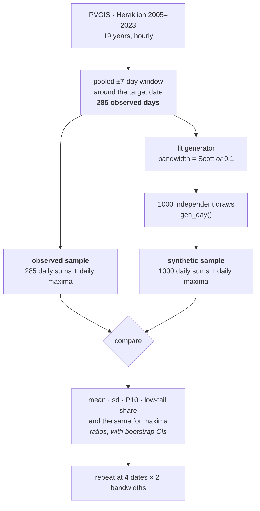

**Design of the diagnostic** · executed 2026-07-28 · results in
[`FINDINGS-2026-07-28.md`](FINDINGS-2026-07-28.md) · serves `FIX-1`, with a `CHORE-1`
by-product

This document is the **why and how**: what is being measured, why it is measured that way,
and what would have counted as which answer. The numbers live in the findings file.

# Does the generator reproduce the distribution it was fitted to?

One question, asked of the code as it ships: draw a large ensemble of synthetic days, and
check whether their daily totals are distributed like the observed days the model was
trained on.



| term | what it means here |
| :--- | :--- |
| **configuration** | one *(date, window half-width, bandwidth)* — 9 in total |
| **observed sample** | the 285 days in that date's ±7-day pool, across all 19 years |
| **synthetic sample** | 1000 independent `gen_day` draws from the generator fitted to that pool |

---

## Why this design

### Why the training pool is the reference

**The model was fitted to exactly the sample it is compared against.** That makes the
comparison target a *known quantity* rather than an estimate of one: no seasonal correction,
no sampling error on the observed side, and nothing to defend about which reference was
chosen.

That last point is the reason. An earlier pass computed three references for the same
question — the pooled window, the exact calendar date, and a detrended estimate of the date —
and found that **the choice alone moved the answer by up to 16.7 %**, more than the effect
being chased. The reference estimated from one value per year had a standard error near 25 %
at small samples, and its noise read as a clean, convincing trend. This design deletes that
degree of freedom rather than managing it.

It also settles a statistical question that would otherwise need an argument: **only the
synthetic side is resampled** for intervals. Holding the observed side fixed would be wrong
if the pool were a sample from a wider population being estimated. It is not — it is the
object the model was fitted to.

### Why four dates, and why consistency instead of a correction

Nine configurations × ten statistics is a lot of intervals, and a Holm correction across
them would be both punishing and beside the point. Instead: **a finding counts when every
informative date excludes, and they agree in sign.** Four dates spread through the solar
year are four near-independent tests of the same claim; agreement across them is stronger
evidence than any single corrected p-value, and it cannot be bought by running more cells.

"Informative" is load-bearing. A tail statistic measured against an *empty* observed tail
can detect an excess but not a deficit, so those cells are excluded from the count rather
than recorded as failures to confirm.

### Why these statistics, and why the omnibus tests are demoted

This is the one choice that had to be argued rather than assumed. An earlier pass **already
ran** a distributional-similarity test on daily totals: Kolmogorov–Smirnov p = 0.55,
Anderson–Darling p = 0.18, neither rejecting. The same data showed the model producing **4×
too few overcast days**. The tail is too small a share of the mass for an omnibus statistic
to see, so scoring this comparison with KS/AD would be *less* sensitive than looking
directly. KS is reported as one line for the record; the conclusion rests on the rest.

| statistic | on | why it is here |
| :--- | :--- | :--- |
| **mean ratio** | daily sum | The `FIX-1` claim, stated directly. |
| **sd ratio** | daily sum | Dispersion is a separate defect from level and points elsewhere. |
| **P10 ratio** | daily sum | The lower tail, as a quantile. |
| **low-tail share** | daily sum | The lower tail, as a count: below `0.25 ×` the observed median, and below 1 kWh/m² for continuity with earlier measurements. |
| P50, P90 ratios | daily sum | Free context. |
| mean, sd, P90 ratios | daily **max** | The upper end, where the daily sum is insensitive. |
| KS p-value | daily sum | Reported, not relied on — see above. |

### Why ±7 days and not the shipped ±15

Halving the window halves the pool (589 → 285 days) and cuts the smear from within-window
seasonal drift. That matters *because the pool is the reference*: any seasonal spread inside
it is spread the model is being asked to reproduce. The share of pool variance attributable
to position in the window is measured at both widths, which is what `CHORE-1` asks for.

### Why bandwidth is a factor and not a rebase

Scott's rule is the data-driven choice and the only setting at which fitted generators are
picklable (`PERF-3`), so it was the intended new default. But it is not a small change:

| | pooled days | Scott's factor |
| :--- | --: | --: |
| ±15, 19 yr | 589 | 0.345 |
| **±7, 19 yr** | **285** | **0.390** |

Both are multipliers on the data covariance, directly comparable to the hand-set `0.1` — so
Scott at the new window is a **3.9× wider kernel**, and the smaller pool is what widens it
further. Two changes at once, in a direction an older bandwidth sweep suggested was
unfavourable. Running bandwidth as a factor costs one loop and keeps *which change moved a
number* answerable.

### Why the controls are not optional

**A negative result is worth only as much as the demonstration that a positive would have
been detected.** Three, all reported before any result:

| control | what it catches |
| :--- | :--- |
| **Null** — observed pool resampled in place of the synthetic sample | a harness that reports differences that are not there. Every interval must cover the observed value. |
| **Positive** — synthetic sample inflated 10 % | a harness too blunt to see the effect it is hunting. The lift must come back at 1.10 and exclude 1. |
| **Anchor** — the ±15 / 0.1 cell of the earlier pass | a rewrite that quietly changed what is computed. It must return the earlier numbers within Monte-Carlo error. |

The anchor exists because every other setting changed at once: without it, no cell in this
run would be comparable to anything measured before.

### What is deliberately not asked

Whether the generator reproduces *the climate of a specific calendar date* — a different
question, whose reference has to be estimated. Whether chained multi-day series drift.
Whether behaviour differs at other sites or for `poa_direct`. And anything about pre-0.2.0
code: that is a question about the repo's history, not about the package. Each is a separate
run if this one motivates it.

---

## How it runs

| | |
| :--- | :--- |
| Record | Heraklion (35.34, 25.14), PVGIS 5.3 / SARAH3, **2005–2023 = 19 years** |
| Attribute | `poa_global` |
| Window | `n_days = 7` — 285 pooled days |
| Bandwidth | factor: `None` (Scott) and `0.1` |
| Dates | 21 Mar · 21 Jun · 21 Sep · 21 Dec |
| Realisations | n = 1000 per configuration |
| Anchor | one extra cell at ±15 / 0.1, 21 Mar |
| Intervals | 10 000 bootstrap resamples, **synthetic side only**, percentile method |
| Cost | 9 configurations, ~17 min, plus a ~2 min fetch |

```bash
uv run python examples/diagnostics-overshoot/run_all.py     # all four steps
```

Four steps, separately runnable, so the simulation is paid once and the analysis re-derives
in seconds:

```
step1_fetch.py      probe PVGIS for the widest range it serves, fetch, cache
step2_simulate.py   every configuration -> results/raw/*.csv, then self-check them
step3_analyse.py    reads results/raw/ only -> results/summary_*.csv
step4_figures.py    ECDF with a tail zoom, ratio-with-interval charts
```

**`step3` reads only the files on disk**, never in-memory state from `step2`. That is
deliberate: any check made by hand against the CSVs is a check against exactly what the
analysis saw. Column-by-column detail is in [`README.md`](README.md).

### What the harness asserts about itself

Run at the end of `step2`, printed as a pass/fail block, because a corrupted run should be
caught before anything is concluded from it: hourly values reconcile against both the daily
sums and the daily maxima; observed row counts match years × (2n+1); day offsets are signed
and symmetric about the centre; every year of the record is present; nothing falls outside
the attribute's registered physical support; no synthetic day exceeds 1.5× the observed
maximum; and no `config_id` appears twice.

Two of those guard defects that actually occurred and produced plausible, wrong answers: an
**unsigned day offset** silently folded the season's rising and falling sides onto one curve,
and **two concurrent runs** appended into one another's output. A PID lockfile now refuses
the second case outright.

### Reproducibility

One `MASTER_SEED` in `config.py`; per-configuration streams derive from it via
`np.random.SeedSequence`, keyed on the cell's identity so adding or removing a cell does not
reshuffle the others. Library versions are the one caveat — a change in `numpy`'s generator
or `scipy`'s `gaussian_kde` shifts the draws. The reported run used **pvlib 0.15.2** on
Python ≥ 3.10; `uv.lock` pins the rest.

`FINDINGS-*.md` and `results/summary_*.csv` are committed — they are the evidence `FIX-1`
cites. `results/raw/` and `figures/` are git-ignored and regenerate from the commands above.

---

## The decision rule, as pre-registered

Written before the run, so the reading was not chosen after the numbers arrived. Judged on
consistency across the four dates at the primary setting (±7, Scott).

| outcome | what it means |
| :--- | :--- |
| All ratios cover 1, low-tail share matches | The generator reproduces its training distribution. `FIX-1`'s mean-overshoot framing is retired and the item closes against this run. |
| Ratios for mean and sd cover 1, but **P10 and low-tail share do not** | **Restate `FIX-1` as a lower-tail defect** — measurable, mechanistic, and exactly what reflection / log-transform / beta kernels act on. |
| **Mean ratio excludes 1** at all four dates | A real mean bias in shipped code. The boundary-correction work is justified and this run is its baseline. |
| **Scott and 0.1 disagree** materially | The default is the lever, not the kernel family. Feeds a bandwidth decision and makes `PERF-3` relevant. |
| sd ratio excludes 1 while the rest match | Under-dispersion in daily aggregates — a first-order chain losing day-scale persistence. A different defect, and it would get its own ID. |

**Which fired:** the second and the fourth. See
[`FINDINGS-2026-07-28.md`](FINDINGS-2026-07-28.md).

### Departures from this plan, as executed

1. **21 September replaced 21 May**, for an even spread through the solar year. 21 May is
   the date an older `FIX-1` figure was measured on, but under this reference that
   reconciliation was never going to be clean. It remains in `DAYS_BACKLOG`.
2. **A bootstrap of zero events returns `[0, 0]`** and "excludes" any observed share
   however small the sample. The upper bound falls back to the rule of three (`3/n`).
3. **Empty observed tails were being counted as failures to confirm**, understating a 2/2
   result as 2/4. Informative cells are now identified explicitly, and the consistency rule
   additionally requires agreement in sign.

---

## Appendix — why `FIX-1`'s original numbers are not the baseline

`FIX-1` recorded a +14 % overshoot without saying which code produced it. Dated against the
git history:

| measured | recorded | estimator |
| :--- | :--- | :--- |
| **670 kWh/m², +13 %** (the original) | `69d0030`, 2026-07-15 09:09 | **month subset**, `gen_day_sequence(start_value=0.0)`, ±10 % domain padding |
| bandwidth sweep, **+9 % … +15 %** | same commit | same — the entry says "the May *subset*" |
| **678 kWh/m², +14 %** (the headline) | `e2337e4`, 2026-07-22 | post-padding-removal re-measure; generator path not recorded |
| Heraklion **+3.2 %**, **+2.0 %** | `71548c6`, 2026-07-27 | rolling ±15 d, shipped defaults |

The rolling window landed at **08:21 on 2026-07-15**; the `FIX-1` entry was written **48
minutes later**, citing measurements from the previous sprint against a month subset. The
fitted π(x₀) and the removal of the ±10 % domain padding landed a week after that. Pre-0.2.0
there was no `generate_series` at all — a chained year came from
`gen_day_sequence(start_value=0.0)`, every day starting from a hard zero rather than a fitted
initial distribution.

**So the numbers that motivated the boundary-correction work were not produced by the code
that ships today**, and each was a single measurement with nothing establishing its spread.
Reproducing them would answer a question about the repo's history rather than about the
package — which is why this diagnostic measures the current code against its own training
data and nothing else.
