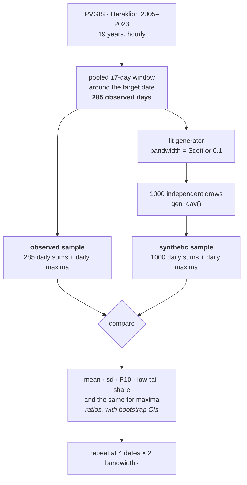

Status: **runs 1 and 2 complete and executed as designed** — results in
[`FINDINGS.md`](FINDINGS.md) · Date: 2026-07-28 · Serves: `FIX-1`, with a `CHORE-1`
by-product

> **Run 2 executed 2026-07-28**, 9 configurations in 16.6 min, all 14 self-checks passing.
> Three departures from this plan, all recorded in `FINDINGS.md`: **21 September replaced
> 21 May** for an even spread through the solar year; **a bootstrap of zero events** needed
> a rule-of-three upper bound, since resampling no events returns the degenerate interval
> `[0, 0]`; and **an empty observed tail was being counted as a failure to confirm** the
> deficit, which understated a 2/2 result as 2/4. The consistency rule additionally
> requires the dates to agree in sign.

# Diagnostics: does the generator reproduce the distribution it was fitted to?

## Overview

One question, asked of **the code as it ships today**: draw a large ensemble of synthetic
days, and check whether their daily totals are distributed like the observed days the model
was trained on.



**The pooled window is both the training data and the reference.** That is the design's one
important property: the model was fitted to exactly this sample, so the comparison target is
a *known quantity* rather than an estimate of one, and no seasonal or sampling correction is
needed on the observed side. Run 1's largest methodological finding was that the choice of
reference moved the answer by up to 16.7 % — more than the effect being chased. This design
removes that degree of freedom instead of managing it.

**What is deliberately not asked.** Whether the generator reproduces *the climate of a
specific calendar date* (a different question, with a reference that has to be estimated);
whether chained multi-day series drift; whether behaviour differs at other sites; and
anything about the pre-0.2.0 code. Each is a separate run if this one motivates it.

## The three named parts

| name | what it is |
| :--- | :--- |
| **configuration** | one (date, bandwidth) pair — 9 in total |
| **observed sample** | the 285 days in that date's ±7-day pool, all 19 years |
| **synthetic sample** | 1000 independent `gen_day` draws from the generator fitted to that pool |

---

## Configuration

| | |
| :--- | :--- |
| Record | Heraklion (35.34, 25.14), PVGIS 5.3 / SARAH3, **2005–2023 = 19 years**, 166 536 hourly rows |
| Attribute | `poa_global` |
| Window | **`n_days = 7`** (15-day window, 285 pooled days) — **changed from the shipped default of 15** |
| Bandwidth | **factor with two levels: `None` (Scott's rule) and `0.1`** — Scott is the intended new default |
| Dates | **21 Mar · 21 Jun · 21 Sep · 21 Dec** — all four run |
| Realisations | **n = 1000** per configuration |
| Training sets | **one** — the full 19-year record. No year-subsetting. |
| Anchor cell | one extra configuration at **±15 / 0.1**, 21 Mar — see [Controls](#controls) |
| Cost | 9 configurations ≈ **10 min**, plus a ~2 min fetch |

### Why these two settings changed

**Window ±15 → ±7.** Halves the pool (589 → 285 days) and cuts the within-window seasonal
smear. Run 1 measured that smear at **10.4 % of pool variance** at ±15; a locally linear
trend's contribution scales with the square of the half-width, so ±7 should put it near 2 %.
That matters here specifically: the observed pool is the reference, so any seasonal spread
inside it is spread the model is being asked to reproduce.

**Bandwidth 0.1 → Scott's rule.** Data-driven rather than hand-set, and it is the level at
which fitted generators are picklable at all (`PERF-3`). But the two changes compound, and
the direction is not obviously benign:

| | pooled days | Scott's factor |
| :--- | --: | --: |
| ±15, 19 yr | 589 | 0.345 |
| **±7, 19 yr** | **285** | **0.390** |

Both are multipliers on the data covariance, so this is directly comparable to the current
`0.1`: Scott at the new window is a **3.9× wider kernel**, and the smaller pool is what
widens it further. `FIX-1`'s bandwidth sweep rises monotonically across that range
(0.1 → +11 %, 0.2 → +14 %, 0.3 → +15 %). That sweep was measured under the retired month-based
estimator and is not evidence about today's code — but the mechanism it implies, boundary
leakage scaling with kernel width, does not depend on the estimator. **This is why bandwidth
is a factor and not a rebase**: if the numbers move, which change moved them is answerable.

---

## The test

For each configuration, both samples are reduced to two per-day scalars — the **daily sum**
(kWh/m²/day) and the **daily maximum** (W/m²) — and compared statistic by statistic.

| # | statistic | on | why it is here |
| --: | :--- | :--- | :--- |
| 1 | **mean ratio** | daily sum | The `FIX-1` claim, stated directly. |
| 2 | **sd ratio** | daily sum | Dispersion is a separate defect from level and points elsewhere. |
| 3 | **P10 ratio** | daily sum | **The signal.** Run 1's low tail, as a quantile. |
| 4 | **low-tail share** | daily sum | **The signal.** Share below `0.25 × observed median`, plus the absolute `< 1 kWh/m²` for continuity with run 1. |
| 5 | P50, P90 ratios | daily sum | Free context; both matched to ~1 % in run 1. |
| 6 | mean, sd, P90 ratios | daily **max** | The upper end, where the daily sum is insensitive. |
| 7 | KS p-value | daily sum | **Reported, not relied on** — see below. |

Each ratio carries a **95 % bootstrap CI from resampling the 1000 synthetic days only**
(10 000 iterations, percentile interval). The observed pool is held fixed, which is correct
here and only here: it is not a sample from a wider population being estimated, it is the
exact object the model was fitted to.

### Why the omnibus tests are demoted

This is the one place where the simplification had to be argued rather than accepted. Run 1
**already ran** a distributional-similarity test on daily sums: KS **p = 0.55**,
Anderson–Darling **p = 0.18**, neither rejecting. The same run found the model producing
**4× too few overcast days** (0.60 % vs 2.38 % below 1 kWh/m²). The tail is too small a share
of the mass for an omnibus statistic to see, so scoring this comparison with KS/AD would be
*less* sensitive than what already exists. KS stays as one reported line for the record;
statistics 1–6 are what the conclusion rests on.

### Multiplicity, handled by consistency rather than correction

Nine configurations × seven statistics is a lot of intervals, and Holm across them would be
both punishing and beside the point. Instead: **a finding counts when it appears in the same
direction at all four dates.** Four dates spanning the solar year are four near-independent
tests of the same claim, and agreement across them is stronger evidence than any single
corrected p-value. Single-configuration results are reported as descriptive.

### Dropped from run 1's battery, and why

Welch's t, the permutation test, Anderson–Darling, Holm–Bonferroni, the three-reference
comparison, the two-sample bootstrap, the k-sweep over training-set sizes with five random
draws each, and the per-hour bias profile. The first six are redundant against statistics
1–6; the k-sweep was answered by run 1 (flat, no size dependence) and the question it served
is not "how does the current code behave"; the per-hour profile showed no compounding and
costs a file to keep. **Roughly a fifth of run 1's analysis surface, and it can see one thing
run 1's could not.**

---

## Controls

Three, all cheap, all run before anything is concluded.

**Anchor cell — ±15 / 0.1 at 21 March.** Reproduces run 1's full-record configuration
exactly. Because everything else about run 2 changes, no other cell is comparable to run 1;
this one is, and it doubles as a regression check that the rewritten `step3` returns run 1's
numbers on run 1's settings (**mean +1.06 %, sd ratio 0.915 against the pool, 0.60 % below
1 kWh/m²**). If it does not, the rewrite changed something and nothing else should be read.

**Null control.** Replace the synthetic sample with a bootstrap resample of the observed
pool and run the analysis unchanged. Every ratio must cover 1. If one does not, the harness
carries a bias of its own.

**Positive control.** Multiply the synthetic daily sums by 1.10 and confirm the mean ratio
comes back at 1.10 with an interval excluding 1. Demonstrates the instrument can see the
effect it is looking for.

---

## Decision rule

Pre-registered, so the reading is not chosen after the numbers arrive. Judged on consistency
across the four dates, at the primary setting (±7, Scott):

| outcome | what it means |
| :--- | :--- |
| All ratios cover 1, low-tail share matches | **The generator reproduces its training distribution.** `FIX-1`'s mean-overshoot framing is retired; the item closes against this run as the calibration evidence. |
| Ratios 1–2 cover 1, but **P10 and low-tail share do not** | The expected result on run 1's evidence. **Restate `FIX-1` as a lower-tail defect** — measurable, mechanistic, and exactly what reflection / log-transform / beta kernels act on. |
| **Mean ratio excludes 1** at all four dates | A real mean bias in shipped code, with a sign and a size. The boundary-correction work is justified and this run is its baseline. |
| **Scott and 0.1 disagree** materially | The default is the lever, not the kernel family. Feeds a bandwidth decision, and makes `PERF-3` (only Scott pickles) relevant. |
| sd ratio excludes 1 while the rest match | Under-dispersion in daily aggregates — a first-order chain losing day-scale persistence. A different defect from `FIX-1`, and it would get its own ID. |

**`CHORE-1` is not closed by this run.** Fixing ±7 without a ±15 comparison leaves the
"is 15 right" question open; what this run contributes is the within-window seasonal share at
±7, measured from the observed pool alone, alongside run 1's 10.4 % at ±15. Two points on
that curve is not an evaluation, and the item should say so.

---

## Raw data written to disk

Unchanged in spirit from run 1: every number the analysis rests on is written out, and
`step3` reads only these files, never in-memory state from `step2`.

| file | one row per | key columns |
| :--- | :--- | :--- |
| `config_index.csv` | configuration | `config_id`, `month`, `day`, `n_days`, `bandwidth`, `seed`, `n`, `m` |
| `observed_daily.csv` | configuration × observed day | `config_id`, `date`, `year`, `slot`, `days_from_centre`, `sum_kwh_m2`, `max_w_m2` |
| `synthetic_daily.csv` | configuration × realisation | `config_id`, `realisation`, `sum_kwh_m2`, `max_w_m2` |
| `observed_hourly.csv` | configuration × observed day × hour | `config_id`, `date`, `hour`, `poa_global_w_m2` |
| `synthetic_hourly.csv` | configuration × realisation × hour | `config_id`, `realisation`, `hour`, `poa_global_w_m2` |

Daily sums are `sum(hourly) / 1000`, the only arithmetic between the hourly and daily files,
so it is directly checkable. The `references.csv` of run 1 is **gone** — there is one
reference now and it is the observed sample itself.

### Self-checks the harness asserts

- `sum(hourly) / 1000 == daily sum` to floating tolerance, both samples.
- Observed row count `== 15 × 19` per configuration (less any missing day, reported).
- `days_from_centre` is **signed** and symmetric about zero — the guard on run 1's first
  harness defect, kept.
- No negative irradiance; no daily sum above a clear-sky ceiling for the latitude and date.
- Synthetic row count `== n`; no duplicate `config_id`; PID lockfile against concurrent runs
  — the guard on run 1's second harness defect, kept.

---

## What run 1 established, and what carries forward

Full detail in [`FINDINGS.md`](FINDINGS.md). The measured facts that shape this design:

- **No mean overshoot at ±15 / 0.1**: +1.06 % at 21 March on the 19-year record, against an
  MDE of 4.8 %. Two-year configurations came out at −0.02 %, failing to reproduce `FIX-1`'s
  +14 % in the configuration built to match it.
- **The real defect is a missing low tail** — 0.60 % of synthetic days below 1 kWh/m²
  against 2.38 % observed, while P50 and P90 match to ~1 %. **This run exists to confirm or
  refute that at four dates and two bandwidths.**
- **Day-to-day CV varies enormously by date** — 21 Mar 35.2 %, 21 May 22.0 %, 21 Jun 10.1 %,
  21 Dec 39.3 %. At n = 1000 that is an MDE of 4.8 % at March against ~1.4 % at June: **June
  is the sharpest cell in the design, December the noisiest and the most overcast-heavy.**
- **No compounding along the walk** — flat per-hour bias, so `FIX-1`'s hour-6 → hour-12 ramp
  does not reproduce.
- **Reference choice moved the answer by up to 16.7 %**, which is why this run has one
  reference by construction.
- **Two harness defects** — unsigned day offsets, and concurrent runs interleaving rows into
  one another's output. Both now fail loudly, and both guards are kept.

`21 Sep` replaces `21 May` in the date list: four dates spread evenly through the solar year
test the consistency requirement better than three clustered in spring and summer. `21 May`
remains available in `DAYS_BACKLOG` for anyone reconciling against `FIX-1`'s +3.2 % row.

---

## Harness changes

The four `step*.py` scripts stay; this is a simplification of them, not a rewrite.

| file | change |
| :--- | :--- |
| `config.py` | `WINDOW_N_DAYS = 7`; new `BANDWIDTHS = (None, 0.1)`; all four dates in `DAYS`; **delete** `training_sizes`, `N_DRAWS`, `REFERENCES`, `PRIMARY_REFERENCE`; `config_id` gains window and bandwidth |
| `step2_simulate.py` | drop year-subsetting and the reference triple; loop over bandwidth; record `max_w_m2` alongside the daily sum; keep the lockfile, the signed-offset helper and the self-checks |
| `step3_analyse.py` | replace the test battery with the seven statistics and a synthetic-side bootstrap |
| `step4_figures.py` | ECDF overlay on a log x-axis (where the tail is visible), and a ratio-with-CI chart per statistic; drop the spread-vs-years figure |

**Run 1's outputs are not in this checkout** — `results/` is absent and `examples/data/` holds
only the 11-year file. The anchor cell regenerates what is needed to check the rewrite against
run 1's published numbers.

---

## Structure and cost

```
examples/diagnostics-overshoot/
├── PLAN.md              this file
├── README.md            what it is and how to run it
├── FINDINGS.md          run 1's result; run 2 appends its own section
├── config.py            dates, bandwidths, n, seeds, paths
├── step1_fetch.py       probe PVGIS, fetch, cache
├── step2_simulate.py    all configurations -> results/raw/*.csv, then self-checks
├── step3_analyse.py     reads results/raw/ only -> results/summary_*.csv
├── step4_figures.py     ECDF, ratio charts
├── results/
│   ├── raw/             the five tidy files above, plus a README
│   └── summary_*.csv    the aggregate tables
└── figures/
```

**Cost.** 9 configurations × 1000 realisations × ~53.5 ms ≈ **8 min of sampling**, plus
fitting and a ~2 min fetch. Step 2 times one configuration and prints a measured ETA before
committing, and writes incrementally so an interrupted run resumes.

**Reproducibility.** One `MASTER_SEED`, per-configuration streams via
`np.random.SeedSequence`. Library versions are the one caveat — a change in `numpy`'s
generator or `scipy`'s `gaussian_kde` shifts the draws. Run 1 used **pvlib 0.15.2** on
Python ≥ 3.10; `uv.lock` pins the rest.

**Committed vs ignored.** `FINDINGS.md` and `results/summary_*.csv` are committed;
`results/raw/` and `figures/` are git-ignored, matching the repo's rule for
`examples/output/`. Git-ignored means *not in version control*, not *not written*.

```bash
uv run python examples/diagnostics-overshoot/step1_fetch.py        # ~2 min, network
uv run python examples/diagnostics-overshoot/step2_simulate.py     # ~10 min
uv run python examples/diagnostics-overshoot/step3_analyse.py      # seconds
uv run python examples/diagnostics-overshoot/step4_figures.py      # seconds
```

---

## What lands in `TODOs.md`

Nothing mid-flight. `FIX-1` currently carries an **unverified — under verification** marker
(added 2026-07-28) so the boundary-correction work is not started on a contested number. On
completion it is restated, closed, or confirmed per the decision rule, and `CHORE-1` gains
the ±7 seasonal-share figure with an explicit note that two points do not settle it.

---

## Appendix — why `FIX-1`'s numbers are not the baseline

Dated against the git history, because the item reports numbers without saying which code
produced them:

| measured | recorded | estimator |
| :--- | :--- | :--- |
| **670 kWh/m², +13 %** (the original) | `69d0030`, 2026-07-15 09:09 | **month subset**, `gen_day_sequence(start_value=0.0)`, ±10 % domain padding |
| bandwidth sweep, **+9 % … +15 %** | same commit | same — the entry says "the May *subset*" |
| **678 kWh/m², +14 %** (the headline) | `e2337e4`, 2026-07-22 | post-padding-removal re-measure; generator path not recorded |
| Heraklion **+3.2 %**, **+2.0 %** | `71548c6`, 2026-07-27 | rolling ±15 d, shipped defaults |
| 21 Mar **+1.06 %** | run 1, 2026-07-28 | same |

The rolling window landed at 08:21 on 2026-07-15; the `FIX-1` entry was written 48 minutes
later, citing measurements from the previous sprint against a month subset. The fitted π(x₀)
and the padding removal landed a week after that. Pre-0.2.0 there was no `generate_series`
at all — a chained year came from `gen_day_sequence(start_value=0.0)`, every day starting
from a hard zero rather than a fitted initial distribution.

**So the numbers that motivated the boundary-correction work were not produced by the code
that ships today**, and reproducing them would be a question about the repo's history rather
than about the package. That is why this run measures the current code against its own
training data and nothing else.
